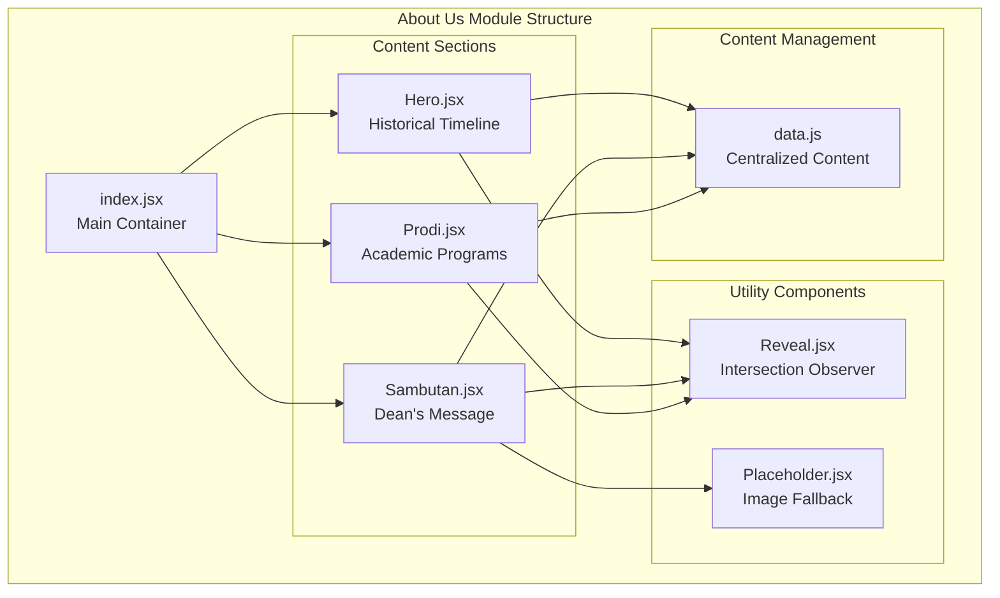
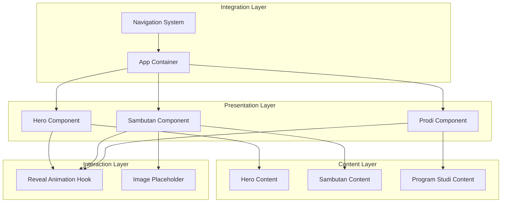
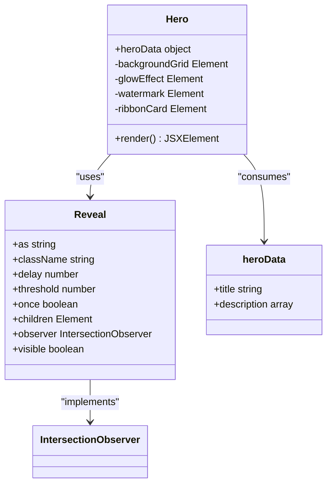
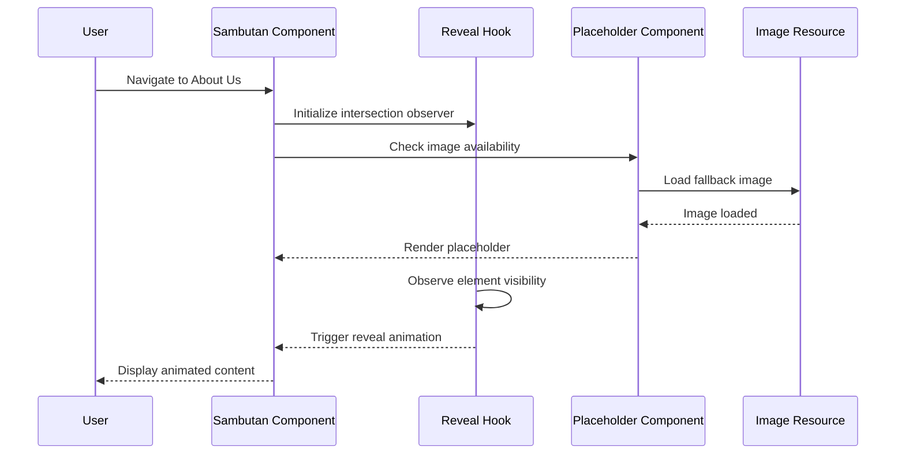
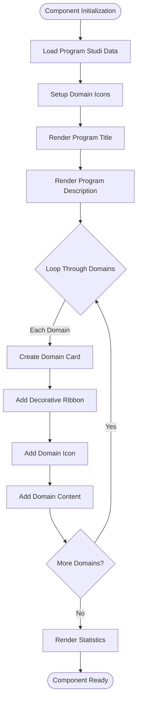
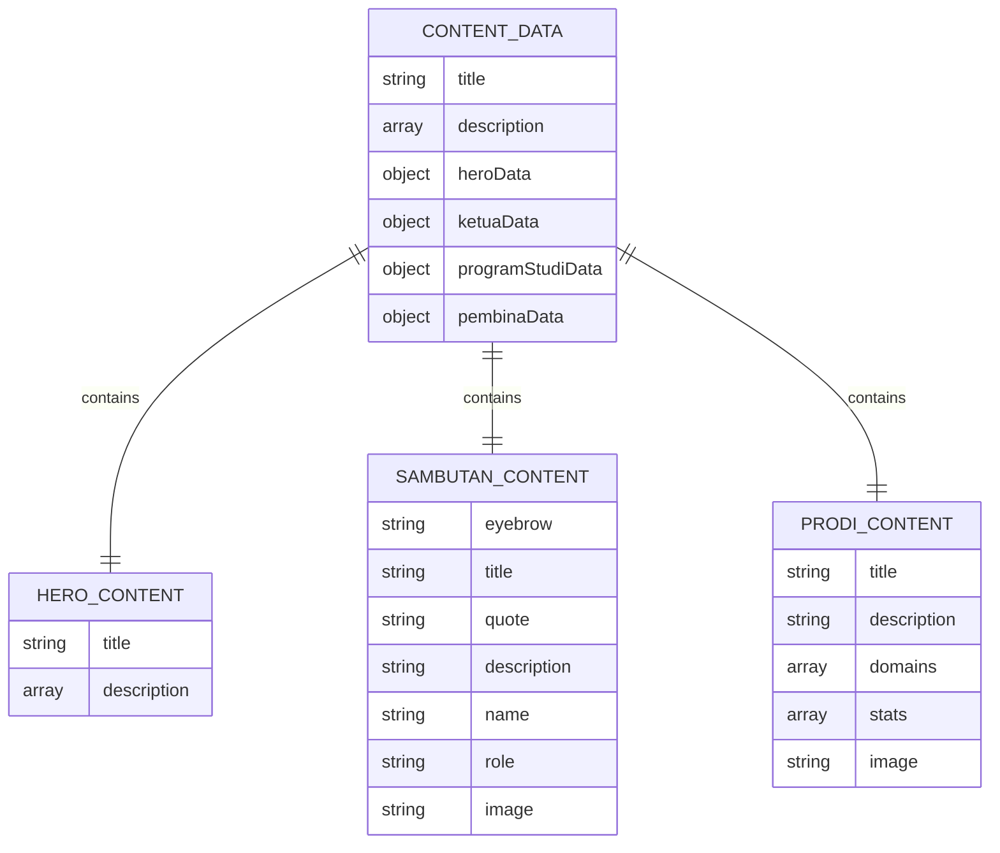
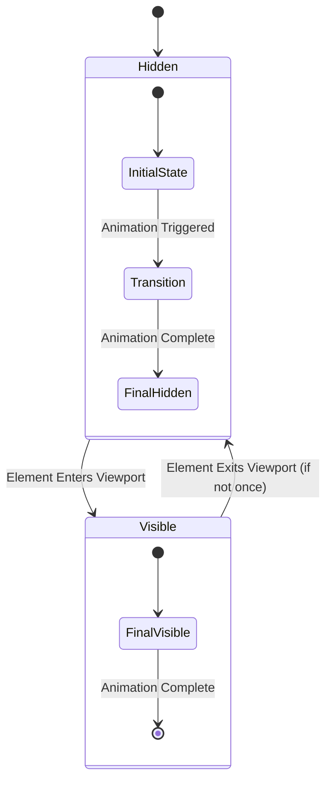
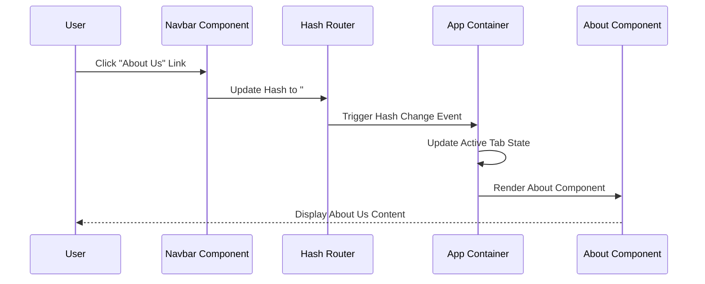

# About Us Section Documentation

<cite>
**Referenced Files in This Document**
- [index.jsx](file://src/components/tentang/index.jsx)
- [Hero.jsx](file://src/components/tentang/Hero.jsx)
- [Sambutan.jsx](file://src/components/tentang/Sambutan.jsx)
- [Prodi.jsx](file://src/components/tentang/Prodi.jsx)
- [data.js](file://src/components/tentang/data/data.js)
- [Reveal.jsx](file://src/components/tentang/Reveal.jsx)
- [Placeholder.jsx](file://src/components/tentang/Placeholder.jsx)
- [PERANCANGAN_TENTANG_KAMI.md](file://docs/PERANCANGAN_TENTANG_KAMI.md)
- [App.jsx](file://src/App.jsx)
- [Navbar.jsx](file://src/components/home/Navbar.jsx)
- [About.jsx](file://src/components/home/About.jsx)
</cite>

## Table of Contents
1. [Introduction](#introduction)
2. [Project Structure](#project-structure)
3. [Core Components](#core-components)
4. [Architecture Overview](#architecture-overview)
5. [Detailed Component Analysis](#detailed-component-analysis)
6. [Content Management System](#content-management-system)
7. [Animation and Interaction](#animation-and-interaction)
8. [Styling and Theming](#styling-and-theming)
9. [Navigation Integration](#navigation-integration)
10. [Performance Considerations](#performance-considerations)
11. [Troubleshooting Guide](#troubleshooting-guide)
12. [Conclusion](#conclusion)

## Introduction

The About Us Section represents a comprehensive React-based implementation of the "Tentang Kami" page for HIMAIF IWU (Himpunan Mahasiswa Informatika International Women University). This modular component system transforms static HTML content into a dynamic, responsive, and accessible web experience while maintaining consistency with the broader project architecture.

The implementation follows established design patterns within the `hima_web` ecosystem, featuring a structured component hierarchy, centralized content management, and sophisticated animation systems. The About Us Section serves as a showcase for organizational history, leadership messages, academic programs, and institutional values.

## Project Structure

The About Us Section is organized within a dedicated component structure that promotes modularity, maintainability, and reusability:

**Diagram sources**
- [index.jsx:1-15](file://src/components/tentang/index.jsx#L1-L15)
- [Hero.jsx:1-92](file://src/components/tentang/Hero.jsx#L1-L92)
- [Sambutan.jsx:1-77](file://src/components/tentang/Sambutan.jsx#L1-L77)
- [Prodi.jsx:1-121](file://src/components/tentang/Prodi.jsx#L1-L121)

**Section sources**
- [index.jsx:1-15](file://src/components/tentang/index.jsx#L1-L15)
- [PERANCANGAN_TENTANG_KAMI.md:39-86](file://docs/PERANCANGAN_TENTANG_KAMI.md#L39-L86)

## Core Components

The About Us Section consists of four primary components, each serving a distinct purpose in presenting organizational information:

### Main Container Component
The root component acts as a composition container that orchestrates the rendering of individual sections in a predefined order, ensuring logical content progression and optimal user experience.

### Historical Timeline Section
This component presents the organization's founding story, foundational principles, and institutional relationships through a visually engaging card-based layout with decorative ribbons and watermarks.

### Dean's Message Section
A sophisticated two-column layout showcasing institutional leadership's perspective, featuring profile imagery with decorative ribbons, inspirational quotations, and professional messaging.

### Academic Programs Section
A comprehensive presentation of the Information Technology program offerings, highlighting specialized domains, statistical achievements, and visual domain representations.

**Section sources**
- [index.jsx:6-14](file://src/components/tentang/index.jsx#L6-L14)
- [Hero.jsx:8-91](file://src/components/tentang/Hero.jsx#L8-L91)
- [Sambutan.jsx:9-76](file://src/components/tentang/Sambutan.jsx#L9-L76)
- [Prodi.jsx:11-120](file://src/components/tentang/Prodi.jsx#L11-L120)

## Architecture Overview

The About Us Section implements a layered architecture that separates concerns between presentation, content, and interaction:

**Diagram sources**
- [App.jsx:13-78](file://src/App.jsx#L13-L78)
- [Navbar.jsx:47-53](file://src/components/home/Navbar.jsx#L47-L53)
- [Reveal.jsx:12-63](file://src/components/tentang/Reveal.jsx#L12-L63)

The architecture emphasizes separation of concerns, enabling independent development and testing of each component while maintaining cohesive user experience through shared styling and interaction patterns.

## Detailed Component Analysis

### Hero Component Analysis

The Hero component serves as the primary introduction to the About Us experience, featuring a sophisticated layout that combines historical narrative with visual appeal:

**Diagram sources**
- [Hero.jsx:8-91](file://src/components/tentang/Hero.jsx#L8-L91)
- [Reveal.jsx:12-63](file://src/components/tentang/Reveal.jsx#L12-L63)
- [data.js:4-11](file://src/components/tentang/data/data.js#L4-L11)

The component implements advanced visual techniques including coordinate grid backgrounds, gradient effects, and decorative ribbons that create depth and visual interest while maintaining readability.

**Section sources**
- [Hero.jsx:4-91](file://src/components/tentang/Hero.jsx#L4-L91)
- [data.js:4-11](file://src/components/tentang/data/data.js#L4-L11)

### Sambutan Component Analysis

The Sambutan component presents institutional leadership's message through a carefully crafted two-column layout:

**Diagram sources**
- [Sambutan.jsx:9-76](file://src/components/tentang/Sambutan.jsx#L9-L76)
- [Reveal.jsx:24-49](file://src/components/tentang/Reveal.jsx#L24-L49)
- [Placeholder.jsx:11-31](file://src/components/tentang/Placeholder.jsx#L11-L31)

The component demonstrates sophisticated state management and conditional rendering, gracefully handling missing image resources while maintaining visual consistency.

**Section sources**
- [Sambutan.jsx:1-77](file://src/components/tentang/Sambutan.jsx#L1-L77)
- [data.js:13-23](file://src/components/tentang/data/data.js#L13-L23)

### Prodi Component Analysis

The Academic Programs component showcases the Information Technology program offerings through a domain-focused presentation:

**Diagram sources**
- [Prodi.jsx:11-120](file://src/components/tentang/Prodi.jsx#L11-L120)
- [data.js:25-54](file://src/components/tentang/data/data.js#L25-L54)

The component implements responsive grid layouts, dynamic content rendering, and visual consistency through shared design patterns.

**Section sources**
- [Prodi.jsx:1-121](file://src/components/tentang/Prodi.jsx#L1-L121)
- [data.js:25-54](file://src/components/tentang/data/data.js#L25-L54)

## Content Management System

The About Us Section employs a centralized content management approach that separates data from presentation:

**Diagram sources**
- [data.js:4-66](file://src/components/tentang/data/data.js#L4-L66)

This structure enables easy content updates without modifying component logic, supports internationalization preparation, and maintains consistency across different sections.

**Section sources**
- [data.js:1-66](file://src/components/tentang/data/data.js#L1-L66)
- [PERANCANGAN_TENTANG_KAMI.md:83-85](file://docs/PERANCANGAN_TENTANG_KAMI.md#L83-L85)

## Animation and Interaction

The About Us Section implements sophisticated animation systems through the Reveal component, which utilizes IntersectionObserver for scroll-triggered animations:

**Diagram sources**
- [Reveal.jsx:24-49](file://src/components/tentang/Reveal.jsx#L24-L49)

The animation system respects user preferences for reduced motion and provides customizable timing and thresholds for optimal user experience.

**Section sources**
- [Reveal.jsx:1-64](file://src/components/tentang/Reveal.jsx#L1-L64)
- [PERANCANGAN_TENTANG_KAMI.md:136-147](file://docs/PERANCANGAN_TENTANG_KAMI.md#L136-L147)

## Styling and Theming

The About Us Section implements a comprehensive theming system that supports both light and dark modes:

| Aspect | Implementation | Color Values |
|--------|----------------|--------------|
| Primary Color | `#031636` | Used for typography and accents |
| Secondary Color | `#005bc1` | Used for highlights and decorations |
| Surface Colors | Light: `#f0f2f8`, Dark: `#040d1a` | Background variations |
| Gradient Effects | Light: `#d8e2ff`, Dark: `#005bc1` | Decorative elements |

The styling system utilizes Tailwind CSS utility classes combined with custom color tokens, ensuring consistency with the broader project design language while maintaining flexibility for future modifications.

**Section sources**
- [Hero.jsx:12-91](file://src/components/tentang/Hero.jsx#L12-L91)
- [Sambutan.jsx:13-76](file://src/components/tentang/Sambutan.jsx#L13-L76)
- [Prodi.jsx:17-120](file://src/components/tentang/Prodi.jsx#L17-L120)

## Navigation Integration

The About Us Section integrates seamlessly with the application's navigation system through hash-based routing:

**Diagram sources**
- [Navbar.jsx:47-53](file://src/components/home/Navbar.jsx#L47-L53)
- [App.jsx:16-44](file://src/App.jsx#L16-L44)

The navigation system supports smooth scrolling, responsive design, and accessibility features while maintaining state consistency across different application views.

**Section sources**
- [Navbar.jsx:1-281](file://src/components/home/Navbar.jsx#L1-L281)
- [App.jsx:13-82](file://src/App.jsx#L13-L82)

## Performance Considerations

The About Us Section implements several performance optimization strategies:

### Lazy Loading and Resource Management
- Conditional image loading with placeholder fallbacks
- IntersectionObserver-based lazy loading for animations
- Efficient component rendering through React.memo patterns
- Optimized asset delivery through Vite bundling

### Accessibility Features
- Semantic HTML structure with proper heading hierarchy
- ARIA labels for interactive elements
- Keyboard navigation support
- Screen reader compatibility
- Reduced motion preference respect

### Responsive Design
- Mobile-first responsive breakpoints
- Flexible grid layouts adapting to screen sizes
- Touch-friendly interactive elements
- Optimized touch targets for mobile devices

**Section sources**
- [Reveal.jsx:28-33](file://src/components/tentang/Reveal.jsx#L28-L33)
- [Placeholder.jsx:11-31](file://src/components/tentang/Placeholder.jsx#L11-L31)

## Troubleshooting Guide

### Common Issues and Solutions

**Content Not Displaying**
- Verify data file exports are properly configured
- Check component prop drilling for data consumption
- Ensure proper import paths for asset files

**Animation Issues**
- Confirm IntersectionObserver browser compatibility
- Verify element visibility thresholds are appropriate
- Check for CSS conflicts affecting transform properties

**Responsive Layout Problems**
- Validate Tailwind CSS configuration
- Check media query breakpoints alignment
- Ensure proper viewport meta tag configuration

**Navigation Problems**
- Verify hash routing implementation
- Check active tab state management
- Ensure proper scroll position handling

**Section sources**
- [Reveal.jsx:24-49](file://src/components/tentang/Reveal.jsx#L24-L49)
- [data.js:1-66](file://src/components/tentang/data/data.js#L1-L66)

## Conclusion

The About Us Section represents a comprehensive implementation of modern React development practices within the `hima_web` ecosystem. The modular architecture, centralized content management, sophisticated animation systems, and seamless integration with the broader application demonstrate best practices in component-based development.

The implementation successfully balances visual appeal with technical excellence, providing an engaging user experience while maintaining code maintainability and scalability. The thoughtful integration of design patterns, accessibility features, and performance optimizations ensures the component system remains robust and future-ready.

This documentation serves as both a reference for current development and a foundation for future enhancements, supporting continued evolution of the About Us experience while preserving the architectural integrity established in the initial implementation.