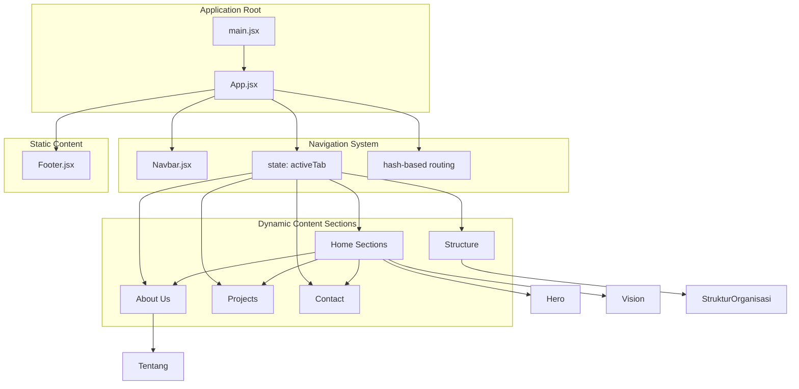
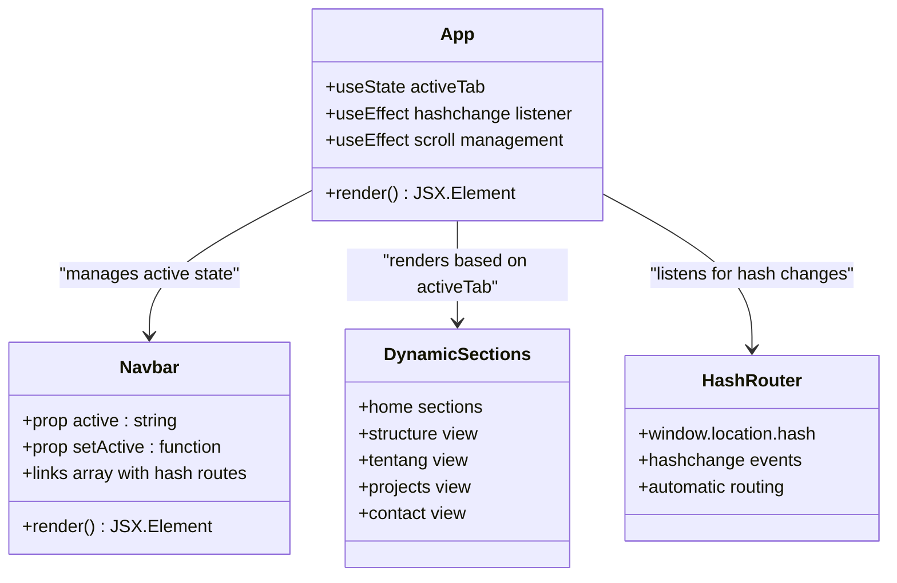
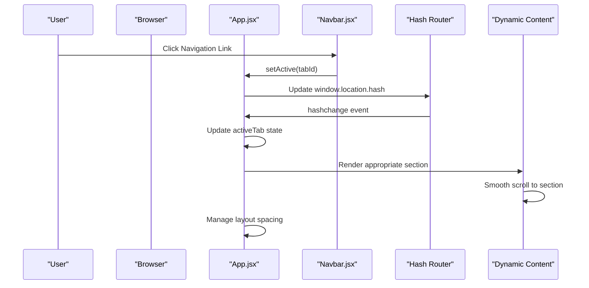
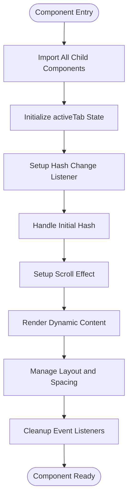
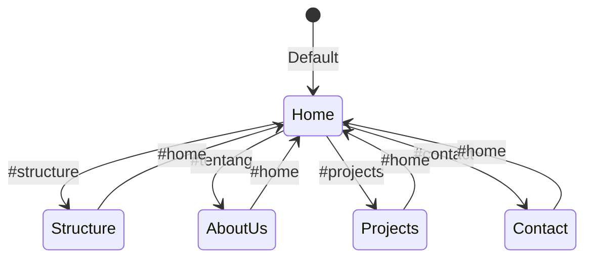
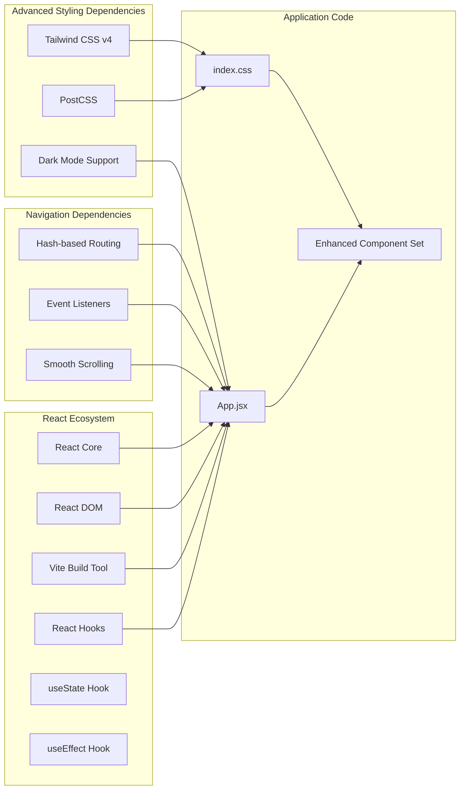

# App Root Component

<cite>
**Referenced Files in This Document**
- [App.jsx](file://src/App.jsx)
- [main.jsx](file://src/main.jsx)
- [Navbar.jsx](file://src/components/home/Navbar.jsx)
- [Hero.jsx](file://src/components/home/Hero.jsx)
- [About.jsx](file://src/components/home/About.jsx)
- [Projects.jsx](file://src/components/home/Projects.jsx)
- [Contact.jsx](file://src/components/home/Contact.jsx)
- [Footer.jsx](file://src/components/home/Footer.jsx)
- [StrukturOrganisasi.jsx](file://src/components/struktur/index.jsx)
- [Tentang.jsx](file://src/components/tentang/index.jsx)
- [index.css](file://src/index.css)
- [package.json](file://package.json)
- [vite.config.js](file://vite.config.js)
</cite>

## Update Summary
**Changes Made**
- Enhanced App.jsx with sophisticated active tab navigation system
- Implemented hash-based routing for seamless section transitions
- Added dynamic content rendering for Home, About Us, Structure, Projects, and Contact sections
- Integrated scroll management with smooth scrolling behavior
- Updated component composition patterns to support tab-based navigation

## Table of Contents
1. [Introduction](#introduction)
2. [Project Structure](#project-structure)
3. [Core Components](#core-components)
4. [Architecture Overview](#architecture-overview)
5. [Detailed Component Analysis](#detailed-component-analysis)
6. [Navigation System](#navigation-system)
7. [Dependency Analysis](#dependency-analysis)
8. [Performance Considerations](#performance-considerations)
9. [Troubleshooting Guide](#troubleshooting-guide)
10. [Conclusion](#conclusion)

## Introduction

The App.jsx component serves as the sophisticated application container and orchestrator for the HIMAIF IWU website. As the root component, it establishes a dynamic navigation system with active tab management, implements hash-based routing for seamless section transitions, and coordinates the overall visual hierarchy of the application. This component demonstrates advanced React architecture principles with modern navigation patterns while maintaining a cohesive design system built around Tailwind CSS utility classes and a custom color palette.

The component's enhanced navigation system allows users to seamlessly transition between different content sections including Home, About Us, Structure, Projects, and Contact through intuitive hash-based routing. The implementation manages state through React hooks and provides smooth scrolling experiences with automatic content rendering based on the active tab.

## Project Structure

The application follows a clean, feature-based component organization with sophisticated navigation architecture that promotes maintainability and scalability. The root component now implements a tab-based navigation system that dynamically renders different content sections based on URL hash parameters.

**Diagram sources**
- [App.jsx:13-82](file://src/App.jsx#L13-L82)
- [main.jsx:6-10](file://src/main.jsx#L6-L10)
- [Navbar.jsx:47-53](file://src/components/home/Navbar.jsx#L47-L53)

**Section sources**
- [App.jsx:13-82](file://src/App.jsx#L13-L82)
- [main.jsx:1-11](file://src/main.jsx#L1-L11)
- [package.json:1-30](file://package.json#L1-L30)

## Core Components

The App.jsx component orchestrates six primary navigation sections that collectively form the application's sophisticated visual narrative. Each section serves a specific purpose within the overall layout while maintaining design consistency through shared styling patterns and hash-based routing.

### Enhanced Component Composition Pattern

The root component implements a sophisticated hierarchical composition pattern with active tab management. The Navbar establishes the navigation framework with five distinct tabs, while the main content area dynamically renders different component sets based on the active tab state. This arrangement creates a logical flow from navigation to content presentation with seamless transitions.

**Diagram sources**
- [App.jsx:14-44](file://src/App.jsx#L14-L44)
- [Navbar.jsx:5](file://src/components/home/Navbar.jsx#L5)
- [Navbar.jsx:47-53](file://src/components/home/Navbar.jsx#L47-L53)

### Advanced Layout Management Strategy

The component employs sophisticated spacing and positioning through className attributes to create visual hierarchy and maintain responsive design principles. The fixed positioning of the Navbar combined with intelligent scroll management ensures optimal content visibility and prevents overlap issues during tab transitions.

**Section sources**
- [App.jsx:47-77](file://src/App.jsx#L47-L77)
- [Navbar.jsx:65](file://src/components/home/Navbar.jsx#L65)
- [App.jsx:49](file://src/App.jsx#L49)

## Architecture Overview

The App.jsx component demonstrates a sophisticated React architecture that emphasizes component reusability, maintainable styling, responsive design patterns, and advanced navigation capabilities. The component serves as both a layout container and a navigation coordinator, managing the relationship between navigation, dynamic content sections, and informational components.

**Diagram sources**
- [App.jsx:16-44](file://src/App.jsx#L16-L44)
- [Navbar.jsx:89-90](file://src/components/home/Navbar.jsx#L89-L90)

### Advanced Design System Integration

The component seamlessly integrates with the established design system through consistent use of Tailwind utility classes, custom CSS variables, and sophisticated color schemes. The dark mode toggle functionality demonstrates advanced state management patterns that enhance user experience across different themes.

**Section sources**
- [App.jsx:47](file://src/App.jsx#L47)
- [index.css:3-65](file://src/index.css#L3-L65)
- [vite.config.js:1-9](file://vite.config.js#L1-L9)

## Detailed Component Analysis

### Enhanced App.jsx Implementation Details

The root component implements a sophisticated navigation system with active tab management that prioritizes user experience and seamless content transitions. The component's architecture reflects modern React best practices while providing extensive functionality for content management.

#### Advanced Component Structure Analysis

The component utilizes React hooks for state management and effect handling, implementing sophisticated logic for hash-based routing and smooth scrolling. The structure supports five distinct navigation states with intelligent fallback mechanisms and automatic initialization from URL hash parameters.

**Diagram sources**
- [App.jsx:13-82](file://src/App.jsx#L13-L82)

#### Sophisticated Prop Passing Strategy

The component demonstrates advanced prop passing patterns through the Navbar component, which receives both active state and setter functions as props. This approach enables bidirectional communication between parent and child components while maintaining encapsulation and separation of concerns.

#### Intelligent Render Flow Orchestration

The render flow follows a sophisticated conditional rendering pattern that intelligently manages different content sections based on the active tab state. The system handles both individual section rendering and composite section rendering for the Home page, creating a seamless user experience.

**Section sources**
- [App.jsx:13-82](file://src/App.jsx#L13-L82)

### Advanced Styling Approach with Tailwind CSS

The component's styling strategy exemplifies modern utility-first CSS methodology through systematic className attribute usage. The approach emphasizes consistency, maintainability, and responsive design capabilities with sophisticated dark mode support.

#### Enhanced Spacing and Layout Management

The component employs strategic spacing patterns through className attributes that create visual hierarchy and maintain readability across different screen sizes. The top padding on the main container prevents content overlap with the fixed navigation bar, while the dark mode gradient backgrounds provide visual depth.

#### Advanced Responsive Design Patterns

The styling implementation incorporates responsive breakpoints and flexible grid systems that adapt to various viewport sizes. The sophisticated color scheme with gradient backgrounds and dark mode support ensures optimal user experience across all devices.

**Section sources**
- [App.jsx:47](file://src/App.jsx#L47)
- [index.css:151-161](file://src/index.css#L151-L161)

### Enhanced Component Integration Patterns

The component demonstrates sophisticated integration patterns through organized import statements and structured render order. The enhanced architecture facilitates easy maintenance and future component additions while supporting complex navigation scenarios.

#### Advanced Navigation Integration

The Navbar component integration showcases state management patterns and responsive behavior through conditional rendering and event handlers. The sophisticated link structure with hash-based routing enables seamless navigation between different content sections.

#### Dynamic Content Section Integration

The Home, About Us, Structure, Projects, and Contact components integrate through shared styling patterns and consistent spacing approaches, creating visual unity across different content areas. The dynamic rendering system efficiently manages content switching with smooth transitions.

**Section sources**
- [App.jsx:48-77](file://src/App.jsx#L48-L77)
- [Navbar.jsx:47-53](file://src/components/home/Navbar.jsx#L47-L53)

## Navigation System

The App.jsx component implements a sophisticated navigation system with active tab management and hash-based routing that provides seamless user experience across different content sections.

### Active Tab Management Architecture

The navigation system uses React's useState hook to manage the active tab state, with sophisticated effect handlers for hash change detection and automatic initialization from URL parameters. The system supports five distinct navigation states with intelligent fallback mechanisms.

**Diagram sources**
- [App.jsx:14](file://src/App.jsx#L14)
- [App.jsx:16-33](file://src/App.jsx#L16-L33)

### Hash-Based Routing Implementation

The system implements sophisticated hash-based routing through window.location.hash manipulation and hashchange event listeners. The routing mechanism automatically detects hash changes and updates the active tab state accordingly, providing seamless navigation without page reloads.

#### Automatic Initialization Process

The navigation system includes automatic initialization that reads the current URL hash on component mount and sets the appropriate active tab. This ensures that users can bookmark specific sections and return to them later with proper content rendering.

#### Smooth Scrolling Integration

The navigation system integrates sophisticated scroll management that automatically scrolls to the appropriate section when a tab is activated. The system distinguishes between individual sections and composite sections (Home) to provide optimal user experience.

**Section sources**
- [App.jsx:16-44](file://src/App.jsx#L16-L44)

### Dynamic Content Rendering Strategy

The navigation system employs sophisticated conditional rendering that dynamically switches between different content sections based on the active tab state. The system efficiently manages content switching while maintaining smooth user experience.

#### Composite Section Handling

The Home section (tab id: 'home') renders multiple subsections (Hero, Vision, About, Projects, Contact) within a single container, enabling smooth scrolling between different content areas. This approach provides a traditional multi-section experience while maintaining the benefits of tab-based navigation.

#### Single Section Handling

Individual sections like Structure, About Us, Projects, and Contact render complete component hierarchies with their own styling and layout requirements. The system manages these sections independently while maintaining consistent navigation state.

**Section sources**
- [App.jsx:50-72](file://src/App.jsx#L50-L72)

## Dependency Analysis

The App.jsx component maintains minimal external dependencies while leveraging a robust ecosystem of React and Tailwind CSS technologies. The enhanced navigation system introduces sophisticated state management dependencies while maintaining performance and maintainability.

**Diagram sources**
- [package.json:12-17](file://package.json#L12-L17)
- [vite.config.js:1-9](file://vite.config.js#L1-L9)
- [index.css:1](file://src/index.css#L1)

### Enhanced External Dependencies Impact

The component benefits from modern development tooling that enhances both development experience and production performance. The integration with Vite provides fast hot module replacement and optimized builds, while the sophisticated navigation system leverages React's advanced features for optimal performance.

**Section sources**
- [package.json:12-28](file://package.json#L12-L28)
- [vite.config.js:6-8](file://vite.config.js#L6-L8)

## Performance Considerations

The App.jsx component architecture demonstrates several advanced performance optimization strategies that contribute to efficient rendering and user experience, particularly with the enhanced navigation system.

### Advanced Rendering Efficiency

The component's sophisticated structure minimizes unnecessary re-renders through intelligent state management and effect cleanup. The use of React hooks for state management and effect handling ensures optimal performance while maintaining complex navigation functionality.

### Optimized Bundle Size Management

Through strategic dependency management and modular component architecture, the application maintains optimal bundle sizes suitable for web delivery. The enhanced navigation system adds minimal overhead while providing substantial functionality improvements.

### Advanced Memory Management

The component's lifecycle includes sophisticated cleanup mechanisms for event listeners and effect handlers, preventing memory leaks and ensuring optimal performance across different browser environments. The hash change event listener is properly cleaned up when the component unmounts.

### Efficient State Management

The navigation system uses React's useState and useEffect hooks efficiently, with proper cleanup mechanisms to prevent memory leaks. The state updates are batched and optimized to minimize re-render cycles.

## Troubleshooting Guide

Common issues and solutions for the enhanced App.jsx component and its sophisticated navigation system.

### Navigation Issues

**Problem**: Tabs not highlighting correctly
**Solution**: Verify that the active tab state matches the hash value and check Navbar prop passing.

**Problem**: Hash-based routing not working
**Solution**: Ensure hashchange event listeners are properly attached and cleaned up during component lifecycle.

**Problem**: Smooth scrolling not functioning
**Solution**: Check element ID existence and verify scrollIntoView options are properly configured.

### Content Rendering Problems

**Problem**: Dynamic content not rendering properly
**Solution**: Verify active tab state management and check conditional rendering logic for different content sections.

**Problem**: Structure and About Us sections not displaying
**Solution**: Ensure proper component imports and check the tab-specific rendering conditions.

### Styling and Layout Issues

**Problem**: Content overlapping with navigation
**Solution**: Verify the top padding value on the main container and ensure the Navbar remains fixed in position.

**Problem**: Dark mode not toggling correctly
**Solution**: Check dark mode state management and verify CSS class application on the document element.

**Problem**: Responsive breakpoints not functioning
**Solution**: Check Tailwind configuration and ensure media query classes are properly applied.

### Component Integration Issues

**Problem**: Child components not rendering properly
**Solution**: Check import statements and ensure component exports match the expected interface.

**Problem**: State management conflicts between components
**Solution**: Verify that child components receive appropriate props and don't require props from the parent.

**Section sources**
- [App.jsx:16-44](file://src/App.jsx#L16-L44)
- [index.css:3-65](file://src/index.css#L3-L65)

## Conclusion

The enhanced App.jsx component successfully fulfills its role as the sophisticated application container through thoughtful architectural decisions and clean implementation practices. The component demonstrates effective use of React patterns, Tailwind CSS utility classes, and advanced navigation systems with modern web development methodologies.

The component's strength lies in its sophisticated navigation system with active tab management and hash-based routing, providing seamless user experience while maintaining design consistency and responsive behavior. Through strategic className attribute usage, component composition patterns, and advanced state management, the App.jsx creates a cohesive user experience that effectively communicates the organization's mission and values.

The enhanced architecture provides a solid foundation for future enhancements while maintaining performance characteristics suitable for modern web applications. The integration with the broader React ecosystem, sophisticated navigation system, and Tailwind CSS ensures long-term maintainability and scalability potential.

The implementation of hash-based routing and smooth scrolling represents a significant advancement in user experience, enabling bookmark-friendly navigation and seamless content transitions. The component's architecture demonstrates best practices for modern React development while providing extensive functionality for complex navigation scenarios.