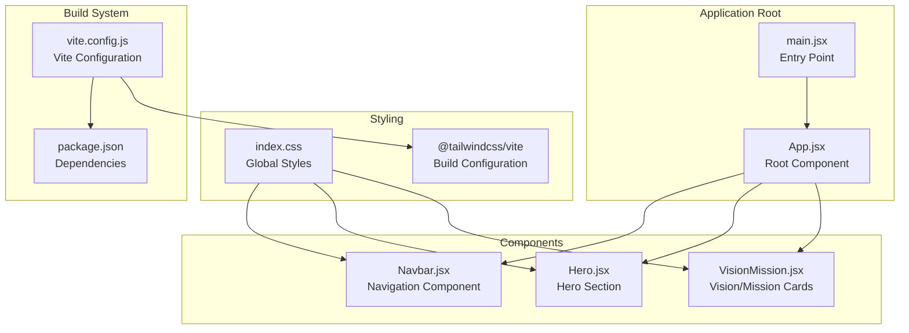
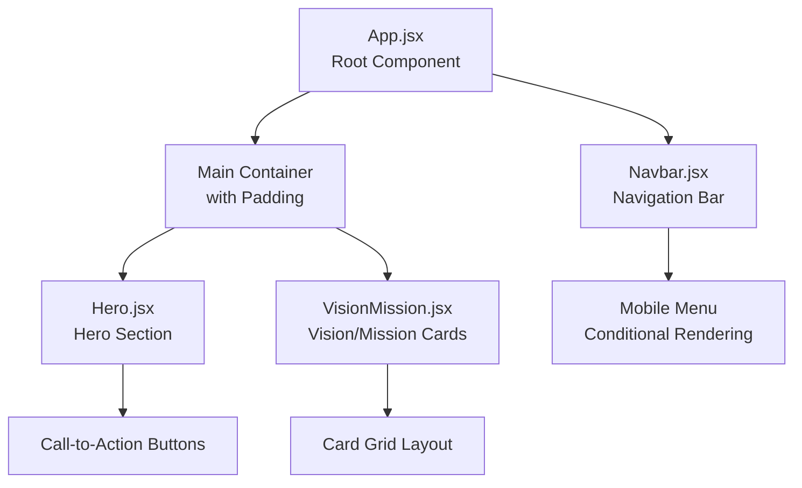
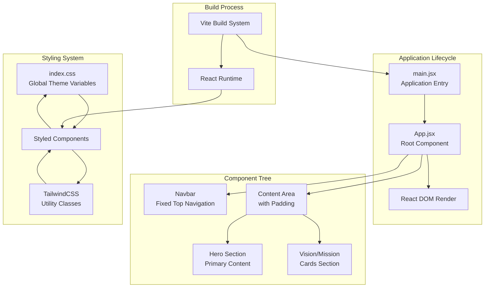
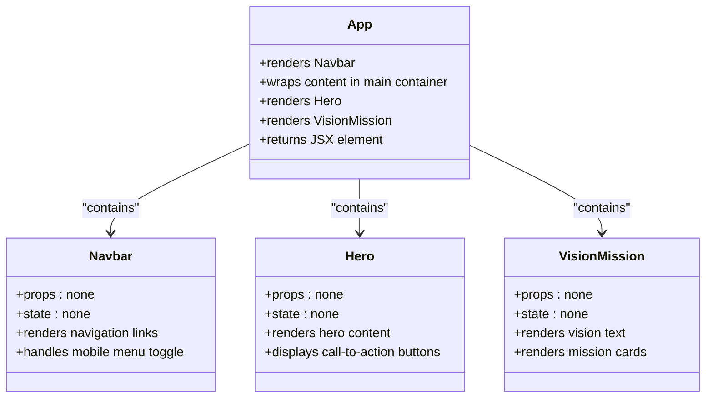
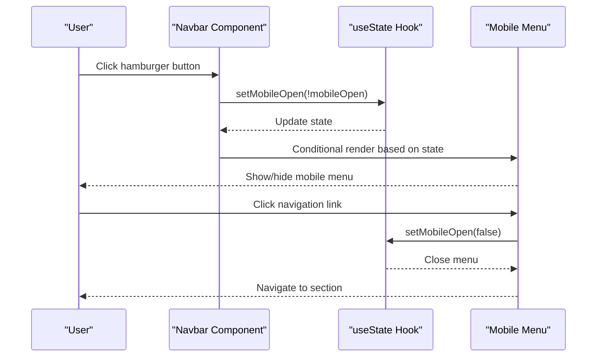
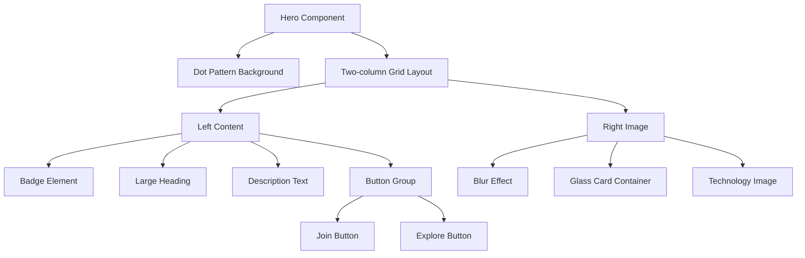
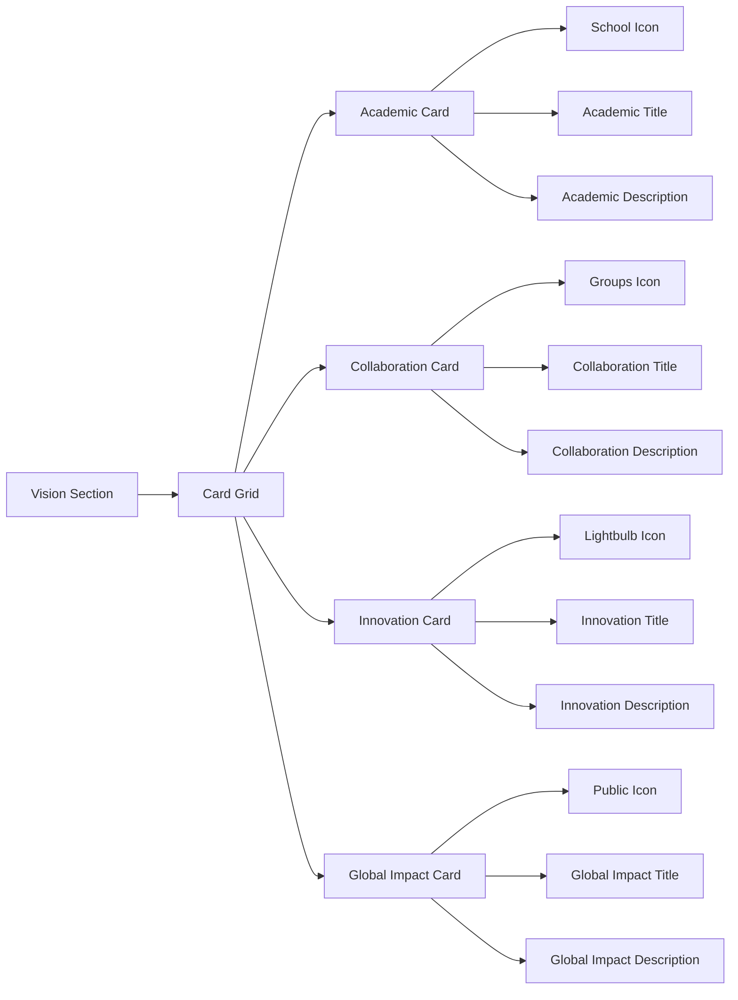
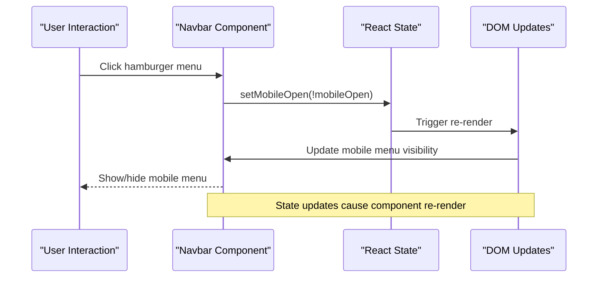
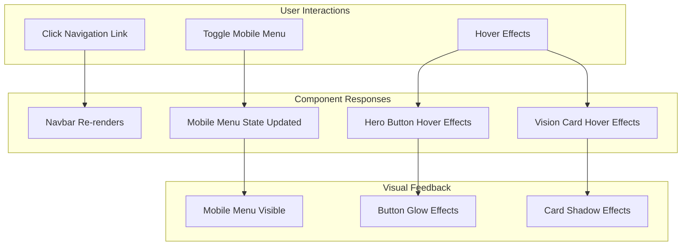

# Component Architecture

<cite>
**Referenced Files in This Document**
- [App.jsx](file://src/App.jsx)
- [Navbar.jsx](file://src/components/Navbar.jsx)
- [Hero.jsx](file://src/components/Hero.jsx)
- [VisionMission.jsx](file://src/components/VisionMission.jsx)
- [main.jsx](file://src/main.jsx)
- [index.css](file://src/index.css)
- [package.json](file://package.json)
- [vite.config.js](file://vite.config.js)
</cite>

## Table of Contents
1. [Introduction](#introduction)
2. [Project Structure](#project-structure)
3. [Core Components](#core-components)
4. [Architecture Overview](#architecture-overview)
5. [Detailed Component Analysis](#detailed-component-analysis)
6. [Component Composition Patterns](#component-composition-patterns)
7. [State Management](#state-management)
8. [Design Patterns](#design-patterns)
9. [Component Interaction Flow](#component-interaction-flow)
10. [Performance Considerations](#performance-considerations)
11. [Conclusion](#conclusion)

## Introduction

The HIMA Web project follows a component-based architecture pattern built with React and Vite. The application is structured around a clean separation of concerns where each component serves a specific UI responsibility. The design emphasizes modularity, reusability, and maintainability through well-defined component boundaries and clear data flow patterns.

The project utilizes modern React development practices including functional components, React hooks for state management, and TailwindCSS for styling. The component hierarchy is intentionally simple, focusing on three primary sections: navigation, hero content, and vision/mission presentation.

## Project Structure

The project follows a conventional React application structure with a focus on component organization:

**Diagram sources**
- [main.jsx:1-11](file://src/main.jsx#L1-L11)
- [App.jsx:1-18](file://src/App.jsx#L1-L18)

**Section sources**
- [main.jsx:1-11](file://src/main.jsx#L1-L11)
- [package.json:1-30](file://package.json#L1-L30)
- [vite.config.js:1-9](file://vite.config.js#L1-L9)

## Core Components

The application consists of four primary components that work together to create the complete user interface:

### Component Responsibilities

| Component | Responsibility | Props | State |
|-----------|---------------|-------|-------|
| **App** | Root container component | None | None |
| **Navbar** | Navigation and mobile menu | None | `mobileOpen` (boolean) |
| **Hero** | Hero section with call-to-action buttons | None | None |
| **VisionMission** | Vision statement and mission cards | None | None |

### Component Hierarchy

**Diagram sources**
- [App.jsx:5-15](file://src/App.jsx#L5-L15)
- [Navbar.jsx:11-79](file://src/components/Navbar.jsx#L11-L79)
- [Hero.jsx:1-57](file://src/components/Hero.jsx#L1-L57)
- [VisionMission.jsx:28-68](file://src/components/VisionMission.jsx#L28-L68)

**Section sources**
- [App.jsx:1-18](file://src/App.jsx#L1-L18)
- [Navbar.jsx:11-79](file://src/components/Navbar.jsx#L11-L79)
- [Hero.jsx:1-57](file://src/components/Hero.jsx#L1-L57)
- [VisionMission.jsx:28-68](file://src/components/VisionMission.jsx#L28-L68)

## Architecture Overview

The HIMA Web application implements a straightforward component-based architecture with clear separation of concerns:

**Diagram sources**
- [main.jsx:6-10](file://src/main.jsx#L6-L10)
- [App.jsx:5-15](file://src/App.jsx#L5-L15)
- [index.css:3-65](file://src/index.css#L3-L65)

The architecture emphasizes:
- **Unidirectional Data Flow**: Components receive props and manage local state independently
- **Component Composition**: Parent components orchestrate child components through JSX
- **Separation of Concerns**: Each component handles a specific UI responsibility
- **Styling Consistency**: Centralized theme variables and utility classes

## Detailed Component Analysis

### App Component

The App component serves as the root container that orchestrates the overall page layout:

**Diagram sources**
- [App.jsx:5-15](file://src/App.jsx#L5-L15)
- [Navbar.jsx:11-79](file://src/components/Navbar.jsx#L11-L79)
- [Hero.jsx:1-57](file://src/components/Hero.jsx#L1-L57)
- [VisionMission.jsx:28-68](file://src/components/VisionMission.jsx#L28-L68)

**Section sources**
- [App.jsx:1-18](file://src/App.jsx#L1-L18)

### Navbar Component

The Navbar component implements a responsive navigation system with mobile support:

**Diagram sources**
- [Navbar.jsx:12](file://src/components/Navbar.jsx#L12)
- [Navbar.jsx:51](file://src/components/Navbar.jsx#L51)
- [Navbar.jsx:69](file://src/components/Navbar.jsx#L69)

Key features:
- **Responsive Design**: Desktop navigation with mobile hamburger menu
- **State Management**: Uses React useState hook for mobile menu toggle
- **Interactive Elements**: Hover effects and smooth transitions
- **Accessibility**: Proper aria-label attributes and semantic HTML

**Section sources**
- [Navbar.jsx:1-79](file://src/components/Navbar.jsx#L1-L79)

### Hero Component

The Hero component creates a visually striking landing section:

**Diagram sources**
- [Hero.jsx:2-56](file://src/components/Hero.jsx#L2-L56)

**Section sources**
- [Hero.jsx:1-57](file://src/components/Hero.jsx#L1-L57)

### VisionMission Component

The VisionMission component presents organizational vision and mission through a card-based layout:

**Diagram sources**
- [VisionMission.jsx:28-68](file://src/components/VisionMission.jsx#L28-L68)

**Section sources**
- [VisionMission.jsx:1-68](file://src/components/VisionMission.jsx#L1-L68)

## Component Composition Patterns

The application demonstrates several key composition patterns:

### 1. Container-Child Pattern
The App component acts as a container that manages the overall layout while delegating specific UI responsibilities to child components.

### 2. Conditional Rendering Pattern
The Navbar component uses conditional rendering based on state to show/hide the mobile menu, demonstrating dynamic UI composition.

### 3. Grid Layout Pattern
Both Hero and VisionMission components utilize CSS Grid for responsive layouts that adapt to different screen sizes.

### 4. Utility Component Pattern
Each component focuses on a single responsibility, promoting reusability and maintainability.

## State Management

The application uses React's built-in state management through hooks:

### Local State Management
- **Navbar**: Manages mobile menu visibility using `useState` hook
- **App**: No local state, serves as a pure container component

### State Flow

**Diagram sources**
- [Navbar.jsx:12](file://src/components/Navbar.jsx#L12)
- [Navbar.jsx:51](file://src/components/Navbar.jsx#L51)

**Section sources**
- [Navbar.jsx:11-79](file://src/components/Navbar.jsx#L11-L79)

## Design Patterns

### 1. Component-Based Architecture
Each component is self-contained with clear responsibilities and minimal dependencies.

### 2. Responsive Design Pattern
Components adapt to different screen sizes using TailwindCSS utility classes and CSS Grid.

### 3. Theme-Based Styling Pattern
Centralized theme variables in CSS provide consistent color schemes and typography.

### 4. Conditional Rendering Pattern
Dynamic UI elements based on component state or props.

## Component Interaction Flow

The components interact through a predictable data flow:

**Diagram sources**
- [Navbar.jsx:51](file://src/components/Navbar.jsx#L51)
- [Hero.jsx:28](file://src/components/Hero.jsx#L28)
- [VisionMission.jsx:49](file://src/components/VisionMission.jsx#L49)

## Performance Considerations

### Optimization Strategies
- **Minimal Dependencies**: Components have no external dependencies, reducing bundle size
- **Efficient Rendering**: Stateless components render efficiently without unnecessary re-renders
- **CSS Optimization**: TailwindCSS utility classes minimize custom CSS overhead
- **Responsive Design**: Mobile-first approach reduces layout thrashing

### Bundle Size Impact
- **React Runtime**: Minimal footprint with functional components
- **TailwindCSS**: Purge unused styles during build process
- **Static Assets**: Images loaded from external sources reduce local bundle size

## Conclusion

The HIMA Web project exemplifies clean component-based architecture with clear separation of concerns and thoughtful design patterns. The component hierarchy promotes maintainability while the state management approach keeps complexity manageable. The responsive design ensures accessibility across devices, and the centralized styling system maintains visual consistency.

Key architectural strengths include:
- **Modular Design**: Each component has a single responsibility
- **Scalable Structure**: Easy to add new components or modify existing ones
- **Performance Focus**: Optimized for efficient rendering and minimal bundle size
- **Developer Experience**: Clear component boundaries and predictable data flow

The application serves as an excellent foundation for larger React applications, demonstrating best practices in component composition, state management, and responsive design.