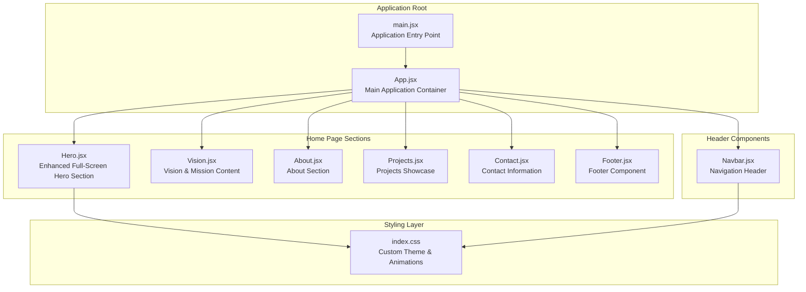
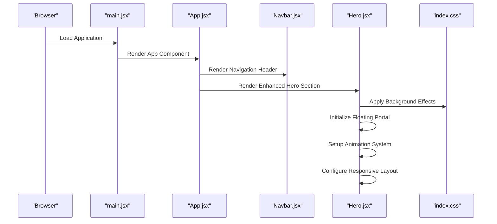
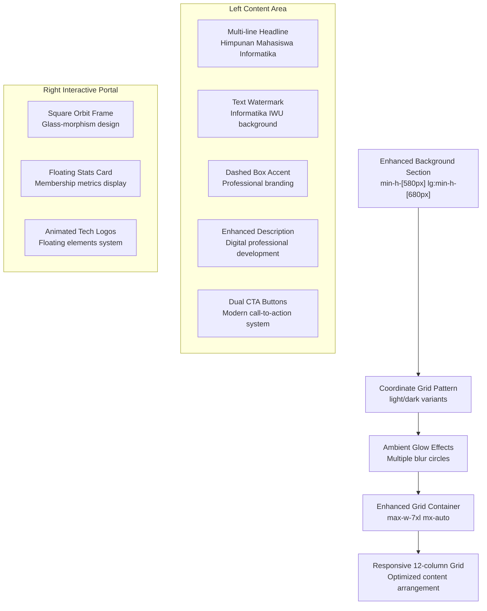
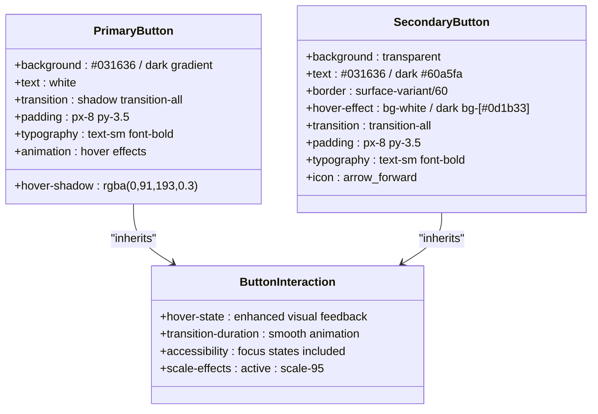
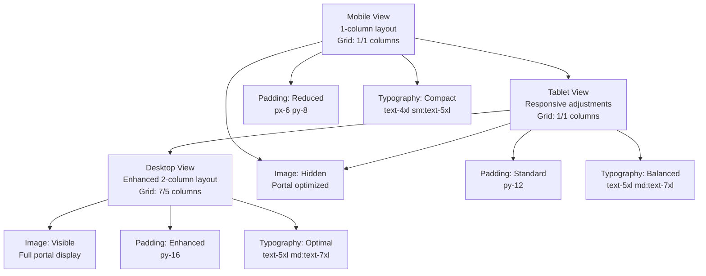
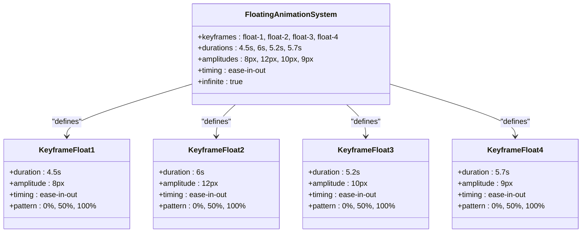
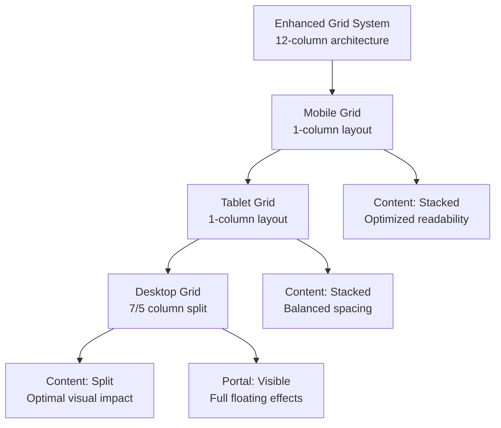
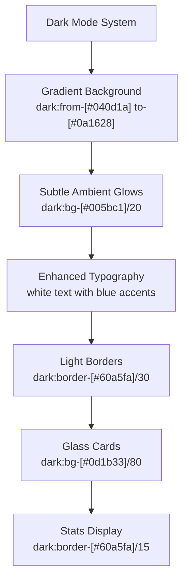
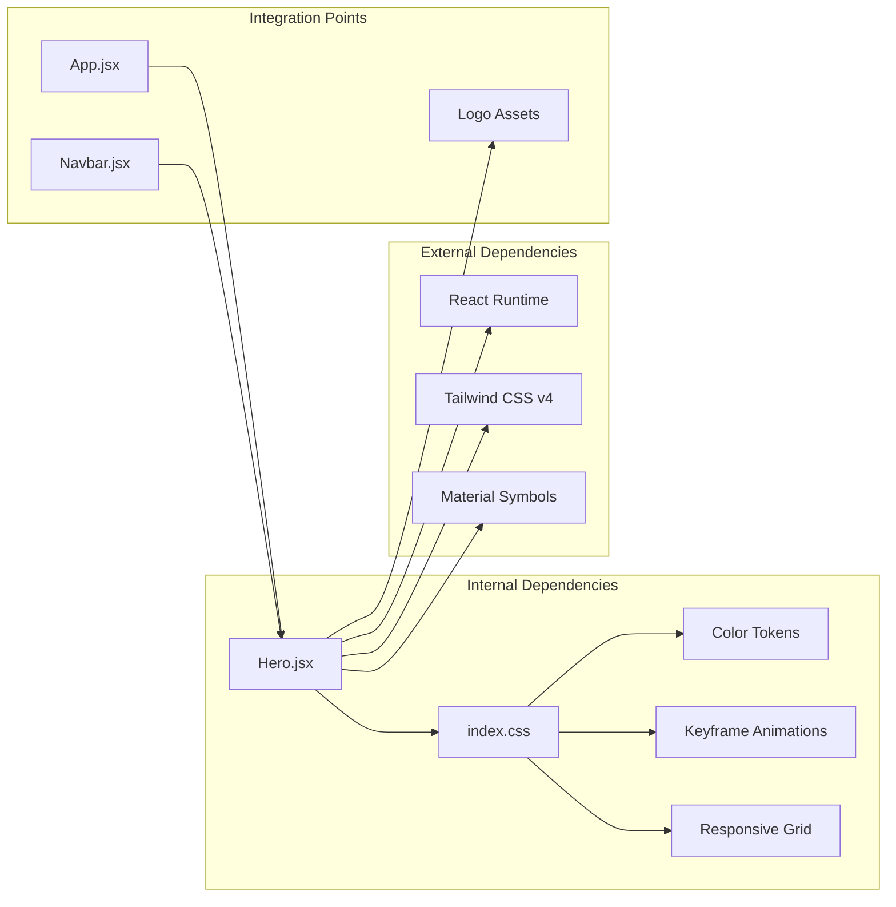

# Hero Section Component

<cite>
**Referenced Files in This Document**
- [Hero.jsx](file://src/components/home/Hero.jsx)
- [App.jsx](file://src/App.jsx)
- [Navbar.jsx](file://src/components/home/Navbar.jsx)
- [index.css](file://src/index.css)
- [main.jsx](file://src/main.jsx)
- [package.json](file://package.json)
</cite>

## Update Summary
**Changes Made**
- Enhanced responsive layout system with improved 12-column grid architecture
- Added custom floating animations using keyframe animations for tech elements
- Implemented interactive floating portal with orbit-style design
- Enhanced background effects with coordinate grid patterns and ambient glows
- Improved visual hierarchy with advanced typography and watermark effects
- Added comprehensive dark mode support with gradient backgrounds

## Table of Contents
1. [Introduction](#introduction)
2. [Project Structure](#project-structure)
3. [Core Components](#core-components)
4. [Architecture Overview](#architecture-overview)
5. [Detailed Component Analysis](#detailed-component-analysis)
6. [Animation System](#animation-system)
7. [Responsive Design Implementation](#responsive-design-implementation)
8. [Dark Mode Integration](#dark-mode-integration)
9. [Dependency Analysis](#dependency-analysis)
10. [Performance Considerations](#performance-considerations)
11. [Troubleshooting Guide](#troubleshooting-guide)
12. [Conclusion](#conclusion)

## Introduction
The Hero section component serves as the primary visual focal point of the HIMAIF IWU website, establishing brand presence and communicating core messaging to visitors. This comprehensive documentation covers the enhanced full-screen hero implementation with improved responsive layouts, animation capabilities, and floating elements using custom keyframe animations.

The component implements modern design principles with sophisticated visual effects including animated dot patterns, glass-morphism cards, interactive floating portals, and dynamic hover states that create an engaging user experience while maintaining accessibility and performance standards.

## Project Structure
The Hero component is part of a modular React application architecture that follows separation of concerns and component-based development patterns. The application utilizes Tailwind CSS v4 for styling with custom theme tokens and utility classes.

**Diagram sources**
- [main.jsx:1-11](file://src/main.jsx#L1-L11)
- [App.jsx:1-82](file://src/App.jsx#L1-L82)
- [Hero.jsx:1-113](file://src/components/home/Hero.jsx#L1-L113)
- [index.css:1-147](file://src/index.css#L1-L147)

**Section sources**
- [main.jsx:1-11](file://src/main.jsx#L1-L11)
- [App.jsx:1-82](file://src/App.jsx#L1-L82)
- [package.json:1-30](file://package.json#L1-L30)

## Core Components
The Hero component implements a sophisticated full-screen hero section featuring multiple design elements and interactive components. The component structure follows an enhanced responsive grid layout with distinct left and right content areas, optimized for desktop and mobile viewing experiences.

### Enhanced Component Architecture
The Hero component consists of several key architectural elements:

- **Advanced Background System**: Full-screen section with coordinate grid patterns and ambient glows
- **Enhanced Content Grid**: Responsive 12-column grid layout for optimal content arrangement
- **Interactive Floating Portal**: Square orbit frame with animated tech elements
- **Visual Effects**: Advanced CSS effects including blur, gradients, and transitions
- **Animation System**: Custom keyframe animations for floating elements
- **Stats Display**: Interactive hanging stats card with membership metrics

### Design Token Integration
The component leverages a comprehensive color system defined through CSS custom properties, enabling consistent theming across all interface elements. The design system includes primary, secondary, and tertiary color palettes with appropriate contrast ratios for accessibility.

**Section sources**
- [Hero.jsx:1-113](file://src/components/home/Hero.jsx#L1-L113)
- [index.css:5-58](file://src/index.css#L5-L58)

## Architecture Overview
The Hero component integrates seamlessly with the application's navigation system and content hierarchy, positioned immediately after the fixed navbar to maximize visual impact and screen real estate utilization.

**Diagram sources**
- [main.jsx:6-9](file://src/main.jsx#L6-L9)
- [App.jsx:13-82](file://src/App.jsx#L13-L82)
- [Hero.jsx:7-113](file://src/components/home/Hero.jsx#L7-L113)

The architectural pattern demonstrates a clean separation of concerns where each component handles specific presentation responsibilities while sharing common styling through the centralized CSS system with enhanced animation capabilities.

## Detailed Component Analysis

### Enhanced Visual Design Elements
The Hero component implements a sophisticated visual design system that combines modern aesthetics with functional usability. The design incorporates multiple layers of visual effects to create depth and engagement.

#### Advanced Background Effects System
The background layer utilizes sophisticated coordinate grid patterns and ambient glow effects, creating a dynamic and engaging visual experience. The system includes both light and dark mode variants with appropriate color adjustments.

**Diagram sources**
- [Hero.jsx:36-108](file://src/components/home/Hero.jsx#L36-L108)
- [index.css:87-91](file://src/index.css#L87-L91)

#### Advanced Typography Hierarchy
The typography system establishes clear visual hierarchy through progressive sizing, with headings scaling appropriately across breakpoints. The use of negative letter spacing and serif fonts creates a sophisticated, modern appearance.

#### Enhanced Color System
The component employs a carefully crafted color palette that emphasizes the secondary accent color (#005bc1) as the primary visual element, creating strong contrast against both light and dark backgrounds. The color system follows Material Design principles with appropriate contrast ratios for accessibility.

**Section sources**
- [Hero.jsx:41-74](file://src/components/home/Hero.jsx#L41-L74)
- [index.css:5-58](file://src/index.css#L5-L58)

### Interactive Elements and Enhanced Animations
The Hero component implements sophisticated hover states and transition effects that enhance user engagement without compromising performance. These interactions are designed to be smooth and accessible across different device capabilities.

#### Enhanced Button System Architecture
The dual button system provides complementary call-to-action options with distinct visual treatments and hover behaviors:

**Diagram sources**
- [Hero.jsx:66-74](file://src/components/home/Hero.jsx#L66-L74)

#### Interactive Floating Portal
The technology visualization portal incorporates advanced CSS effects including floating animations and interactive elements. The portal features a square orbit frame with animated tech logos and a floating stats card.

#### Advanced Hover State Implementation
Hover states are implemented through carefully crafted CSS transitions that provide immediate visual feedback while maintaining performance standards. The effects utilize hardware-accelerated properties to ensure smooth animations across devices.

**Section sources**
- [Hero.jsx:77-108](file://src/components/home/Hero.jsx#L77-L108)

### Enhanced Responsive Behavior and Breakpoints
The Hero component implements a comprehensive responsive design system that adapts gracefully across different screen sizes and device orientations. The responsive architecture follows a mobile-first approach with progressive enhancement for larger screens.

**Diagram sources**
- [Hero.jsx:36](file://src/components/home/Hero.jsx#L36)

#### Enhanced Breakpoint Strategy
The component utilizes Tailwind's responsive prefixes (sm, md, lg, xl) to implement progressive layout changes. The design maintains content hierarchy and readability across all viewport sizes while optimizing visual impact for each breakpoint.

#### Advanced Content Adaptation
Content elements adapt proportionally across breakpoints, with typography scaling and spacing adjustments ensuring optimal readability and visual balance. The enhanced grid system provides flexible content arrangement that responds to available space.

**Section sources**
- [Hero.jsx:36-108](file://src/components/home/Hero.jsx#L36-L108)

### Integration Patterns
The Hero component integrates seamlessly with the application's navigation system and subsequent content sections, creating a cohesive user journey from initial engagement to deeper content exploration.

#### Enhanced Navigation Integration
The component is positioned immediately after the fixed navigation header, utilizing the application's established z-index hierarchy to ensure proper layering. The design accounts for navigation height through strategic spacing and positioning.

#### Content Flow Architecture
The Hero section serves as the primary content anchor, directing users toward subsequent sections through strategic placement and visual cues. The integration with other home page components creates a logical progression from brand introduction to organizational values.

**Section sources**
- [App.jsx:46-77](file://src/App.jsx#L46-L77)
- [Hero.jsx:7](file://src/components/home/Hero.jsx#L7)

## Animation System
The Hero component features a sophisticated animation system built around custom keyframe animations for floating elements. This system enhances visual appeal while maintaining performance standards.

### Floating Animation Architecture
The animation system consists of four distinct floating animations with varying durations and amplitudes, creating a natural, organic movement pattern.

**Diagram sources**
- [index.css:94-122](file://src/index.css#L94-L122)

### Animation Implementation
The floating animations are implemented through CSS keyframes and utility classes, providing consistent behavior across different elements. Each animation has unique characteristics to create visual diversity while maintaining harmony.

#### Animation Performance
Animations are optimized for performance using hardware-accelerated properties and efficient timing functions. The system ensures smooth 60fps animations across devices while minimizing computational overhead.

**Section sources**
- [index.css:93-122](file://src/index.css#L93-L122)

## Responsive Design Implementation
The Hero component implements a comprehensive responsive design system that adapts gracefully across different screen sizes and device orientations. The responsive architecture follows a mobile-first approach with progressive enhancement for larger screens.

### Enhanced Grid System
The component utilizes a sophisticated 12-column grid system that optimizes content arrangement across all viewport sizes. The grid provides flexible content distribution while maintaining visual balance.

**Diagram sources**
- [Hero.jsx:36](file://src/components/home/Hero.jsx#L36)

### Typography Scaling
Typography scales progressively across breakpoints, with headings adapting from compact mobile sizes to expansive desktop dimensions. The system maintains readability and visual hierarchy at all sizes.

### Content Optimization
Content elements are strategically optimized for each breakpoint, with spacing and padding adjusted to ensure optimal user experience. The floating portal and interactive elements are adapted to maintain functionality across all devices.

**Section sources**
- [Hero.jsx:36-108](file://src/components/home/Hero.jsx#L36-L108)

## Dark Mode Integration
The Hero component provides comprehensive dark mode support with carefully crafted color schemes and visual effects that enhance the user experience in low-light conditions.

### Dark Mode Color System
The component implements a sophisticated dark mode color palette that complements the light mode design while providing optimal contrast and readability.

**Diagram sources**
- [Hero.jsx:9](file://src/components/home/Hero.jsx#L9)

### Dark Mode Animations
Animations are carefully adapted for dark mode, with appropriate adjustments to glow effects, transparency levels, and color saturation to maintain visual appeal and performance.

### Contrast and Accessibility
The dark mode implementation maintains appropriate contrast ratios and accessibility standards, ensuring optimal readability and user experience across all devices and lighting conditions.

**Section sources**
- [Hero.jsx:9-34](file://src/components/home/Hero.jsx#L9-L34)
- [index.css:54-58](file://src/index.css#L54-L58)

## Dependency Analysis
The Hero component maintains loose coupling with external dependencies while leveraging the application's centralized styling system. The component's dependencies are intentionally minimal to ensure maintainability and performance.

**Diagram sources**
- [Hero.jsx:1-6](file://src/components/home/Hero.jsx#L1-L6)
- [index.css:1-147](file://src/index.css#L1-L147)
- [package.json:12-16](file://package.json#L12-L16)

### External Dependencies
The component relies on React for rendering and state management, Tailwind CSS for styling utilities, and Material Symbols for iconography. These dependencies are managed through the project's package configuration and integrated through the Vite build system.

### Internal Dependencies
The component shares styling through the centralized CSS system, utilizing custom theme tokens, keyframe animations, and responsive grid utilities. This approach ensures consistency across components while maintaining flexibility for individual component customization.

**Section sources**
- [package.json:12-16](file://package.json#L12-L16)
- [index.css:87-146](file://src/index.css#L87-L146)

## Performance Considerations
The Hero component is optimized for performance through careful consideration of rendering costs, resource loading, and animation efficiency. The implementation prioritizes smooth user experiences while minimizing computational overhead.

### Enhanced Rendering Optimization
The component structure minimizes DOM complexity through efficient nesting and strategic use of CSS Grid for layout. The design avoids unnecessary reflows and repaints through judicious use of transform properties for animations.

### Advanced Asset Management
Images are loaded with appropriate sizing and lazy-loading considerations to minimize initial page weight. The technology visualization images utilize caching strategies and CDN optimization for improved load times.

### Optimized Animation Performance
CSS transitions are implemented using hardware-accelerated properties to ensure smooth 60fps animations across devices. The floating animations are optimized for quick activation while maintaining visual appeal and performance.

### Dark Mode Performance
Dark mode implementations are optimized for performance, with appropriate adjustments to color calculations and background effects that minimize computational overhead while maintaining visual quality.

## Troubleshooting Guide
Common issues and solutions for the enhanced Hero component implementation:

### Styling Issues
- **Missing Utility Classes**: Ensure Tailwind CSS is properly configured and utility classes are recognized
- **Color Token Problems**: Verify CSS custom properties are correctly defined in the theme system
- **Responsive Breakpoints**: Check media query implementation and breakpoint specificity
- **Animation Issues**: Verify keyframe animations are properly defined and applied

### Interactive Element Problems
- **Button Hover States**: Verify transition properties and hover selectors are properly applied
- **Floating Animations**: Confirm CSS keyframes are correctly implemented and applied
- **Image Effects**: Ensure CSS filters and transforms are compatible with browser support
- **Accessibility**: Test keyboard navigation and screen reader compatibility

### Layout Concerns
- **Grid Alignment**: Validate CSS Grid properties and column spanning across breakpoints
- **Spacing Issues**: Check padding and margin calculations for different viewport sizes
- **Overflow Problems**: Monitor content overflow and scroll behavior on smaller screens
- **Portal Positioning**: Ensure floating portal elements are properly positioned and sized

### Animation Troubleshooting
- **Animation Performance**: Monitor animation frame rates and adjust timing functions if needed
- **Animation Synchronization**: Verify floating animations are properly timed and coordinated
- **Animation Fallbacks**: Ensure animations degrade gracefully on older browsers

**Section sources**
- [Hero.jsx:66-108](file://src/components/home/Hero.jsx#L66-L108)
- [index.css:93-122](file://src/index.css#L93-L122)

## Conclusion
The enhanced Hero component represents a sophisticated implementation of modern web design principles, combining visual excellence with technical robustness. The component successfully balances aesthetic appeal with performance considerations, creating an engaging user experience that effectively communicates brand identity and values.

Through careful attention to responsive design, interactive elements, animation systems, and dark mode integration, the Hero component serves as a foundation for the application's visual narrative while maintaining technical excellence and accessibility standards. The implementation demonstrates best practices in component architecture, styling systems, and user experience design that can serve as a model for similar implementations.

The component's modular design and comprehensive styling system provide excellent extensibility for future enhancements while maintaining consistency with the application's overall design language. This foundation supports continued growth and evolution of the HIMAIF IWU website while preserving the quality and impact of the enhanced user experience.

The addition of floating animations, interactive portals, and advanced responsive layouts demonstrates the component's evolution toward a more sophisticated and engaging user interface that captures attention while maintaining clarity and purpose.