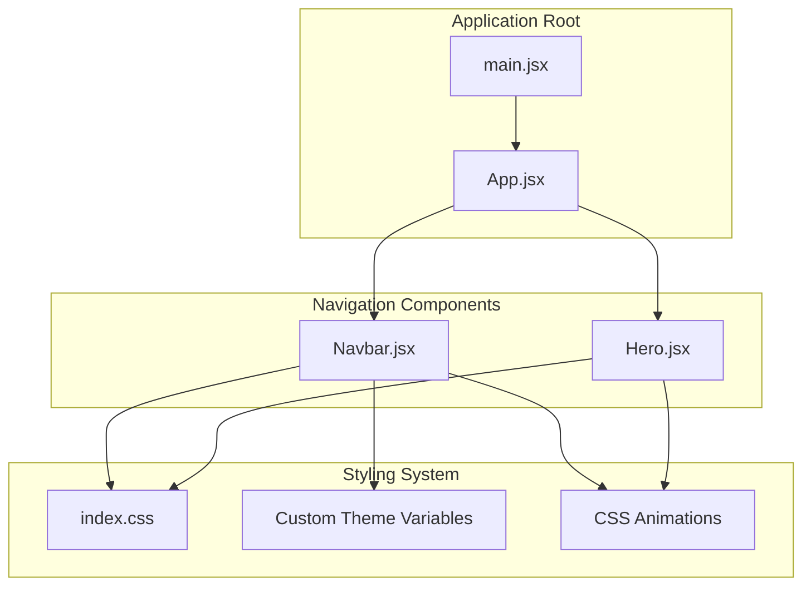
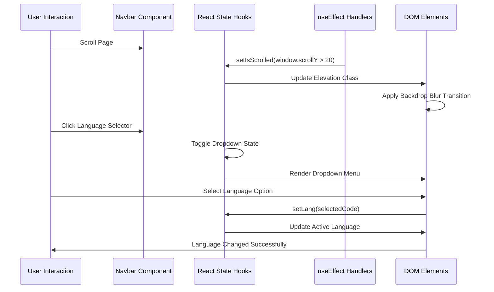
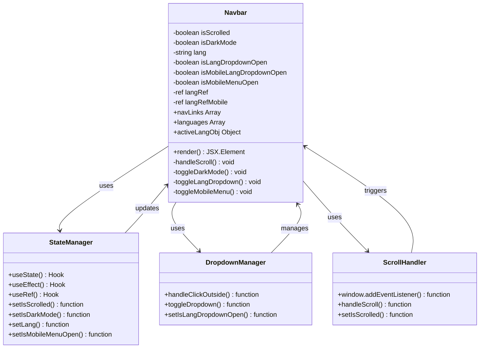
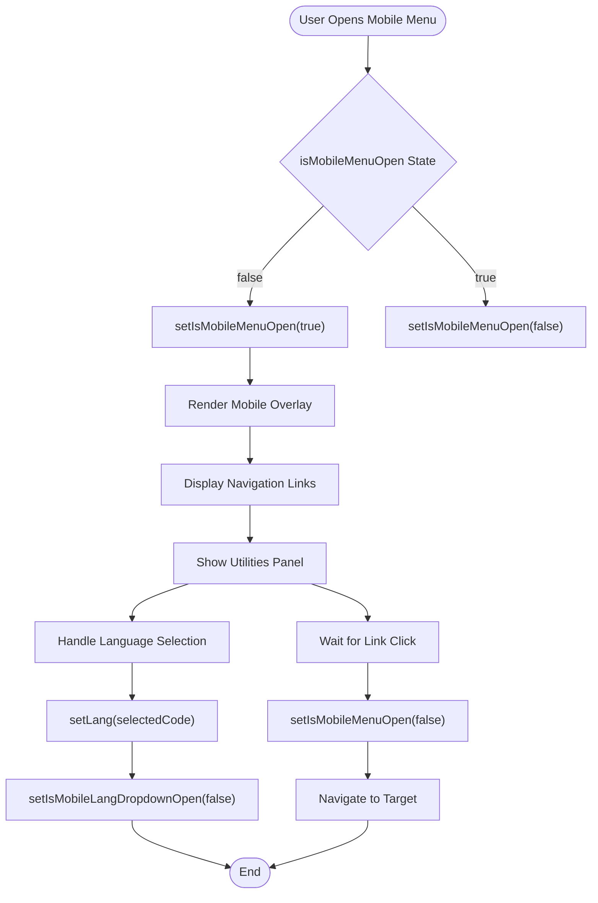
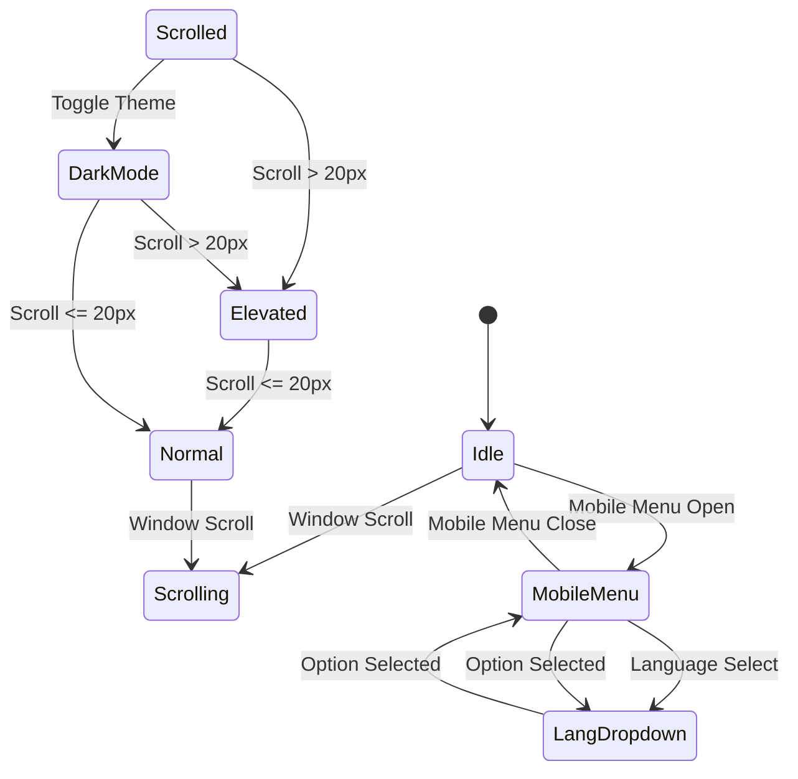

# Navigation Component

<cite>
**Referenced Files in This Document**
- [Navbar.jsx](file://src/components/home/Navbar.jsx)
- [App.jsx](file://src/App.jsx)
- [main.jsx](file://src/main.jsx)
- [index.css](file://src/index.css)
- [Hero.jsx](file://src/components/home/Hero.jsx)
- [package.json](file://package.json)
</cite>

## Update Summary
**Changes Made**
- Enhanced mobile menu functionality with utilities panel
- Added sophisticated language selector with desktop and mobile variants
- Implemented scroll-aware elevation effects with backdrop blur transitions
- Integrated social media icons with branded styling
- Added dark mode toggle with persistent floating utilities panel
- Expanded state management with multiple dropdowns and click-outside handling
- Improved responsive design with enhanced mobile interactions

## Table of Contents
1. [Introduction](#introduction)
2. [Project Structure](#project-structure)
3. [Core Components](#core-components)
4. [Architecture Overview](#architecture-overview)
5. [Detailed Component Analysis](#detailed-component-analysis)
6. [Advanced Features](#advanced-features)
7. [State Management Architecture](#state-management-architecture)
8. [Responsive Design Implementation](#responsive-design-implementation)
9. [Styling and Visual Design](#styling-and-visual-design)
10. [Integration with Application](#integration-with-application)
11. [Performance Considerations](#performance-considerations)
12. [Troubleshooting Guide](#troubleshooting-guide)
13. [Conclusion](#conclusion)

## Introduction
This document provides comprehensive documentation for the enhanced Navbar.jsx component, featuring a sophisticated fixed-position navigation system with advanced interactive elements. The navbar serves as the primary navigation interface for the HIMAIF IWU website, implementing modern design patterns including responsive mobile menu, language selector, social media integration, and scroll-aware elevation effects with backdrop blur transitions.

## Project Structure
The navigation component is part of a modern React application built with Vite and Tailwind CSS 4.0, featuring a sophisticated component architecture with seamless integration across different screen sizes.

**Diagram sources**
- [main.jsx:1-11](file://src/main.jsx#L1-L11)
- [App.jsx:1-82](file://src/App.jsx#L1-L82)
- [Navbar.jsx:1-281](file://src/components/home/Navbar.jsx#L1-L281)
- [index.css:1-147](file://src/index.css#L1-L147)

**Section sources**
- [main.jsx:1-11](file://src/main.jsx#L1-L11)
- [App.jsx:1-82](file://src/App.jsx#L1-L82)
- [package.json:1-30](file://package.json#L1-L30)

## Core Components
The enhanced navigation system implements multiple sophisticated components working together to provide a comprehensive user experience across all device types.

### Fixed Position Navigation System
The navbar utilizes a fixed positioning strategy with intelligent elevation changes based on scroll position, featuring backdrop blur effects and smooth transitions for enhanced visual appeal.

### Advanced Mobile Menu System
The component implements a comprehensive mobile menu system with collapsible navigation, integrated utilities panel, and sophisticated state management for seamless mobile interactions.

### Persistent Floating Utilities Panel
A unique desktop-only floating panel provides quick access to essential utilities including language selection, social media links, and theme switching without interfering with main navigation content.

### Sophisticated Language Selector
Dual-language selectors provide internationalization support with desktop dropdown menus and mobile inline selections, featuring country flags and cultural appropriateness.

**Section sources**
- [Navbar.jsx:64-281](file://src/components/home/Navbar.jsx#L64-L281)
- [index.css:3-65](file://src/index.css#L3-L65)

## Architecture Overview
The navbar component follows a sophisticated component-based architecture with advanced state management and lifecycle handling for optimal performance and user experience.

**Diagram sources**
- [Navbar.jsx:25-31](file://src/components/home/Navbar.jsx#L25-L31)
- [Navbar.jsx:16-23](file://src/components/home/Navbar.jsx#L16-L23)
- [Navbar.jsx:232-257](file://src/components/home/Navbar.jsx#L232-L257)

## Detailed Component Analysis

### Enhanced State Management Architecture
The navbar employs multiple React hooks for comprehensive state management including scroll awareness, dark mode, language selection, and dropdown interactions.

**Diagram sources**
- [Navbar.jsx:5-15](file://src/components/home/Navbar.jsx#L5-L15)
- [Navbar.jsx:16-45](file://src/components/home/Navbar.jsx#L16-L45)

### Advanced Navigation Link Configuration
The component defines navigation links as a comprehensive configuration array with enhanced metadata for improved functionality and maintainability.

| Property | Type | Description |
|----------|------|-------------|
| id | string | Unique identifier for navigation section |
| label | string | Display text for the navigation link |
| href | string | Target URL or anchor reference |

### Sophisticated Mobile Menu Implementation
The mobile menu system includes advanced state management with automatic closing behavior, integrated utilities panel, and comprehensive dropdown handling.

**Diagram sources**
- [Navbar.jsx:124-193](file://src/components/home/Navbar.jsx#L124-L193)
- [Navbar.jsx:130-133](file://src/components/home/Navbar.jsx#L130-L133)
- [Navbar.jsx:168-177](file://src/components/home/Navbar.jsx#L168-L177)

**Section sources**
- [Navbar.jsx:47-62](file://src/components/home/Navbar.jsx#L47-L62)
- [Navbar.jsx:124-193](file://src/components/home/Navbar.jsx#L124-L193)

## Advanced Features

### Scroll-Aware Elevation Effects
The navbar implements sophisticated scroll detection with backdrop blur transitions and elevation changes for enhanced visual depth and user experience.

#### Elevation States
- **Default State**: Full height navigation with subtle shadow
- **Scrolled State**: Reduced height with backdrop blur and enhanced shadow
- **Transition Effects**: Smooth CSS transitions between states

#### Backdrop Blur Implementation
The component uses advanced backdrop blur effects with opacity adjustments for different themes and states.

### Persistent Floating Utilities Panel
A sophisticated desktop-only panel provides continuous access to essential utilities without interfering with main navigation content.

#### Panel Features
- **Location Information**: Display current location and contact details
- **Social Media Integration**: Branded SVG icons with hover effects
- **Language Selection**: Compact dropdown for internationalization
- **Theme Switching**: Quick dark/light mode toggle
- **Border Separators**: Subtle dividers for visual organization

### Enhanced Language Selector System
The component implements a dual-language selector system with desktop and mobile variants, providing comprehensive internationalization support.

#### Language Options
- **Indonesian (ID)**: Default language with national flag representation
- **English (EN)**: International standard language
- **Korean (KR)**: Asian market representation
- **Taiwanese (TW)**: Regional variant

#### Selector Variants
- **Desktop Dropdown**: Traditional dropdown menu with smooth animations
- **Mobile Inline**: Compact inline selector with reduced footprint
- **Click-Outside Detection**: Automatic dropdown closure for better UX

### Social Media Integration
The navbar includes comprehensive social media integration with branded styling and hover effects for enhanced community engagement.

#### Social Platforms
- **GitHub**: Professional development platform with official branding
- **Instagram**: Visual content platform with brand-specific styling
- **LinkedIn**: Professional networking with corporate colors

#### Integration Features
- **SVG Icons**: Custom vector graphics for crisp rendering
- **Hover Effects**: Scale transformations and color transitions
- **Accessibility**: Proper ARIA labels for screen readers

**Section sources**
- [Navbar.jsx:67-72](file://src/components/home/Navbar.jsx#L67-L72)
- [Navbar.jsx:195-277](file://src/components/home/Navbar.jsx#L195-L277)
- [Navbar.jsx:230-272](file://src/components/home/Navbar.jsx#L230-L272)
- [Navbar.jsx:210-226](file://src/components/home/Navbar.jsx#L210-L226)

## State Management Architecture

### Multi-State Coordination
The navbar coordinates multiple state variables with sophisticated interdependencies and lifecycle management.

**Diagram sources**
- [Navbar.jsx:6-11](file://src/components/home/Navbar.jsx#L6-L11)
- [Navbar.jsx:25-31](file://src/components/home/Navbar.jsx#L25-L31)
- [Navbar.jsx:16-23](file://src/components/home/Navbar.jsx#L16-L23)

### Event Handling Architecture
The component implements sophisticated event handling with multiple listeners and cleanup mechanisms for optimal performance.

#### Event Listeners
- **Scroll Events**: Window scroll detection with debouncing
- **Click Events**: Dropdown interaction handling
- **Outside Click Events**: Click-outside detection for dropdown closure
- **Theme Change Events**: Dark mode preference persistence

#### Cleanup Mechanisms
- **Event Listener Removal**: Proper cleanup on component unmount
- **Memory Management**: Prevent memory leaks from lingering listeners
- **State Synchronization**: Coordinated state updates across components

**Section sources**
- [Navbar.jsx:16-45](file://src/components/home/Navbar.jsx#L16-L45)
- [Navbar.jsx:33-45](file://src/components/home/Navbar.jsx#L33-L45)

## Responsive Design Implementation

### Advanced Breakpoint Strategy
The component implements a sophisticated breakpoint system using Tailwind CSS responsive prefixes with enhanced mobile-first approach.

#### Breakpoint Categories
- **Mobile (Default)**: Full mobile experience with hamburger menu
- **Tablet (md:)**: Enhanced tablet experience with expanded utilities
- **Desktop (lg:)**: Full desktop experience with floating panel
- **Large Desktop (xl:)**: Optimized for wide screens with additional spacing

#### Responsive Behaviors
- **Mobile Menu**: Collapsible navigation with slide-down animations
- **Desktop Navigation**: Full-width navigation with hover effects
- **Floating Panel**: Desktop-only utilities with sticky positioning
- **Language Selectors**: Adaptive sizing and positioning

### Mobile Experience Enhancements
The mobile implementation includes comprehensive touch-friendly interactions and optimized space utilization.

#### Mobile Features
- **Touch-Friendly Targets**: Minimum 44px touch targets for accessibility
- **Gesture Support**: Swipe gestures for navigation
- **Orientation Handling**: Responsive layout adaptation to device orientation
- **Performance Optimization**: Lightweight rendering for mobile devices

### Desktop Experience Enhancements
The desktop implementation focuses on maximizing utility and minimizing visual clutter while maintaining aesthetic appeal.

#### Desktop Features
- **Persistent Panel**: Always-visible utilities without navigation interference
- **Advanced Animations**: Smooth transitions and micro-interactions
- **Keyboard Navigation**: Full keyboard accessibility support
- **High-DPI Support**: Crisp rendering on Retina displays

**Section sources**
- [Navbar.jsx:64-121](file://src/components/home/Navbar.jsx#L64-L121)
- [Navbar.jsx:123-193](file://src/components/home/Navbar.jsx#L123-L193)
- [Navbar.jsx:195-277](file://src/components/home/Navbar.jsx#L195-L277)

## Styling and Visual Design

### Advanced Color System Integration
The navbar implements a comprehensive color system leveraging custom theme variables and dark mode support for seamless theme transitions.

#### Color Palette Architecture
- **Primary Colors**: Blue-based palette (#005bc1) for brand consistency
- **Surface Colors**: Light/dark variants for different contexts
- **Text Colors**: High contrast ratios for accessibility compliance
- **Accent Colors**: Complementary colors for interactive elements

#### Theme Variable System
The component utilizes a sophisticated theme variable system with automatic dark mode switching and smooth transitions.

### Material Symbols Integration
The component uses Google's Material Symbols for consistent iconography across platforms with custom styling and animations.

#### Symbol Usage
- **Navigation Icons**: Menu, close, and arrow symbols for intuitive navigation
- **Utility Icons**: Public, light/dark mode, and social media symbols
- **Animation Support**: Rotation and scaling animations for interactive feedback
- **Accessibility**: Proper ARIA labels and semantic markup

### Advanced Typography System
The navbar implements a sophisticated typography system with serif fonts for brand identity and careful spacing for readability.

#### Typography Hierarchy
- **Brand Identity**: Serif fonts for logo and headings
- **Navigation Text**: Sans-serif for menu items and utilities
- **Font Weights**: Careful weight progression for visual hierarchy
- **Letter Spacing**: Optimized tracking for different contexts

### Animation and Transition System
The component implements a comprehensive animation system with carefully crafted transitions for enhanced user experience.

#### Animation Categories
- **Elevation Transitions**: Smooth height and shadow changes on scroll
- **Dropdown Animations**: Fade and slide transitions for menus
- **Icon Rotations**: Smooth rotation animations for interactive elements
- **Backdrop Blurs**: Progressive blur effects for depth perception

**Section sources**
- [index.css:5-58](file://src/index.css#L5-L58)
- [Navbar.jsx:67-72](file://src/components/home/Navbar.jsx#L67-L72)
- [Navbar.jsx:232-257](file://src/components/home/Navbar.jsx#L232-L257)

## Integration with Application

### Component Integration Points
The navbar integrates seamlessly with the application through multiple integration points for optimal functionality and user experience.

#### Application Integration
- **Route Management**: Active state management for navigation sections
- **Layout Context**: Proper spacing and positioning within application layout
- **Theme System**: Integration with global dark mode preferences
- **Accessibility**: Full ARIA support and keyboard navigation

#### Data Flow Integration
The component participates in the application's data flow with proper prop passing and state synchronization.

### Layout System Integration
The navbar works harmoniously with the application's layout system to provide consistent spacing and visual continuity.

#### Layout Features
- **Padding Management**: Proper spacing for mobile and desktop views
- **Z-Index Coordination**: Correct layering with other application elements
- **Responsive Grid**: Integration with application-wide responsive design
- **Content Offset**: Proper positioning with application content sections

### State Synchronization
The navbar maintains proper state synchronization with the application for consistent user experience across all components.

**Section sources**
- [App.jsx:13-44](file://src/App.jsx#L13-L44)
- [Navbar.jsx:5-11](file://src/components/home/Navbar.jsx#L5-L11)

## Performance Considerations

### Advanced Rendering Optimization
The navbar implements sophisticated rendering optimizations to ensure smooth performance across all device types and browser capabilities.

#### Rendering Strategies
- **Conditional Rendering**: Mobile menu only renders when needed
- **State Isolation**: Minimal state changes trigger re-renders
- **Static Configuration**: Navigation links defined as immutable arrays
- **Event Delegation**: Efficient event handling with proper cleanup

### Memory Management Excellence
The component implements comprehensive memory management practices to prevent memory leaks and optimize performance.

#### Memory Optimization
- **Event Listener Cleanup**: Proper removal of event listeners on unmount
- **Ref Management**: Efficient DOM reference handling
- **State Cleanup**: Proper cleanup of complex state structures
- **Animation Optimization**: Efficient animation frame usage

### Accessibility Performance
The navbar maintains excellent accessibility performance with optimized keyboard navigation and screen reader support.

#### Accessibility Features
- **Keyboard Navigation**: Full keyboard accessibility support
- **Screen Reader**: Proper ARIA attributes and semantic markup
- **Focus Management**: Logical tab order and focus indicators
- **Color Contrast**: Maintains WCAG compliance across all themes

### Responsive Performance
The component optimizes performance across different screen sizes with adaptive loading and rendering strategies.

#### Performance Adaptations
- **Mobile Optimization**: Reduced complexity for mobile devices
- **Desktop Enhancement**: Additional features for desktop environments
- **Network Efficiency**: Optimized asset loading for different connection speeds
- **Battery Life**: Minimized CPU usage for mobile battery conservation

**Section sources**
- [Navbar.jsx:33-45](file://src/components/home/Navbar.jsx#L33-L45)
- [Navbar.jsx:16-23](file://src/components/home/Navbar.jsx#L16-L23)

## Troubleshooting Guide

### Advanced Issue Resolution

#### Scroll Detection Problems
**Symptoms**: Elevation effects not triggering or triggering incorrectly
**Causes**: 
- Scroll event listener conflicts
- Incorrect scroll threshold calculations
- CSS transition timing issues

**Solutions**:
- Verify scroll event listener registration
- Check scroll threshold values (20px default)
- Inspect CSS transition duration settings

#### Dropdown Interaction Issues
**Symptoms**: Language selectors not responding or closing unexpectedly
**Causes**:
- Click-outside detection conflicts
- State management synchronization issues
- CSS positioning conflicts

**Solutions**:
- Verify click-outside detection implementation
- Check state variable naming consistency
- Inspect CSS positioning and z-index values

#### Mobile Menu Responsiveness
**Symptoms**: Mobile menu not opening/closing properly
**Causes**:
- Touch event handling issues
- CSS media query conflicts
- JavaScript execution errors

**Solutions**:
- Test touch event handling on actual devices
- Verify CSS media query syntax
- Check JavaScript console for errors

#### Dark Mode Synchronization
**Symptoms**: Theme switching not working consistently
**Causes**:
- DOM class manipulation conflicts
- CSS specificity issues
- State synchronization problems

**Solutions**:
- Verify dark mode class application
- Check CSS specificity hierarchy
- Ensure proper state synchronization

#### Performance Issues
**Symptoms**: Navigation feels sluggish or unresponsive
**Causes**:
- Excessive re-renders
- Memory leaks from event listeners
- CSS animation performance issues

**Solutions**:
- Monitor component re-render frequency
- Verify event listener cleanup
- Optimize CSS animations and transitions

**Section sources**
- [Navbar.jsx:25-31](file://src/components/home/Navbar.jsx#L25-L31)
- [Navbar.jsx:33-45](file://src/components/home/Navbar.jsx#L33-L45)
- [Navbar.jsx:16-23](file://src/components/home/Navbar.jsx#L16-L23)

## Conclusion
The enhanced Navbar.jsx component represents a sophisticated implementation of modern React patterns combined with advanced responsive design principles and comprehensive state management. Its innovative features including scroll-aware elevation effects, persistent floating utilities panel, and dual-language selectors demonstrate exceptional attention to user experience and technical excellence.

The component successfully balances functionality with performance, providing an accessible and visually appealing navigation solution that scales effectively across different device form factors. The modular architecture allows for easy customization while maintaining consistency with the overall application aesthetic.

Key achievements include:
- **Advanced Scroll Awareness**: Sophisticated elevation changes with backdrop blur transitions
- **Comprehensive State Management**: Multiple dropdowns with intelligent click-outside handling
- **Dual-Language Support**: Desktop and mobile language selectors with cultural appropriateness
- **Social Media Integration**: Branded icons with proper accessibility support
- **Performance Optimization**: Efficient rendering patterns with memory management
- **Accessibility Excellence**: Full keyboard navigation and screen reader support

Future enhancements could include dynamic route detection, enhanced animation systems, and expanded internationalization support, building upon the solid foundation established in this comprehensive implementation.