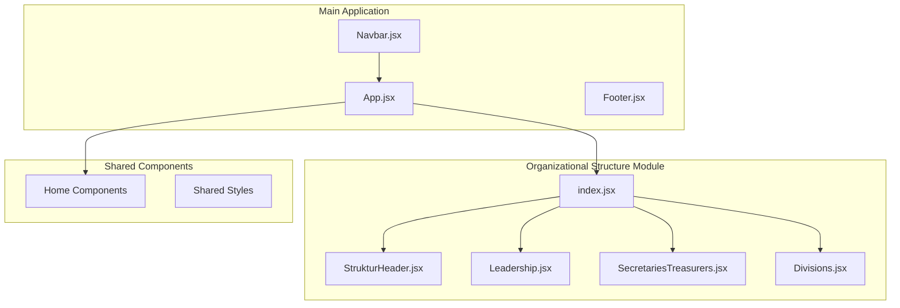
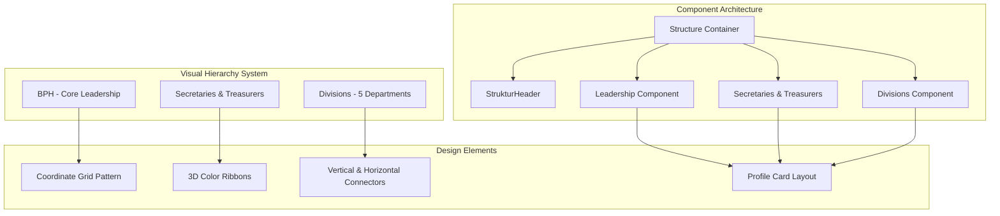
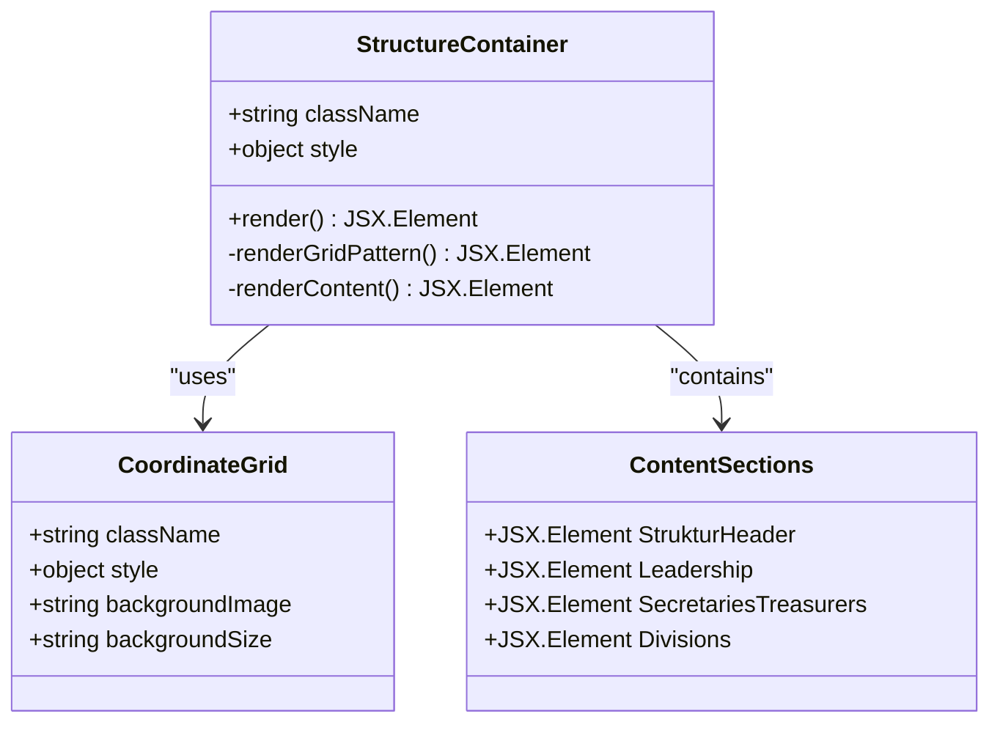
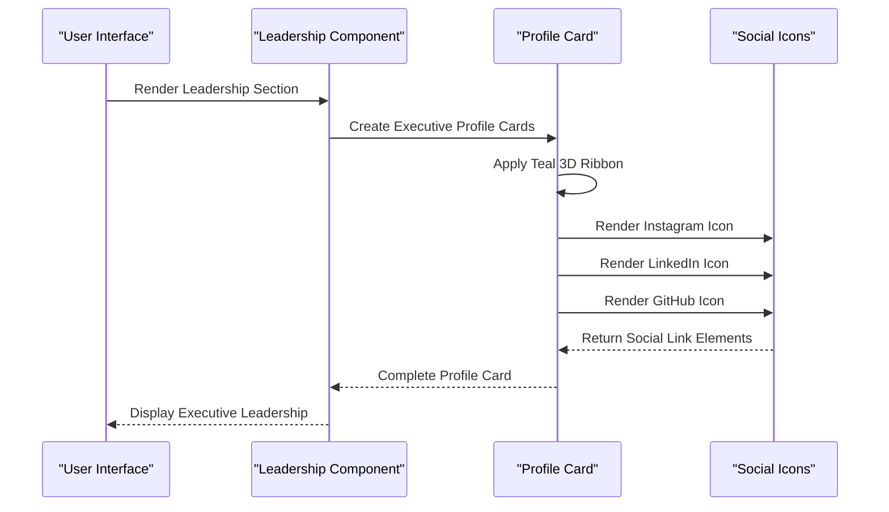
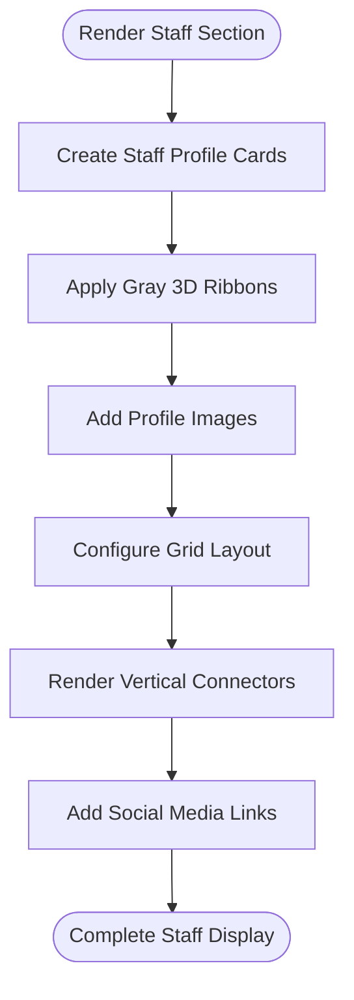
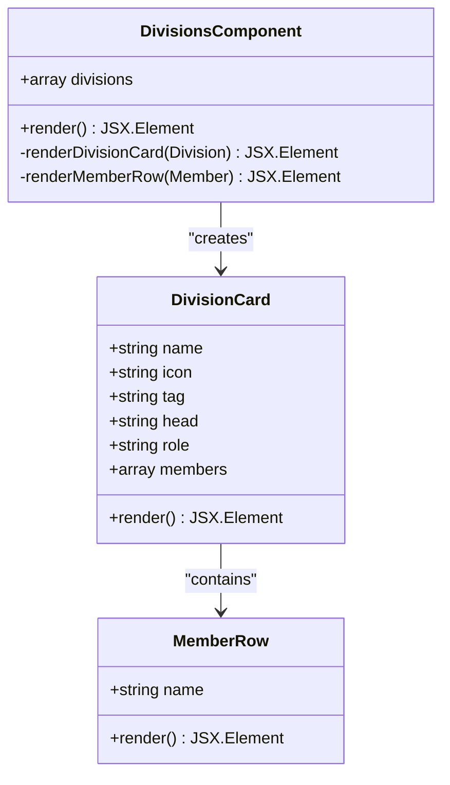
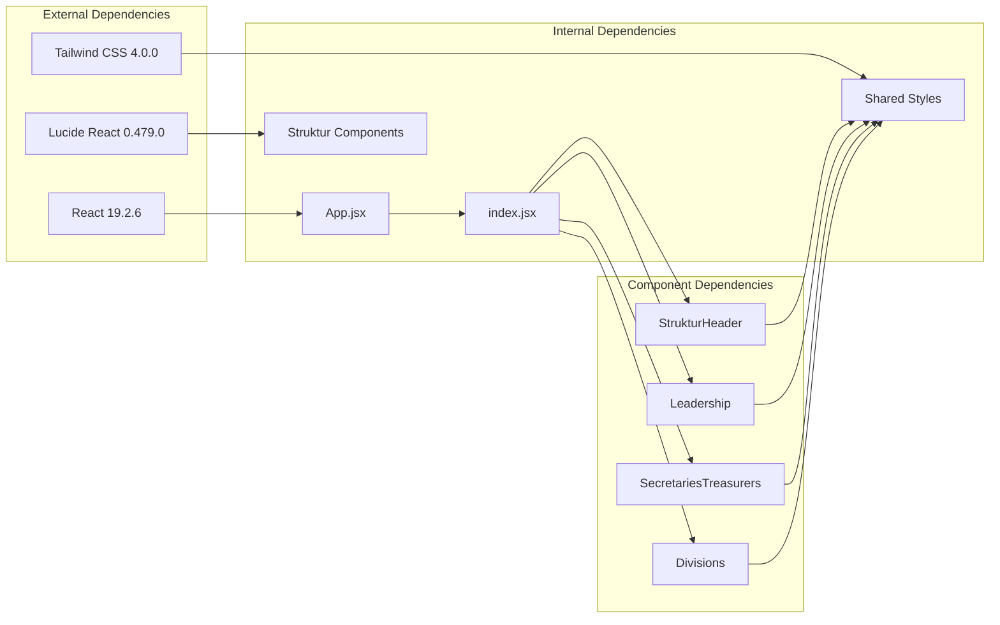

# Organizational Structure

<cite>
**Referenced Files in This Document**
- [index.jsx](file://src/components/struktur/index.jsx)
- [Divisions.jsx](file://src/components/struktur/Divisions.jsx)
- [Leadership.jsx](file://src/components/struktur/Leadership.jsx)
- [SecretariesTreasurers.jsx](file://src/components/struktur/SecretariesTreasurers.jsx)
- [StrukturHeader.jsx](file://src/components/struktur/StrukturHeader.jsx)
- [App.jsx](file://src/App.jsx)
- [Navbar.jsx](file://src/components/home/Navbar.jsx)
- [index.css](file://src/index.css)
- [package.json](file://package.json)
</cite>

## Table of Contents
1. [Introduction](#introduction)
2. [Project Structure](#project-structure)
3. [Core Components](#core-components)
4. [Architecture Overview](#architecture-overview)
5. [Detailed Component Analysis](#detailed-component-analysis)
6. [Dependency Analysis](#dependency-analysis)
7. [Performance Considerations](#performance-considerations)
8. [Troubleshooting Guide](#troubleshooting-guide)
9. [Conclusion](#conclusion)

## Introduction

The organizational structure module represents the leadership hierarchy and departmental structure of HIMAIF SYNAPSE, the Informatics Student Organization at International Women's University. This system showcases the governance structure with clear reporting relationships and departmental divisions that support the organization's mission and activities.

The implementation follows modern React patterns with a focus on responsive design, dark mode support, and maintainable component architecture. The structure emphasizes transparency in leadership roles while maintaining visual hierarchy and professional presentation standards.

## Project Structure

The organizational structure is implemented as a dedicated React component system within the larger HIMAIF website ecosystem. The structure follows established patterns from the home page components while introducing specialized layouts for representing hierarchical relationships.

**Diagram sources**
- [App.jsx:13-82](file://src/App.jsx#L13-L82)
- [index.jsx:1-48](file://src/components/struktur/index.jsx#L1-L48)

**Section sources**
- [App.jsx:1-82](file://src/App.jsx#L1-L82)
- [index.jsx:1-48](file://src/components/struktur/index.jsx#L1-L48)

## Core Components

The organizational structure module consists of four primary components that work together to present the complete leadership hierarchy:

### Structure Container
The main container component orchestrates the layout and provides the overall framework for displaying organizational information. It establishes the visual theme, manages the coordinate grid background, and organizes the hierarchical sections.

### Leadership Component
Represents the core executive leadership including the President and Vice President positions. This component uses distinctive teal-colored ribbons and prominent profile displays to emphasize the central leadership role.

### Secretaries and Treasurers Component  
Manages the administrative support staff including Secretaries and Treasurers. Features a neutral gray color scheme that distinguishes administrative roles from executive positions.

### Divisions Component
Displays the five departmental divisions with their respective heads and team members. Each division maintains consistent styling while highlighting unique characteristics through color-coded tags and department-specific icons.

**Section sources**
- [index.jsx:7-47](file://src/components/struktur/index.jsx#L7-L47)
- [Leadership.jsx:28-141](file://src/components/struktur/Leadership.jsx#L28-L141)
- [SecretariesTreasurers.jsx:28-118](file://src/components/struktur/SecretariesTreasurers.jsx#L28-L118)
- [Divisions.jsx:45-220](file://src/components/struktur/Divisions.jsx#L45-L220)

## Architecture Overview

The organizational structure architecture follows a hierarchical component pattern that mirrors the real-world organizational structure it represents. The system employs a coordinate grid background pattern that reinforces the structured nature of the hierarchy.

**Diagram sources**
- [index.jsx:35-42](file://src/components/struktur/index.jsx#L35-L42)
- [Leadership.jsx:58-67](file://src/components/struktur/Leadership.jsx#L58-L67)
- [SecretariesTreasurers.jsx:68-76](file://src/components/struktur/SecretariesTreasurers.jsx#L68-L76)
- [Divisions.jsx:136-145](file://src/components/struktur/Divisions.jsx#L136-L145)

The architecture implements several key design patterns:

- **Hierarchical Layout**: Visual representation mirrors the organizational hierarchy
- **Responsive Grid System**: Adapts to different screen sizes while maintaining structure
- **Consistent Card Design**: Uniform presentation style across all organizational levels
- **Color-Coded Identity**: Distinct color schemes for different organizational levels
- **Connector System**: Visual pathways showing relationships between levels

**Section sources**
- [index.jsx:9-30](file://src/components/struktur/index.jsx#L9-L30)
- [index.jsx:35-43](file://src/components/struktur/index.jsx#L35-L43)

## Detailed Component Analysis

### Structure Container Component

The main container serves as the foundation for the entire organizational structure presentation. It establishes the visual framework with coordinate grid patterns that reinforce the structured nature of the hierarchy.

**Diagram sources**
- [index.jsx:9-30](file://src/components/struktur/index.jsx#L9-L30)
- [index.jsx:32-43](file://src/components/struktur/index.jsx#L32-L43)

The container implements sophisticated background patterns that serve both aesthetic and structural purposes. The light blue grid pattern creates visual continuity while the dark mode variant uses a blue tinted grid for contrast.

**Section sources**
- [index.jsx:1-48](file://src/components/struktur/index.jsx#L1-L48)

### Leadership Component Analysis

The leadership component represents the core executive authority with distinctive visual elements that emphasize the central position in the organizational hierarchy.

**Diagram sources**
- [Leadership.jsx:51-103](file://src/components/struktur/Leadership.jsx#L51-L103)
- [Leadership.jsx:22-26](file://src/components/struktur/Leadership.jsx#L22-L26)

The leadership component utilizes a sophisticated 3D ribbon system with vertical text orientation to clearly communicate role hierarchy. Each executive profile includes:

- Prominent profile images with hover effects
- Role-specific material icons
- Integrated social media connectivity
- Consistent card layout with shadow depth

**Section sources**
- [Leadership.jsx:28-141](file://src/components/struktur/Leadership.jsx#L28-L141)

### Secretaries and Treasurers Component

The secretarial and treasury staff component maintains a professional appearance while distinguishing administrative roles from executive positions through color coding and layout variations.

**Diagram sources**
- [SecretariesTreasurers.jsx:62-111](file://src/components/struktur/SecretariesTreasurers.jsx#L62-L111)

The component implements a streamlined approach compared to the leadership section, focusing on functional presentation rather than prominent visual emphasis. The neutral gray color scheme maintains professional appearance while clearly indicating administrative support roles.

**Section sources**
- [SecretariesTreasurers.jsx:28-118](file://src/components/struktur/SecretariesTreasurers.jsx#L28-L118)

### Divisions Component Analysis

The divisions component represents the operational departments with the most complex organizational structure requiring detailed presentation of team compositions and individual contributions.

**Diagram sources**
- [Divisions.jsx:46-97](file://src/components/struktur/Divisions.jsx#L46-L97)
- [Divisions.jsx:131-192](file://src/components/struktur/Divisions.jsx#L131-L192)

The divisions component implements a sophisticated grid layout system that adapts to different screen sizes while maintaining visual coherence. Each division card includes:

- Department-specific color-coded tags
- Division head profiles with distinct styling
- Team member listings with social connectivity
- Responsive grid arrangement for optimal viewing

**Section sources**
- [Divisions.jsx:45-220](file://src/components/struktur/Divisions.jsx#L45-L220)

## Dependency Analysis

The organizational structure module maintains loose coupling with the broader application while establishing clear internal dependencies that support maintainable development practices.

**Diagram sources**
- [package.json:12-28](file://package.json#L12-L28)
- [App.jsx:1-12](file://src/App.jsx#L1-L12)

The dependency structure supports modularity through:

- **Standardized Imports**: All components use consistent import patterns
- **Shared Styling**: Common stylesheets reduce duplication
- **Component Composition**: Higher-level components manage lower-level dependencies
- **External Library Integration**: Strategic use of external libraries for icons and UI elements

**Section sources**
- [package.json:1-30](file://package.json#L1-L30)
- [index.css:1-147](file://src/index.css#L1-L147)

## Performance Considerations

The organizational structure implementation prioritizes performance through several optimization strategies:

### Rendering Efficiency
- **Component Memoization**: Individual components are designed for efficient re-rendering
- **Conditional Rendering**: Only relevant sections are displayed based on active tabs
- **CSS Grid Optimization**: Efficient layout calculations through CSS Grid system

### Asset Management
- **SVG Icons**: Inline SVG components eliminate external asset dependencies
- **Material Symbols**: Efficient icon rendering through web font system
- **Background Patterns**: Optimized CSS patterns reduce JavaScript overhead

### Responsive Design
- **Mobile-First Approach**: Components adapt gracefully to smaller screens
- **Flexible Grid Systems**: CSS Grid provides efficient layout calculations
- **Reduced DOM Complexity**: Streamlined component structure minimizes DOM manipulation

## Troubleshooting Guide

Common issues and their solutions when working with the organizational structure module:

### Styling Issues
**Problem**: Color inconsistencies between components
**Solution**: Verify that all components use the shared color tokens defined in the CSS theme

**Problem**: Layout breaks on different screen sizes
**Solution**: Check CSS Grid breakpoints and ensure responsive utilities are properly applied

### Component Integration Issues
**Problem**: Navigation not updating active state
**Solution**: Verify that the active tab state management in App.jsx properly handles the 'structure' tab

**Problem**: Social media icons not displaying
**Solution**: Confirm that Material Symbols font is properly loaded and accessible

### Performance Issues
**Problem**: Slow rendering on initial load
**Solution**: Implement lazy loading for heavy components and optimize image assets

**Section sources**
- [index.css:54-58](file://src/index.css#L54-L58)
- [App.jsx:13-44](file://src/App.jsx#L13-L44)

## Conclusion

The organizational structure module successfully implements a comprehensive representation of HIMAIF SYNAPSE's governance hierarchy through modern React development practices. The system demonstrates excellent architectural decisions including:

- **Clear Visual Hierarchy**: Design elements effectively communicate organizational relationships
- **Responsive Flexibility**: Components adapt seamlessly across different device sizes
- **Maintainable Codebase**: Modular structure supports easy updates and modifications
- **Performance Optimization**: Efficient rendering and asset management ensure smooth user experience

The implementation serves as both a functional component library and a model for how complex organizational information can be presented in an intuitive, visually appealing manner. The system's success lies in its ability to mirror the real-world structure it represents while providing an engaging user experience that enhances understanding of the organization's governance model.

Future enhancements could include dynamic data loading, internationalization support, and expanded interactive features while maintaining the clean architectural principles established in this implementation.