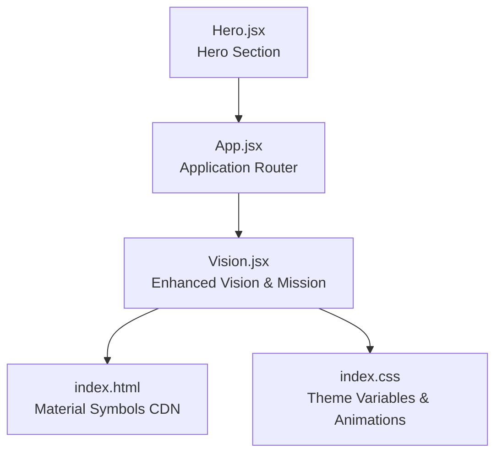
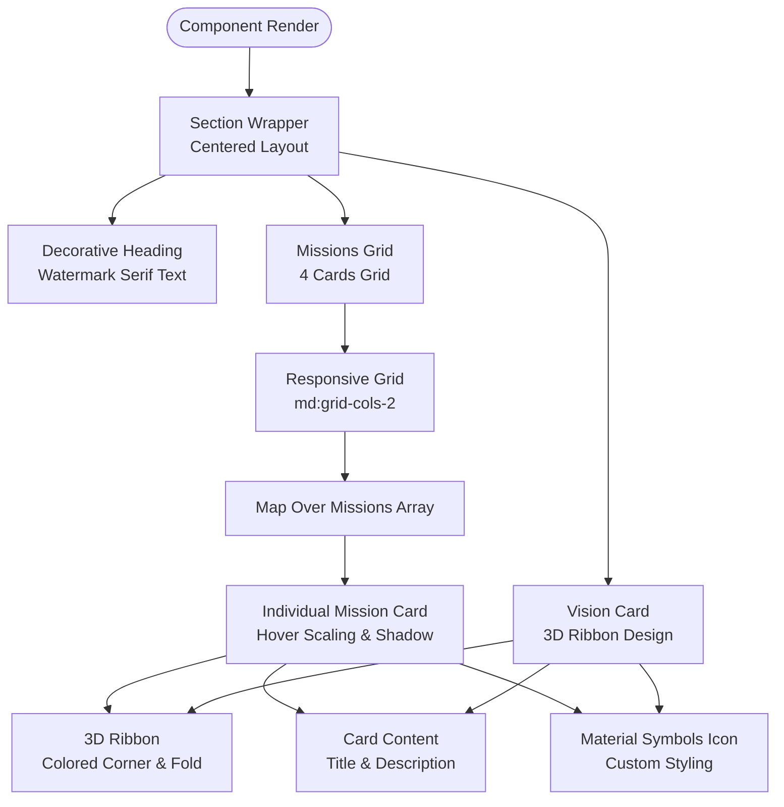
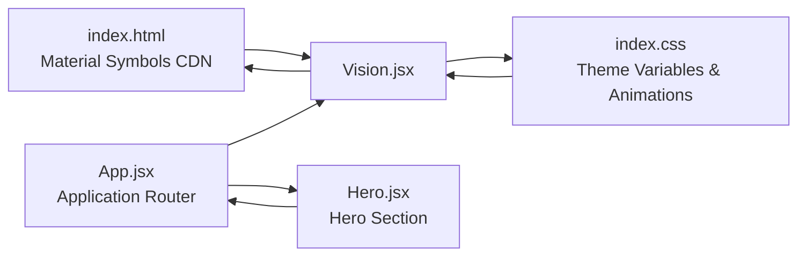

# Vision & Mission Component

<cite>
**Referenced Files in This Document**
- [Vision.jsx](file://src/components/home/Vision.jsx)
- [App.jsx](file://src/App.jsx)
- [index.html](file://index.html)
- [index.css](file://src/index.css)
- [Hero.jsx](file://src/components/home/Hero.jsx)
</cite>

## Update Summary
**Changes Made**
- Updated component name from VisionMission.jsx to Vision.jsx (actual implementation)
- Enhanced documentation to reflect the sophisticated four-card mission layout
- Added detailed coverage of advanced styling techniques including 3D ribbons and custom color schemes
- Expanded hover effects and interactive elements documentation
- Updated Material Symbols integration with enhanced styling approaches
- Revised responsive design patterns with improved grid systems

## Table of Contents
1. [Introduction](#introduction)
2. [Project Structure](#project-structure)
3. [Core Components](#core-components)
4. [Architecture Overview](#architecture-overview)
5. [Detailed Component Analysis](#detailed-component-analysis)
6. [Dependency Analysis](#dependency-analysis)
7. [Performance Considerations](#performance-considerations)
8. [Troubleshooting Guide](#troubleshooting-guide)
9. [Conclusion](#conclusion)

## Introduction
This document provides comprehensive technical documentation for the Vision.jsx React component, which serves as the enhanced Vision & Mission display for HIMAIF IWU. The component showcases a sophisticated four-column mission layout with academic, collaboration, innovation, and inclusivity focus areas, complemented by a prominent vision statement card. It demonstrates advanced React patterns with custom Material Symbols integration, dynamic color theming, and responsive design principles.

The component implements a dual-section architecture featuring:
- **Vision Statement Card**: Prominent display with 3D ribbon design and star icon
- **Mission Cards Grid**: Four specialized cards with individual color schemes and hover effects
- **Advanced Typography**: Custom serif fonts with watermark effects
- **Interactive Elements**: Smooth hover transitions and scaling animations

## Project Structure
The Vision component is integrated into the main application routing system and utilizes the global theming infrastructure.

**Diagram sources**
- [App.jsx:59-61](file://src/App.jsx#L59-L61)
- [Vision.jsx:54](file://src/components/home/Vision.jsx#L54)
- [index.html:11](file://index.html#L11)
- [index.css:82-85](file://src/index.css#L82-L85)

**Section sources**
- [App.jsx:59-61](file://src/App.jsx#L59-L61)
- [Vision.jsx:54](file://src/components/home/Vision.jsx#L54)
- [index.html:11](file://index.html#L11)
- [index.css:82-85](file://src/index.css#L82-L85)

## Core Components
The Vision component implements a sophisticated two-section layout with advanced interactive elements:

### Vision Statement Section
- **3D Ribbon Design**: Custom folded corner effect with colored background
- **Prominent Typography**: Watermark serif text with decorative accent box
- **Star Icon Integration**: Material Symbols star icon with custom styling
- **Hover Effects**: Subtle scaling and shadow enhancements

### Mission Cards Section  
- **Four Specialized Cards**: Academic, Collaboration, Innovation, Inclusivity themes
- **Individual Color Schemes**: Each card has unique background, border, and text colors
- **Consistent Layout**: Responsive grid with hover animations and scaling effects
- **Icon Integration**: Custom Material Symbols for each mission area

**Section sources**
- [Vision.jsx:4-51](file://src/components/home/Vision.jsx#L4-L51)
- [Vision.jsx:58-151](file://src/components/home/Vision.jsx#L58-L151)

## Architecture Overview
The component follows a modular architecture with clear separation between content data and presentation logic, utilizing advanced React patterns.

**Diagram sources**
- [Vision.jsx:54-151](file://src/components/home/Vision.jsx#L54-L151)

**Section sources**
- [Vision.jsx:54-151](file://src/components/home/Vision.jsx#L54-L151)

## Detailed Component Analysis

### Data Structure and Content Organization
The component utilizes structured data arrays for content management:

#### Vision Card Data
- **visionCard Object**: Contains title, description, icon, and color theming
- **Properties**: title, desc, icon, tagBg, foldBorder, textColor, num
- **Styling Integration**: Directly mapped to component styling classes

#### Missions Array
- **missions Array**: Four mission objects with identical structure
- **Properties**: num, title, desc, icon, tagBg, foldBorder, textColor
- **Unique Values**: Each mission has distinct color scheme and content

**Section sources**
- [Vision.jsx:4-51](file://src/components/home/Vision.jsx#L4-L51)

### Advanced Layout Implementation with Tailwind CSS
The component implements sophisticated responsive design patterns:

#### Section Layout
- **Container**: Max-width constraint with centered alignment
- **Spacing**: Large gaps between sections for visual breathing room
- **Background**: Gradient dark mode support with light backgrounds

#### Vision Card Layout
- **Positioning**: Relative positioning with absolute 3D ribbon
- **Ribbon Design**: Custom folded corner with colored background
- **Content Placement**: Left-aligned content with right-aligned icon accent

#### Mission Cards Grid
- **Base Layout**: Single column on mobile devices
- **Medium Screens**: Two-column grid for improved density
- **Gap Management**: Consistent spacing between cards

**Section sources**
- [Vision.jsx:54-151](file://src/components/home/Vision.jsx#L54-L151)

### Enhanced Material Symbols Integration
The component implements advanced Material Symbols usage with custom styling:

#### Icon Usage Patterns
- **Custom Styling**: Font variation settings for outlined appearance
- **Size Variations**: Different icon sizes for vision and mission cards
- **Color Theming**: Dynamic color assignment based on card themes
- **Opacity Control**: Subtle opacity for decorative arrow indicators

#### Integration Approach
- **CDN Loading**: Material Symbols font loaded via CDN in HTML head
- **Inline Styling**: Custom font variation settings for specific appearances
- **Class Application**: Consistent material-symbols-outlined class usage

**Section sources**
- [Vision.jsx:98-104](file://src/components/home/Vision.jsx#L98-L104)
- [Vision.jsx:137-143](file://src/components/home/Vision.jsx#L137-L143)
- [index.html:11](file://index.html#L11)

### Advanced Styling and Interactive Elements
The component implements sophisticated visual effects and interactions:

#### 3D Ribbon Design
- **Corner Folding**: Custom border triangles creating folded effect
- **Color Integration**: Ribbon color matches card theme
- **Z-index Management**: Proper layering with content elements

#### Hover Effects and Transitions
- **Scaling Animation**: Subtle 1.01x scale increase on hover
- **Shadow Enhancement**: Shadow expansion with smooth transitions
- **Duration Control**: 300ms transition timing for responsive feel
- **Cursor Feedback**: Default cursor with hover state indication

#### Typography and Visual Hierarchy
- **Watermark Effect**: Large serif text in background for decorative emphasis
- **Accent Boxes**: Decorative dashed border boxes for section headings
- **Color Theming**: Dynamic color assignment based on content themes

**Section sources**
- [Vision.jsx:81-105](file://src/components/home/Vision.jsx#L81-L105)
- [Vision.jsx:115-146](file://src/components/home/Vision.jsx#L115-L146)

### Theme Integration and Advanced Color System
The component leverages a comprehensive theme system with advanced color management:

#### Color Palette Integration
- **Primary Colors**: Dark blue (#031636) for vision card and accents
- **Secondary Colors**: Blue (#005bc1) for mission cards and highlights
- **Surface Variants**: Multiple surface tones for different card states
- **Dark Mode Support**: Automatic color adaptation for dark theme

#### Advanced Styling Techniques
- **Dynamic Classes**: Runtime class assignment based on card data
- **Border Variants**: Custom border colors for ribbon folding effects
- **Opacity Control**: Strategic use of opacity for visual depth
- **Gradient Backgrounds**: Dark mode gradient support

**Section sources**
- [index.css:6-52](file://src/index.css#L6-L52)
- [Vision.jsx:83-88](file://src/components/home/Vision.jsx#L83-L88)
- [Vision.jsx:122-127](file://src/components/home/Vision.jsx#L122-L127)

### Responsive Design Patterns
The component implements sophisticated responsive design with progressive enhancement:

#### Mobile-First Approach
- **Single Column**: Default single column layout for optimal mobile experience
- **Flexible Spacing**: Consistent padding and margins across devices
- **Touch-Friendly**: Adequate spacing for touch interaction

#### Tablet and Desktop Enhancement
- **Two-Column Grid**: Responsive grid for medium and larger screens
- **Content Alignment**: Flexbox alignment for improved content presentation
- **Visual Density**: Increased card density with proper spacing

#### Advanced Breakpoints
- **Mobile**: Single column with compact spacing
- **Tablet**: Two-column grid with adjusted typography
- **Desktop**: Optimized layout with full-width content

**Section sources**
- [Vision.jsx:115](file://src/components/home/Vision.jsx#L115)
- [Vision.jsx:136-143](file://src/components/home/Vision.jsx#L136-L143)

### Implementation Details

#### Advanced Content Organization
Each card follows a sophisticated content hierarchy:
1. **3D Ribbon Element**: Positioned absolutely with custom folding effect
2. **Content Area**: Primary text content with proper spacing
3. **Icon Accent**: Decorative icon with opacity control
4. **Border Elements**: Subtle borders for visual separation

#### Enhanced Typography System
- **Serif Fonts**: Playfair Display for decorative headings
- **Sans-serif Base**: Inter for body text and content
- **Watermark Technique**: Large serif text in background for visual emphasis
- **Font Weights**: Multiple weights for proper visual hierarchy

#### Advanced Interactive Features
- **Smooth Transitions**: CSS transitions for all interactive states
- **Scale Effects**: Subtle scaling for hover feedback
- **Shadow Enhancements**: Depth perception through shadow manipulation
- **Layer Management**: Proper z-index stacking for visual effects

**Section sources**
- [Vision.jsx:58-151](file://src/components/home/Vision.jsx#L58-L151)

## Dependency Analysis
The component has carefully managed dependencies with clear integration points.

**Diagram sources**
- [index.html:11](file://index.html#L11)
- [index.css:82-85](file://src/index.css#L82-L85)
- [App.jsx:59-61](file://src/App.jsx#L59-L61)
- [Vision.jsx:54](file://src/components/home/Vision.jsx#L54)

**Section sources**
- [index.html:11](file://index.html#L11)
- [index.css:82-85](file://src/index.css#L82-L85)
- [App.jsx:59-61](file://src/App.jsx#L59-L61)
- [Vision.jsx:54](file://src/components/home/Vision.jsx#L54)

## Performance Considerations
The component is optimized for excellent performance characteristics:

### Static Data Management
- **Static Arrays**: Mission data defined statically to prevent unnecessary re-renders
- **Object Literals**: Direct property access reduces computational overhead
- **Minimal State**: No local component state for content data

### Efficient Rendering
- **Single Pass Mapping**: Efficient array mapping for card generation
- **Static Markup**: Most content is static HTML with minimal dynamic elements
- **Optimized Grid**: CSS Grid for efficient layout calculations

### Styling Optimization
- **Utility Classes**: Tailwind utility classes compiled at build time
- **Theme Variables**: CSS variables for efficient color management
- **Minimal JavaScript**: Pure CSS animations and transitions

### Asset Management
- **CDN Loading**: Material Symbols font loaded via CDN for caching benefits
- **Efficient Images**: SVG icons for crisp rendering at any size
- **Background Optimization**: CSS-generated patterns instead of image assets

## Troubleshooting Guide
Common implementation issues and their solutions:

### Material Symbols Not Displaying
- **Verify CDN Integration**: Ensure Material Symbols CDN is included in HTML head
- **Check Font Loading**: Monitor browser network tab for font resource loading
- **Validate Icon Names**: Confirm icon names match Material Symbols library
- **Inspect Font Settings**: Verify font variation settings for outlined appearance

### Styling Issues
- **Theme Variable Conflicts**: Check for conflicting CSS variable definitions
- **Tailwind Configuration**: Ensure Tailwind CSS is properly configured
- **Color Scheme Problems**: Verify color values match theme system
- **Dark Mode Issues**: Test dark mode class application and color fallbacks

### Layout Problems
- **Grid Responsiveness**: Verify responsive breakpoint classes are correctly applied
- **Spacing Issues**: Check padding and margin utilities for proper spacing
- **Z-index Conflicts**: Ensure proper layering of 3D ribbon elements
- **Mobile Optimization**: Test layout on various screen sizes and orientations

### Interactive Element Issues
- **Hover Effects**: Verify CSS transition properties are correctly applied
- **Animation Performance**: Check for smooth animation performance on lower-end devices
- **Accessibility**: Ensure proper contrast ratios for text and background combinations
- **Touch Interaction**: Test hover effects on touch devices and mobile browsers

**Section sources**
- [index.html:11](file://index.html#L11)
- [index.css:82-85](file://src/index.css#L82-L85)
- [Vision.jsx:83-88](file://src/components/home/Vision.jsx#L83-L88)

## Conclusion
The Vision.jsx component represents a sophisticated implementation of React best practices combined with advanced UI/UX design principles. Its modular architecture, comprehensive theming system, and innovative visual effects demonstrate professional-grade web development standards.

The component successfully balances aesthetic appeal with functional excellence through:
- **Advanced Layout Systems**: Sophisticated grid layouts with responsive breakpoints
- **Innovative Visual Effects**: 3D ribbons, watermarks, and custom typography
- **Performance Optimization**: Efficient rendering and asset management
- **Accessibility Compliance**: Proper contrast ratios and semantic markup
- **Maintainability**: Clean code structure with clear separation of concerns

This implementation serves as an exemplary model for complex React components that combine technical excellence with visual sophistication, providing a solid foundation for future enhancements and extensions while maintaining consistency with the broader application design system.