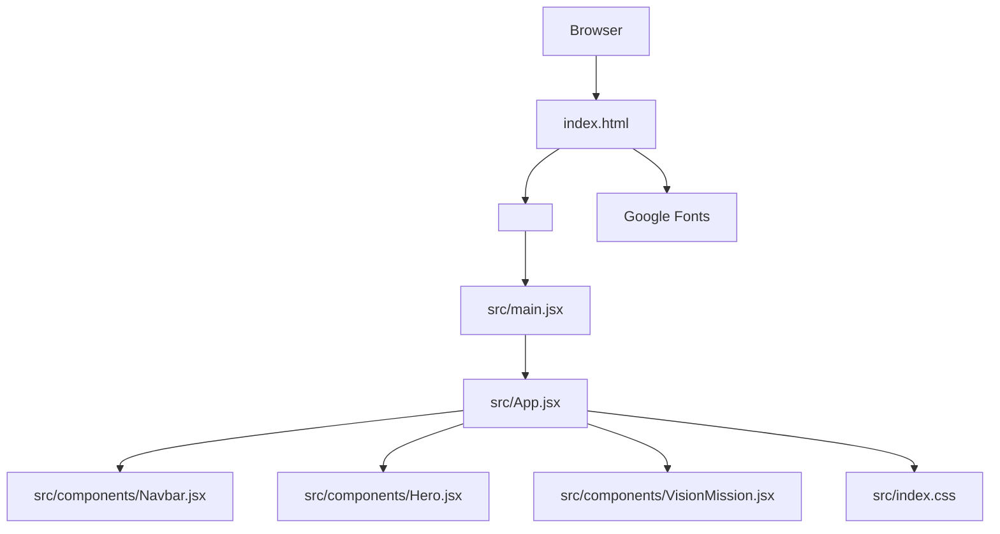
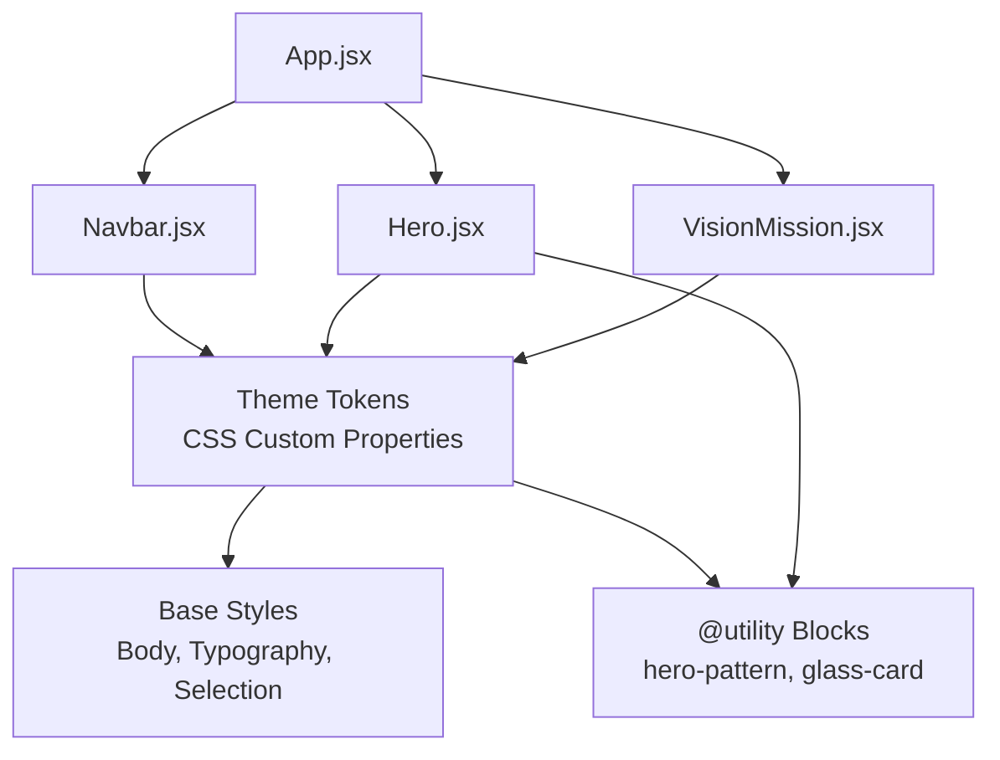
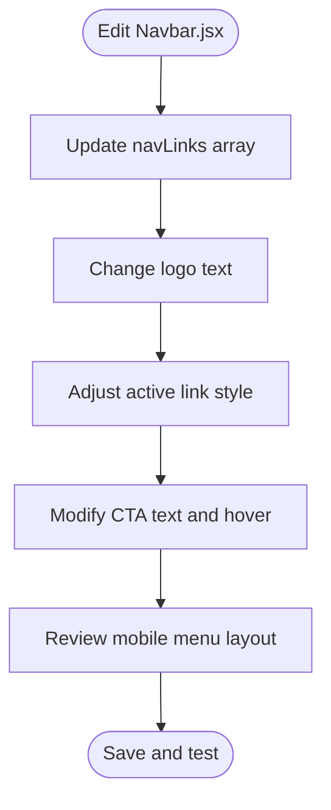
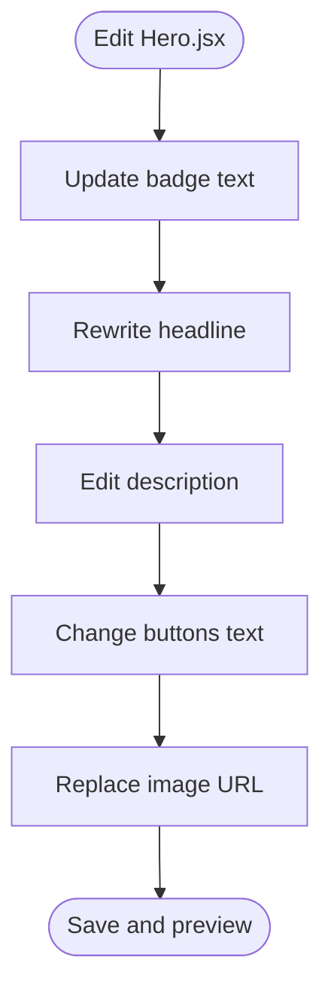
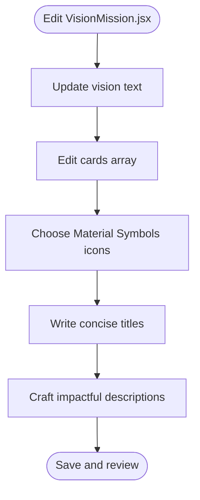
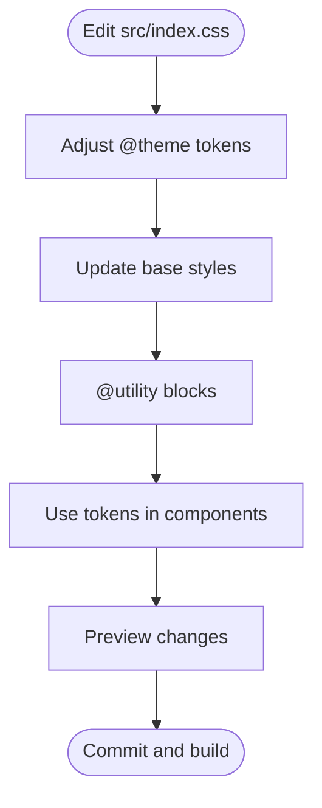
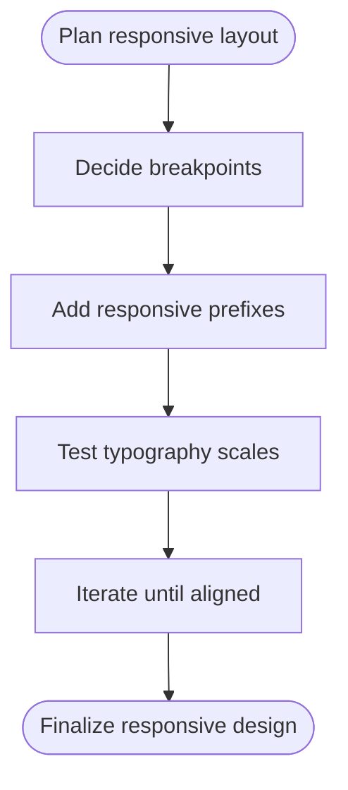
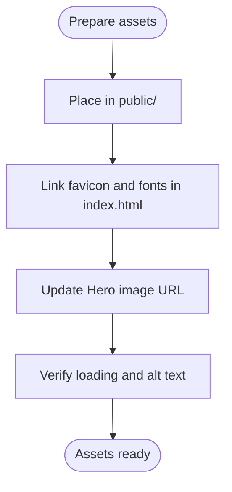
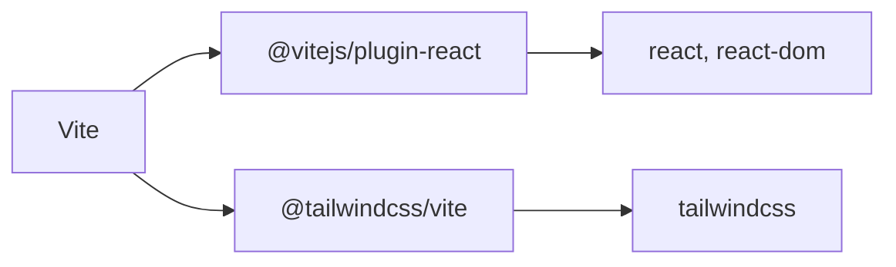

# Customization Guide

<cite>
**Referenced Files in This Document**
- [README.md](file://README.md)
- [package.json](file://package.json)
- [vite.config.js](file://vite.config.js)
- [index.html](file://index.html)
- [src/index.css](file://src/index.css)
- [src/main.jsx](file://src/main.jsx)
- [src/App.jsx](file://src/App.jsx)
- [src/components/Navbar.jsx](file://src/components/Navbar.jsx)
- [src/components/Hero.jsx](file://src/components/Hero.jsx)
- [src/components/VisionMission.jsx](file://src/components/VisionMission.jsx)
</cite>

## Table of Contents
1. [Introduction](#introduction)
2. [Project Structure](#project-structure)
3. [Core Components](#core-components)
4. [Architecture Overview](#architecture-overview)
5. [Detailed Component Analysis](#detailed-component-analysis)
6. [Dependency Analysis](#dependency-analysis)
7. [Performance Considerations](#performance-considerations)
8. [Troubleshooting Guide](#troubleshooting-guide)
9. [Conclusion](#conclusion)
10. [Appendices](#appendices)

## Introduction
This guide explains how to customize the HIMA Web project for different organizations or use cases. It covers modifying content (vision/mission statements, navigation links, hero section text), adjusting branding and styling via CSS custom properties and Tailwind utilities, managing assets (logos and images), and adapting typography and themes. It also provides step-by-step customization scenarios and best practices to keep your changes intact during updates.

## Project Structure
The project is a React + Vite application with Tailwind CSS v4. The runtime entry renders the root App component, which composes three primary UI components: Navbar, Hero, and VisionMission. Styling is centralized in a single CSS file that defines theme tokens, base styles, and utility classes. Assets are served from the public folder, while fonts are loaded via Google Fonts in the HTML head.

**Diagram sources**
- [index.html:1-18](file://index.html#L1-L18)
- [src/main.jsx:1-11](file://src/main.jsx#L1-L11)
- [src/App.jsx:1-18](file://src/App.jsx#L1-L18)
- [src/components/Navbar.jsx:1-79](file://src/components/Navbar.jsx#L1-L79)
- [src/components/Hero.jsx:1-57](file://src/components/Hero.jsx#L1-L57)
- [src/components/VisionMission.jsx:1-68](file://src/components/VisionMission.jsx#L1-L68)
- [src/index.css:1-206](file://src/index.css#L1-L206)

**Section sources**
- [README.md:1-17](file://README.md#L1-L17)
- [package.json:1-30](file://package.json#L1-L30)
- [vite.config.js:1-9](file://vite.config.js#L1-L9)
- [index.html:1-18](file://index.html#L1-L18)
- [src/main.jsx:1-11](file://src/main.jsx#L1-L11)
- [src/App.jsx:1-18](file://src/App.jsx#L1-L18)
- [src/index.css:1-206](file://src/index.css#L1-L206)

## Core Components
- Navbar: Fixed header with logo, desktop links, mobile menu, and call-to-action button. Navigation links and CTA text are defined in the component.
- Hero: Full-height hero section with headline, tagline, two CTAs, and a right-side image area. Background color and text colors are applied via Tailwind classes bound to theme tokens.
- VisionMission: Two-column layout featuring a vision statement on the left and four mission cards on the right. Content is defined in the component’s data array.

Key customization touchpoints:
- Content: Modify text and links inside Navbar.jsx, Hero.jsx, and VisionMission.jsx.
- Branding: Adjust logo text and colors; align with theme tokens in src/index.css.
- Styling: Use CSS custom properties and Tailwind utilities defined in src/index.css.
- Assets: Replace images and favicon in the public directory; ensure correct URLs.

**Section sources**
- [src/components/Navbar.jsx:1-79](file://src/components/Navbar.jsx#L1-L79)
- [src/components/Hero.jsx:1-57](file://src/components/Hero.jsx#L1-L57)
- [src/components/VisionMission.jsx:1-68](file://src/components/VisionMission.jsx#L1-L68)
- [src/index.css:1-206](file://src/index.css#L1-L206)

## Architecture Overview
The customization architecture centers on three pillars:
- Theme tokens: Centralized color and typography tokens in CSS enable consistent theming across components.
- Utility classes: Tailwind utilities and custom @utility blocks in CSS apply consistent spacing, effects, and backgrounds.
- Component composition: App.jsx orchestrates Navbar, Hero, and VisionMission, allowing targeted overrides per section.

**Diagram sources**
- [src/index.css:1-206](file://src/index.css#L1-L206)
- [src/App.jsx:1-18](file://src/App.jsx#L1-L18)
- [src/components/Navbar.jsx:1-79](file://src/components/Navbar.jsx#L1-L79)
- [src/components/Hero.jsx:1-57](file://src/components/Hero.jsx#L1-L57)
- [src/components/VisionMission.jsx:1-68](file://src/components/VisionMission.jsx#L1-L68)

## Detailed Component Analysis

### Navbar Customization
- Navigation links: Edit the navLinks array to change labels, URLs, or add/remove entries.
- Logo: Update the anchor text to reflect your organization’s name.
- Active link style: The first link uses a distinct style; adjust or remove as needed.
- Call-to-action: Change the CTA text and hover effect.
- Mobile menu: Customize the list rendering and spacing.

**Diagram sources**
- [src/components/Navbar.jsx:1-79](file://src/components/Navbar.jsx#L1-L79)

**Section sources**
- [src/components/Navbar.jsx:1-79](file://src/components/Navbar.jsx#L1-L79)

### Hero Section Customization
- Tagline badge: Update the inline badge text and styling.
- Headline: Modify the main headline and accent spans.
- Description: Rewrite the paragraph under the headline.
- Buttons: Change CTA text and hover effects.
- Image: Replace the image URL with your own asset; ensure aspect ratio and blur effect remain visually balanced.

**Diagram sources**
- [src/components/Hero.jsx:1-57](file://src/components/Hero.jsx#L1-L57)

**Section sources**
- [src/components/Hero.jsx:1-57](file://src/components/Hero.jsx#L1-L57)

### VisionMission Content Customization
- Vision text: Update the vision paragraph on the left.
- Mission cards: Modify the cards array to change icons, titles, and descriptions.

**Diagram sources**
- [src/components/VisionMission.jsx:1-68](file://src/components/VisionMission.jsx#L1-L68)

**Section sources**
- [src/components/VisionMission.jsx:1-68](file://src/components/VisionMission.jsx#L1-L68)

### Styling and Theming
- Theme tokens: Adjust color tokens in the @theme block to change primary, secondary, surface, and text palettes.
- Base styles: Update body, selection, and typography defaults.
- Utilities: Extend or override @utility blocks for backgrounds and glass effects.
- Component-level classes: Use Tailwind utilities bound to theme tokens (e.g., text colors, backgrounds) to maintain consistency.

**Diagram sources**
- [src/index.css:1-206](file://src/index.css#L1-L206)

**Section sources**
- [src/index.css:1-206](file://src/index.css#L1-L206)

### Responsive Design Adjustments
- Breakpoints: Use Tailwind’s responsive prefixes (e.g., md:, lg:) to adapt layouts for mobile and desktop.
- Typography scaling: Adjust heading sizes and margins at different viewport widths.
- Component grids: Switch from single-column to multi-column layouts at breakpoints.

**Section sources**
- [src/index.css:170-187](file://src/index.css#L170-L187)
- [src/components/Hero.jsx:7-54](file://src/components/Hero.jsx#L7-L54)
- [src/components/VisionMission.jsx:30-66](file://src/components/VisionMission.jsx#L30-L66)

### Asset Management
- Logos and favicon: Place SVG/PNG assets in the public directory and reference them from index.html or components.
- Hero image: Replace the image URL in Hero.jsx with your asset; ensure accessibility alt text remains meaningful.
- Fonts: Keep Inter and Material Symbols linked in index.html; swap families if desired.

**Diagram sources**
- [index.html:5-11](file://index.html#L5-L11)
- [src/components/Hero.jsx:45-50](file://src/components/Hero.jsx#L45-L50)

**Section sources**
- [index.html:5-11](file://index.html#L5-L11)
- [src/components/Hero.jsx:45-50](file://src/components/Hero.jsx#L45-L50)

## Dependency Analysis
The app depends on React, React DOM, Tailwind CSS v4, and the Tailwind plugin for Vite. Build-time, Vite compiles JSX and CSS, applying Tailwind utilities and theme tokens.

**Diagram sources**
- [package.json:12-27](file://package.json#L12-L27)
- [vite.config.js:1-9](file://vite.config.js#L1-L9)

**Section sources**
- [package.json:12-27](file://package.json#L12-L27)
- [vite.config.js:1-9](file://vite.config.js#L1-L9)

## Performance Considerations
- Keep images optimized and appropriately sized; lazy-load where possible.
- Minimize heavy background effects (e.g., blur radius) to avoid layout thrashing.
- Prefer CSS custom properties for theming to reduce repeated utility classes.
- Use responsive prefixes judiciously to avoid excessive media queries.

## Troubleshooting Guide
- Favicon or font not loading: Verify paths in index.html and ensure assets are served from public/.
- Theme not applying: Confirm Tailwind directives and custom properties are present in src/index.css.
- Mobile menu not toggling: Inspect event handlers and conditional rendering in Navbar.jsx.
- Hero image missing: Ensure the image URL is reachable and alt text is descriptive.

**Section sources**
- [index.html:5-11](file://index.html#L5-L11)
- [src/index.css:1-206](file://src/index.css#L1-L206)
- [src/components/Navbar.jsx:11-79](file://src/components/Navbar.jsx#L11-L79)
- [src/components/Hero.jsx:45-50](file://src/components/Hero.jsx#L45-L50)

## Conclusion
Customizing HIMA Web involves updating content in Navbar.jsx, Hero.jsx, and VisionMission.jsx, aligning brand identity with theme tokens in src/index.css, and managing assets in the public directory. By leveraging Tailwind utilities and responsive prefixes, you can tailor the site to diverse organizations while preserving a clean, maintainable structure.

## Appendices

### Step-by-Step Customization Scenarios

- Change Organization Name and Navigation
  1. Open Navbar.jsx.
  2. Update the logo text to your organization name.
  3. Modify the navLinks array to reflect your pages.
  4. Save and preview.

  **Section sources**
  - [src/components/Navbar.jsx:18-23](file://src/components/Navbar.jsx#L18-L23)
  - [src/components/Navbar.jsx:3-9](file://src/components/Navbar.jsx#L3-L9)

- Update Hero Headline and Description
  1. Open Hero.jsx.
  2. Edit the badge text, headline, and description.
  3. Replace the image URL with your asset.
  4. Save and preview.

  **Section sources**
  - [src/components/Hero.jsx:10-25](file://src/components/Hero.jsx#L10-L25)
  - [src/components/Hero.jsx:45-50](file://src/components/Hero.jsx#L45-L50)

- Customize Vision and Mission Cards
  1. Open VisionMission.jsx.
  2. Update the vision paragraph.
  3. Edit the cards array to change icons, titles, and descriptions.
  4. Save and preview.

  **Section sources**
  - [src/components/VisionMission.jsx:37-41](file://src/components/VisionMission.jsx#L37-L41)
  - [src/components/VisionMission.jsx:1-26](file://src/components/VisionMission.jsx#L1-L26)

- Adjust Theme Colors and Typography
  1. Open src/index.css.
  2. Modify @theme tokens for primary/secondary/surface colors.
  3. Update base font family and selection colors.
  4. Save and rebuild.

  **Section sources**
  - [src/index.css:3-65](file://src/index.css#L3-L65)
  - [src/index.css:67-79](file://src/index.css#L67-L79)

- Add a New Navigation Link
  1. Open Navbar.jsx.
  2. Add a new object to the navLinks array with label and href.
  3. Optionally adjust active link style.
  4. Save and preview.

  **Section sources**
  - [src/components/Navbar.jsx:3-9](file://src/components/Navbar.jsx#L3-L9)
  - [src/components/Navbar.jsx:26-40](file://src/components/Navbar.jsx#L26-L40)

- Replace Hero Image
  1. Upload your image to the public directory.
  2. Open Hero.jsx.
  3. Update the src attribute to your asset path.
  4. Save and preview.

  **Section sources**
  - [src/components/Hero.jsx:45-50](file://src/components/Hero.jsx#L45-L50)

- Update Favicon and Fonts
  1. Place your favicon in public/ and update index.html.
  2. Keep Inter and Material Symbols linked or replace with your preferred fonts.
  3. Save and refresh.

  **Section sources**
  - [index.html:5-11](file://index.html#L5-L11)

### Best Practices for Maintaining Customizations During Updates
- Version control: Commit all customizations separately from framework updates.
- Token-first theming: Prefer changing theme tokens over hardcoding colors in components.
- Component boundaries: Keep content changes localized to their respective components.
- Asset hygiene: Store all images in public/ and reference them by path; avoid bundling large assets.
- Incremental testing: After updates, test responsive breakpoints, theme tokens, and navigation links.