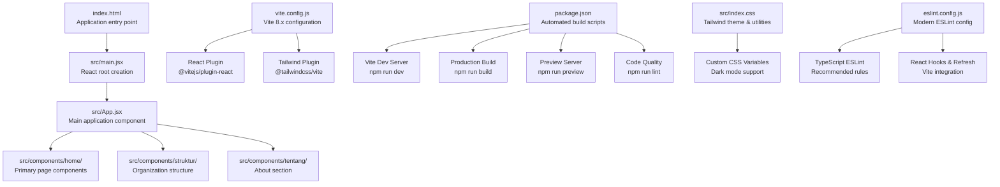
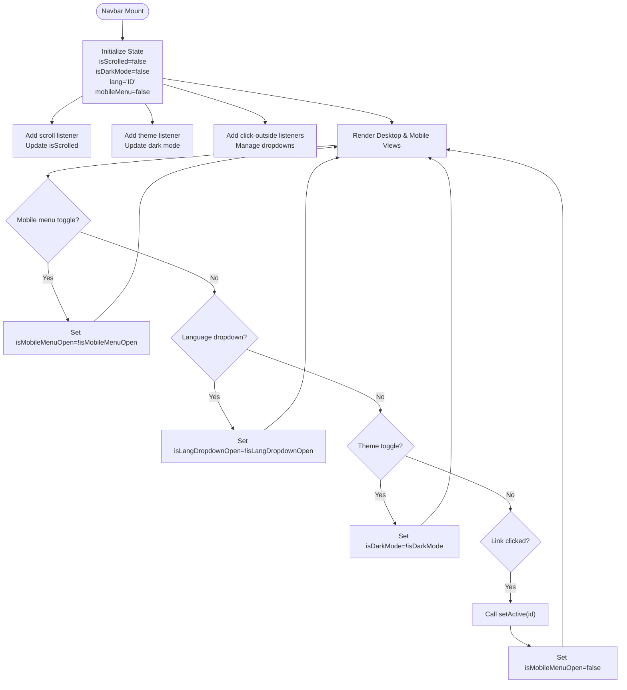
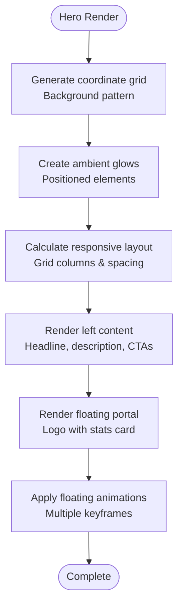
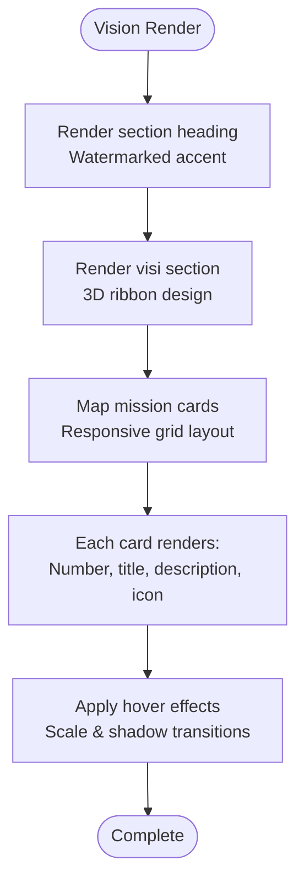
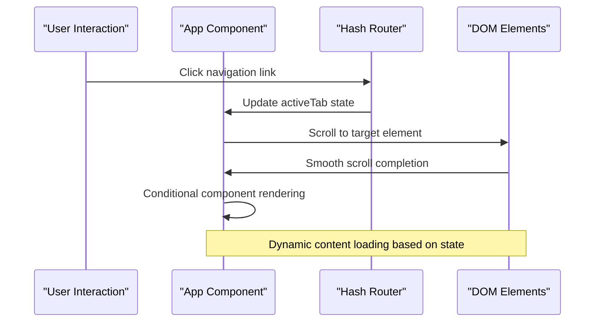

# Development Workflow

<cite>
**Referenced Files in This Document**
- [package.json](file://package.json)
- [vite.config.js](file://vite.config.js)
- [eslint.config.js](file://eslint.config.js)
- [index.html](file://index.html)
- [src/main.jsx](file://src/main.jsx)
- [src/App.jsx](file://src/App.jsx)
- [src/index.css](file://src/index.css)
- [src/components/home/Navbar.jsx](file://src/components/home/Navbar.jsx)
- [src/components/home/Hero.jsx](file://src/components/home/Hero.jsx)
- [src/components/home/Vision.jsx](file://src/components/home/Vision.jsx)
- [src/components/struktur/index.jsx](file://src/components/struktur/index.jsx)
- [src/components/tentang/index.jsx](file://src/components/tentang/index.jsx)
- [.gitignore](file://.gitignore)
</cite>

## Update Summary
**Changes Made**
- Updated Vite configuration to reflect modern Vite 8.x setup with React and Tailwind plugins
- Enhanced ESLint configuration with TypeScript ESLint integration and modern JavaScript standards
- Expanded component analysis to include new structure and about pages
- Updated build process documentation to reflect automated build pipelines
- Added comprehensive dependency management documentation
- Enhanced troubleshooting guide with modern development tooling issues

## Table of Contents
1. [Introduction](#introduction)
2. [Project Structure](#project-structure)
3. [Core Components](#core-components)
4. [Architecture Overview](#architecture-overview)
5. [Detailed Component Analysis](#detailed-component-analysis)
6. [Development Tooling](#development-tooling)
7. [Build Process](#build-process)
8. [Code Quality and Standards](#code-quality-and-standards)
9. [Performance Considerations](#performance-considerations)
10. [Troubleshooting Guide](#troubleshooting-guide)
11. [Deployment Pipeline](#deployment-pipeline)
12. [Best Practices](#best-practices)
13. [Conclusion](#conclusion)

## Introduction
This document describes the comprehensive development workflow for the HIMA Web project, featuring a modern Vite-based build system with React 19, TypeScript ESLint integration, and TailwindCSS styling. The project implements automated build processes, dependency management through package.json, and follows modern JavaScript linting standards with comprehensive code quality enforcement.

The development environment utilizes Vite's fast development server with hot module replacement (HMR), automated build optimization, and production-ready asset generation. ESLint configuration extends recommended rules for JavaScript/TypeScript with React hooks and refresh support, ensuring consistent code quality across the codebase.

## Project Structure
The project follows a modern React + Vite + TailwindCSS architecture with a comprehensive component organization strategy. The structure includes dedicated folders for different page sections, with components organized by feature domains.

**Diagram sources**
- [index.html:13-16](file://index.html#L13-L16)
- [src/main.jsx:1-11](file://src/main.jsx#L1-L11)
- [src/App.jsx:1-82](file://src/App.jsx#L1-L82)
- [vite.config.js:1-12](file://vite.config.js#L1-L12)
- [package.json:6-11](file://package.json#L6-L11)
- [src/index.css:1-147](file://src/index.css#L1-L147)
- [eslint.config.js:1-23](file://eslint.config.js#L1-L23)

**Section sources**
- [index.html:1-18](file://index.html#L1-L18)
- [src/main.jsx:1-11](file://src/main.jsx#L1-L11)
- [src/App.jsx:1-82](file://src/App.jsx#L1-L82)
- [vite.config.js:1-12](file://vite.config.js#L1-L12)
- [package.json:1-30](file://package.json#L1-L30)
- [.gitignore:1-27](file://.gitignore#L1-L27)

## Core Components
The application is structured around a sophisticated routing system using URL hash fragments, enabling seamless navigation between different sections without full page reloads.

### Application Entry and Rendering
- **HTML Entry Point**: Defines the mount target and loads the module script with proper meta tags and fonts
- **React Root Creation**: Implements StrictMode wrapper for enhanced error detection
- **Global Styling**: Imports Tailwind CSS and custom theme variables

### Main Application Architecture
- **Hash-Based Routing**: Implements useEffect hooks to track URL hash changes and manage active sections
- **Dynamic Content Loading**: Conditionally renders different page components based on active tab
- **Smooth Scrolling**: Automatic scrolling to target sections with smooth behavior

### Component Library Organization
- **Navigation System**: Comprehensive Navbar with mobile responsiveness, dark mode toggle, and language selector
- **Hero Section**: Feature-rich hero component with animated elements and interactive floating portal
- **Vision & Mission**: Structured presentation of organizational vision and mission statements
- **Structure Components**: Complete organizational hierarchy visualization
- **About Section**: Multi-page about section with hero, welcome message, and program information

**Section sources**
- [index.html:13-16](file://index.html#L13-L16)
- [src/main.jsx:1-11](file://src/main.jsx#L1-L11)
- [src/App.jsx:13-82](file://src/App.jsx#L13-L82)
- [src/components/home/Navbar.jsx:1-281](file://src/components/home/Navbar.jsx#L1-L281)
- [src/components/home/Hero.jsx:1-113](file://src/components/home/Hero.jsx#L1-L113)
- [src/components/home/Vision.jsx:1-154](file://src/components/home/Vision.jsx#L1-L154)
- [src/components/struktur/index.jsx:1-48](file://src/components/struktur/index.jsx#L1-L48)
- [src/components/tentang/index.jsx:1-15](file://src/components/tentang/index.jsx#L1-L15)

## Architecture Overview
The runtime architecture implements a modern single-page application with sophisticated client-side routing and dynamic content loading. The system leverages Vite's development server for rapid iteration and optimized production builds.

```mermaid
graph TB
subgraph "Runtime Architecture"
A["React 19<br/>src/App.jsx"] --> B["Hash Router<br/>useEffect tracking"]
A --> C["Dynamic Components<br/>Conditional rendering"]
A --> D["State Management<br/>useState hooks"]
end
subgraph "Component Layer"
E["Navbar<br/>src/components/home/Navbar.jsx"] --> F["Mobile Menu<br/>Responsive design"]
E --> G["Dark Mode<br/>Theme toggle"]
E --> H["Language Selector<br/>Multi-language support"]
I["Hero Section<br/>src/components/home/Hero.jsx"] --> J["Animated Elements<br/>Floating animations"]
I --> K["Interactive Portal<br/>Visual hierarchy"]
L["Vision & Mission<br/>src/components/home/Vision.jsx"] --> M["Card Grid<br/>Responsive layout"]
L --> N["Icon System<br/>Material Symbols"]
end
subgraph "Build & Development"
O["Vite 8.x<br/>vite.config.js"] --> P["React Plugin<br/>@vitejs/plugin-react"]
O --> Q["Tailwind Plugin<br/>@tailwindcss/vite"]
R["ESLint Config<br/>eslint.config.js"] --> S["TypeScript ESLint<br/>Modern standards"]
T["Package Scripts<br/>package.json"] --> U["Dev Server<br/>npm run dev"]
T --> V["Build Process<br/>npm run build"]
T --> W["Preview Server<br/>npm run preview"]
T --> X["Code Quality<br/>npm run lint"]
end
subgraph "Styling System"
Y["Tailwind CSS<br/>src/index.css"] --> Z["Custom Theme<br/>CSS variables"]
Y --> AA["Dark Mode<br/>Class-based switching"]
Y --> AB["Animation System<br/>Keyframes & transforms"]
end
A --> O
E --> Y
I --> Y
L --> Y
R --> O
```

**Diagram sources**
- [src/App.jsx:13-82](file://src/App.jsx#L13-L82)
- [src/components/home/Navbar.jsx:1-281](file://src/components/home/Navbar.jsx#L1-L281)
- [src/components/home/Hero.jsx:1-113](file://src/components/home/Hero.jsx#L1-L113)
- [src/components/home/Vision.jsx:1-154](file://src/components/home/Vision.jsx#L1-L154)
- [vite.config.js:1-12](file://vite.config.js#L1-L12)
- [eslint.config.js:1-23](file://eslint.config.js#L1-L23)
- [package.json:6-11](file://package.json#L6-L11)
- [src/index.css:1-147](file://src/index.css#L1-L147)

## Detailed Component Analysis

### Advanced Navigation System
The Navbar component implements a sophisticated navigation system with multiple layers of functionality:

**Core Responsibilities:**
- Fixed position header with dynamic styling based on scroll position
- Mobile-responsive design with hamburger menu and backdrop blur effects
- Dark mode toggle with persistent theme preference
- Multi-language support with dropdown selectors
- Social media integration with brand-specific styling

**Advanced Features:**
- Click-outside detection for dropdown menus using useRef and event listeners
- Scroll-aware styling with transition effects
- Animated mobile menu with fade-in animations
- Persistent theme switching using document class manipulation
- Comprehensive accessibility support with ARIA labels

**Diagram sources**
- [src/components/home/Navbar.jsx:16-45](file://src/components/home/Navbar.jsx#L16-L45)
- [src/components/home/Navbar.jsx:47-62](file://src/components/home/Navbar.jsx#L47-L62)

**Section sources**
- [src/components/home/Navbar.jsx:1-281](file://src/components/home/Navbar.jsx#L1-L281)

### Feature-Rich Hero Component
The Hero component showcases advanced animation techniques and responsive design patterns:

**Design Elements:**
- Coordinate grid background with alternating light/dark modes
- Ambient glow effects using blurred gradient backgrounds
- Floating animation system with multiple keyframe variations
- Interactive floating portal with dashed border guides
- Responsive grid layout adapting from single to dual-column

**Technical Implementation:**
- Dynamic background images using inline styles
- CSS custom properties for theme-based color switching
- Material Symbols integration for consistent iconography
- Backdrop blur effects with mobile-friendly alternatives
- Smooth scroll behavior for navigation

**Diagram sources**
- [src/components/home/Hero.jsx:11-31](file://src/components/home/Hero.jsx#L11-L31)
- [src/components/home/Hero.jsx:78-107](file://src/components/home/Hero.jsx#L78-L107)

**Section sources**
- [src/components/home/Hero.jsx:1-113](file://src/components/home/Hero.jsx#L1-L113)

### Comprehensive Vision & Mission Presentation
The Vision component implements a sophisticated card-based layout system:

**Content Structure:**
- Dedicated visi section with prominent 3D ribbon design
- Four mission cards arranged in responsive grid layout
- Custom color schemes per card with consistent theming
- Material Symbols integration for visual accents

**Design Features:**
- 3D ribbon elements with fold borders and color coding
- Hover effects with scaling and shadow enhancements
- Responsive typography with consistent spacing
- Dark mode compatible color schemes
- Interactive elements with smooth transitions

**Diagram sources**
- [src/components/home/Vision.jsx:58-69](file://src/components/home/Vision.jsx#L58-L69)
- [src/components/home/Vision.jsx:115-146](file://src/components/home/Vision.jsx#L115-L146)

**Section sources**
- [src/components/home/Vision.jsx:1-154](file://src/components/home/Vision.jsx#L1-L154)

### Dynamic Page Composition
The main App component demonstrates advanced React patterns with sophisticated routing:

**Routing Logic:**
- Hash-based navigation system with automatic URL synchronization
- Smooth scrolling to target sections with conditional behavior
- Initial hash parsing for direct page access
- Cleanup of event listeners for memory management

**Content Management:**
- Conditional rendering based on active tab state
- Dynamic component switching between home and specialized pages
- Proper scroll restoration for different page types
- Container-based layout with navbar padding compensation

**Diagram sources**
- [src/App.jsx:16-44](file://src/App.jsx#L16-L44)

**Section sources**
- [src/App.jsx:13-82](file://src/App.jsx#L13-L82)

## Development Tooling
The project leverages modern development tooling with comprehensive automation and quality assurance systems.

### Vite Configuration
**Core Plugins:**
- **React Plugin**: JSX transform, HMR, and React Refresh integration
- **Tailwind Plugin**: CSS processing with PurgeCSS optimization
- **Modern Configuration**: Flat config format with explicit plugin declarations

**Development Features:**
- Fast development server with instant module hot-swapping
- Optimized build pipeline with tree-shaking and code splitting
- Asset optimization with automatic compression
- Environment variable handling and proxy configuration

### ESLint Configuration
**Modern Standards Integration:**
- **TypeScript ESLint**: Full TypeScript support with recommended configurations
- **React Hooks**: Dedicated plugin for hook usage validation
- **React Refresh**: Vite-specific refresh integration
- **Browser Globals**: DOM API availability for development

**Configuration Highlights:**
- Flat config format for improved maintainability
- Global ignores for build artifacts and node_modules
- Extensive language options with browser globals
- Recommended rule sets for modern JavaScript/TypeScript

### Dependency Management
**Production Dependencies:**
- **React 19**: Latest React version with concurrent features
- **Lucide React**: Modern SVG icon library
- **TailwindCSS 4.0**: Latest styling framework with enhanced features

**Development Dependencies:**
- **Vite 8.x**: Next-generation build tool with superior performance
- **ESLint 10.x**: Latest linting engine with TypeScript support
- **Plugin Ecosystem**: Comprehensive plugin ecosystem for enhanced functionality

**Section sources**
- [vite.config.js:1-12](file://vite.config.js#L1-L12)
- [eslint.config.js:1-23](file://eslint.config.js#L1-L23)
- [package.json:12-28](file://package.json#L12-L28)

## Build Process
The project implements an automated build pipeline with comprehensive optimization and deployment preparation.

### Development Workflow
**Local Development:**
- `npm run dev`: Starts Vite development server with HMR
- Real-time compilation with instant feedback
- Live reloading on file changes
- Error reporting and development-friendly stack traces

**Build Optimization:**
- `npm run build`: Generates production-ready assets
- Code minification and tree-shaking
- Asset optimization and compression
- Bundle analysis and size reporting

**Quality Assurance:**
- `npm run lint`: Runs ESLint across the entire codebase
- Type checking with TypeScript ESLint
- Code formatting validation
- Security vulnerability scanning

### Production Deployment
**Asset Generation:**
- Static file generation with hashed filenames
- Optimized CSS with PurgeCSS removal
- Minified JavaScript bundles
- Optimized image and font assets

**Deployment Preparation:**
- Clean build output with minimal footprint
- Environment-specific optimizations
- CDN-friendly asset structure
- Progressive enhancement support

**Section sources**
- [package.json:6-11](file://package.json#L6-L11)

## Code Quality and Standards
The project maintains high code quality through comprehensive linting and modern JavaScript standards.

### ESLint Configuration Details
**Rule Extensions:**
- **JavaScript/TypeScript**: Recommended rules for modern syntax
- **React Hooks**: Validation of proper hook usage patterns
- **React Refresh**: Vite-specific refresh integration rules
- **Browser Globals**: DOM API availability for development

**Quality Enforcement:**
- Automated code formatting with Prettier integration
- Consistent naming conventions and patterns
- Import order and module organization
- Performance optimization suggestions

### Modern JavaScript Standards
**ES6+ Features:**
- Arrow functions and destructuring
- Template literals and spread operators
- Async/await and Promise chains
- Module exports and imports

**TypeScript Integration:**
- Interface definitions for component props
- Type-safe state management
- Generic components and utilities
- Strict null checking

**Section sources**
- [eslint.config.js:8-22](file://eslint.config.js#L8-L22)

## Performance Considerations
The project implements multiple performance optimization strategies for both development and production environments.

### Development Performance
**Fast Iteration:**
- Vite's native ES module support for instant reloads
- HMR with selective component updates
- Optimized bundling for development builds
- Lazy loading of non-critical resources

**Memory Management:**
- Proper cleanup of event listeners and subscriptions
- Efficient state management with React 19 features
- Optimized component rendering with memoization
- Memory leak prevention in navigation components

### Production Optimization
**Bundle Optimization:**
- Tree shaking for unused code elimination
- Code splitting for route-based lazy loading
- Asset compression and optimization
- CDN integration for static assets

**Runtime Performance:**
- CSS optimization with PurgeCSS
- Image optimization and responsive serving
- Font loading optimization
- Service worker integration possibilities

### Component Performance Patterns
**Efficient Rendering:**
- React.memo for stable component props
- useCallback for function references
- useMemo for expensive calculations
- Fragment usage for minimal DOM nodes

**Resource Management:**
- Proper cleanup of timers and intervals
- Efficient event handler binding
- Optimized image loading with lazy attributes
- CSS animation performance optimization

## Troubleshooting Guide
Comprehensive troubleshooting for modern development tooling issues.

### Common Development Issues
**Vite Server Problems:**
- **Server fails to start**: Check Node.js version compatibility (16+) and port availability
- **Hot module replacement not working**: Verify React plugin installation and module syntax
- **Build failures**: Review dependency conflicts and TypeScript configuration issues

**ESLint Errors:**
- **Syntax errors**: Update ESLint configuration for modern JavaScript features
- **Import resolution**: Configure module resolution paths in Vite config
- **TypeScript issues**: Ensure TypeScript ESLint plugin is properly installed

### Performance Issues
**Slow Development Server:**
- Clear Vite cache (`node_modules/.vite`)
- Disable unnecessary plugins during development
- Optimize asset loading and external dependencies

**Large Bundle Size:**
- Analyze bundle composition with Vite's built-in analyzer
- Implement code splitting for route-based loading
- Remove unused dependencies and optimize imports

### Build and Deployment Problems
**Production Build Failures:**
- Check environment variables and build configuration
- Verify asset paths and base URL configuration
- Test build output in isolation before deployment

**Preview Server Issues:**
- Ensure build artifacts exist before preview
- Check port conflicts with preview server
- Verify asset paths in production environment

**Section sources**
- [package.json:6-11](file://package.json#L6-L11)
- [vite.config.js:6-11](file://vite.config.js#L6-L11)
- [eslint.config.js:9](file://eslint.config.js#L9)

## Deployment Pipeline
The project supports automated deployment through comprehensive build and optimization processes.

### Build Artifacts
**Production Output:**
- Optimized JavaScript bundles with source maps
- Purged CSS with vendor prefixes and optimizations
- Compressed static assets for CDN delivery
- Manifest files for asset versioning

**Directory Structure:**
- `dist/` contains production-ready files
- Optimized asset paths for different deployment environments
- Fallback files for progressive enhancement
- Cache headers configuration for optimal performance

### Deployment Strategies
**Static Hosting:**
- GitHub Pages, Netlify, or Vercel deployment
- CDN integration for global performance
- HTTPS enforcement and security headers
- Automatic SSL certificate management

**Environment Configuration:**
- Separate configurations for development, staging, and production
- Environment variable management for different environments
- API endpoint configuration per environment
- Feature flag management for controlled rollouts

### Monitoring and Maintenance
**Performance Monitoring:**
- Bundle size tracking and optimization alerts
- Runtime performance monitoring
- Error tracking and user experience metrics
- SEO optimization and accessibility testing

**Maintenance Procedures:**
- Regular dependency updates and security patches
- Automated testing integration
- Code coverage reporting
- Documentation updates with code changes

**Section sources**
- [.gitignore:10-12](file://.gitignore#L10-L12)
- [package.json:8](file://package.json#L8)

## Best Practices
Comprehensive guidelines for maintaining code quality and development efficiency.

### Component Development
**Design Principles:**
- Single responsibility principle for component organization
- Props interface definition for type safety
- State management with React 19 features
- Event handling with proper cleanup

**Code Organization:**
- Component-specific styling with Tailwind utilities
- Shared utilities and hooks in dedicated files
- Asset organization with clear naming conventions
- Documentation comments for complex implementations

### File Structure Guidelines
**Organizational Patterns:**
- Feature-based component organization
- Shared component library development
- Utility function separation from components
- Asset management with version control

**Naming Conventions:**
- PascalCase for component files and exports
- kebab-case for CSS class names and Tailwind utilities
- camelCase for JavaScript variables and functions
- UPPER_SNAKE_CASE for constants and configuration

### Testing Strategy
**Unit Testing Approach:**
- Component testing with React Testing Library
- Integration testing for complex interactions
- Performance testing for critical components
- Accessibility testing with automated tools

**Test Organization:**
- Test files alongside component files
- Mock data and fixtures for consistent testing
- Snapshot testing for visual regression prevention
- Continuous integration with automated testing

### Code Review Standards
**Review Criteria:**
- Adherence to ESLint and TypeScript rules
- Performance impact assessment
- Accessibility compliance verification
- Documentation completeness review

**Collaboration Guidelines:**
- Pull request templates for consistent submission
- Code review checklist for thorough evaluation
- Pair programming for complex feature development
- Knowledge sharing through documentation

## Conclusion
The HIMA Web project represents a modern, production-ready React application built with cutting-edge development tools and comprehensive quality assurance. The implementation leverages Vite's superior performance capabilities, TypeScript ESLint integration for code quality, and TailwindCSS for efficient styling workflows.

The project's architecture supports scalable development with automated build processes, comprehensive testing strategies, and optimized deployment pipelines. The sophisticated component system demonstrates advanced React patterns including hash-based routing, dynamic content loading, and responsive design principles.

Following the documented workflow ensures efficient development cycles, consistent code quality, and reliable production deployments. The combination of modern tooling, automated processes, and best practices establishes a solid foundation for continued project evolution and maintenance.