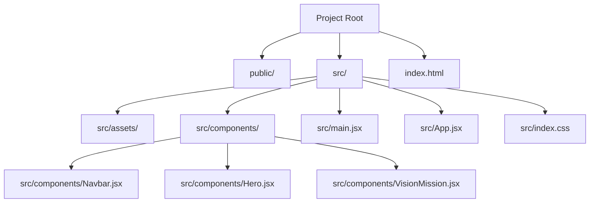
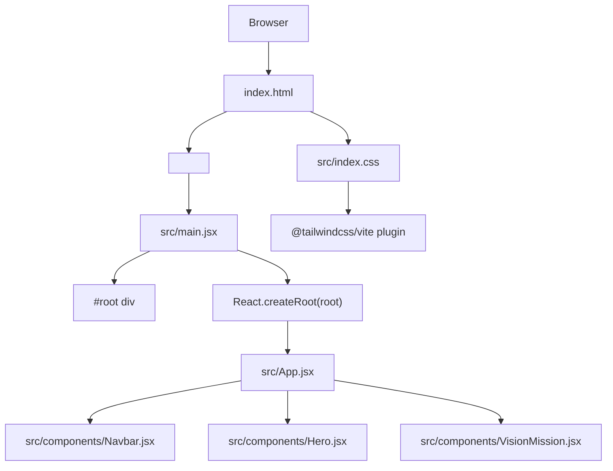

# Getting Started

<cite>
**Referenced Files in This Document**
- [README.md](file://README.md)
- [package.json](file://package.json)
- [vite.config.js](file://vite.config.js)
- [index.html](file://index.html)
- [src/main.jsx](file://src/main.jsx)
- [src/App.jsx](file://src/App.jsx)
- [src/index.css](file://src/index.css)
- [src/components/Navbar.jsx](file://src/components/Navbar.jsx)
- [src/components/Hero.jsx](file://src/components/Hero.jsx)
- [src/components/VisionMission.jsx](file://src/components/VisionMission.jsx)
- [eslint.config.js](file://eslint.config.js)
</cite>

## Table of Contents
1. [Introduction](#introduction)
2. [Prerequisites](#prerequisites)
3. [Installation](#installation)
4. [Development Workflow](#development-workflow)
5. [Project Structure Overview](#project-structure-overview)
6. [Key Commands](#key-commands)
7. [Environment Setup](#environment-setup)
8. [Basic Usage Examples](#basic-usage-examples)
9. [Customization Guide](#customization-guide)
10. [Architecture Overview](#architecture-overview)
11. [Troubleshooting Guide](#troubleshooting-guide)
12. [Verification Steps](#verification-steps)
13. [Conclusion](#conclusion)

## Introduction
This guide helps you quickly set up and work with the HIMA Web project. It covers prerequisites, installation, development server setup, basic usage, customization, and troubleshooting. The project uses React, Vite, Tailwind CSS, and ESLint for a modern, fast, and maintainable frontend workflow.

## Prerequisites
- Node.js: Ensure you have a compatible Node.js version installed. While the project does not explicitly declare a Node.js version in its configuration files, most modern Vite-based React projects work best with recent LTS versions of Node.js. Install the latest LTS version from the official Node.js website if you haven't already.
- Package manager: The project uses npm. Make sure npm is installed alongside Node.js.

## Installation
Follow these steps to install and run the project locally:

1. **Clone or download the repository** to your local machine.
2. **Install dependencies**:
   - Open a terminal in the project root.
   - Run the npm install command to install all required dependencies and devDependencies defined in the project configuration.
3. **Verify installation**:
   - After installation completes, proceed to start the development server using the instructions below.

## Development Workflow
The development workflow leverages Vite for fast builds and Hot Module Replacement (HMR). This enables rapid iteration: edit files and see changes reflected immediately in the browser without manual refreshes.

- Hot Module Replacement (HMR): Changes to components and styles propagate instantly, improving developer productivity.
- Fast builds: Vite optimizes bundling and serves assets efficiently during development.
- Linting: ESLint enforces code quality and React-specific best practices during development.

## Project Structure Overview
The project follows a conventional React + Vite layout with modular components and styling via Tailwind CSS.

**Diagram sources**
- [index.html:1-18](file://index.html#L1-L18)
- [src/main.jsx:1-11](file://src/main.jsx#L1-L11)
- [src/App.jsx:1-18](file://src/App.jsx#L1-L18)
- [src/index.css:1-206](file://src/index.css#L1-L206)
- [src/components/Navbar.jsx:1-79](file://src/components/Navbar.jsx#L1-L79)
- [src/components/Hero.jsx:1-57](file://src/components/Hero.jsx#L1-L57)
- [src/components/VisionMission.jsx:1-68](file://src/components/VisionMission.jsx#L1-L68)

**Section sources**
- [index.html:1-18](file://index.html#L1-L18)
- [src/main.jsx:1-11](file://src/main.jsx#L1-L11)
- [src/App.jsx:1-18](file://src/App.jsx#L1-L18)
- [src/index.css:1-206](file://src/index.css#L1-L206)
- [src/components/Navbar.jsx:1-79](file://src/components/Navbar.jsx#L1-L79)
- [src/components/Hero.jsx:1-57](file://src/components/Hero.jsx#L1-L57)
- [src/components/VisionMission.jsx:1-68](file://src/components/VisionMission.jsx#L1-L68)

## Key Commands
The project defines several npm scripts for common tasks:

- Development server: Start the Vite dev server with live reload.
- Build: Create an optimized production bundle.
- Preview: Serve the production build locally for testing.
- Lint: Run ESLint to check code quality.

These commands are defined in the project configuration and can be executed from the project root.

**Section sources**
- [package.json:6-11](file://package.json#L6-L11)

## Environment Setup
Vite handles environment variables with sensible defaults. For this project:
- Plugins: React plugin and Tailwind CSS plugin are configured in the Vite config.
- HTML entry: The HTML file sets up the root element and loads the main JavaScript module.
- CSS: Tailwind is imported and configured with theme tokens and utility classes.

**Section sources**
- [vite.config.js:1-9](file://vite.config.js#L1-L9)
- [index.html:1-18](file://index.html#L1-L18)
- [src/index.css:1-206](file://src/index.css#L1-L206)

## Basic Usage Examples
To get started quickly:

1. **Start the development server**:
   - Run the development script to launch the app in your browser with HMR enabled.
2. **Explore the main page**:
   - The root component renders the navigation bar, hero section, and vision/mision content.
3. **Make a small change**:
   - Edit a component (for example, update text in the hero section) and observe instant updates in the browser.

These steps demonstrate the typical developer loop with this project.

**Section sources**
- [package.json:6-11](file://package.json#L6-L11)
- [src/App.jsx:1-18](file://src/App.jsx#L1-L18)
- [src/components/Hero.jsx:1-57](file://src/components/Hero.jsx#L1-L57)

## Customization Guide
You can customize the application by modifying components, styles, and configuration:

- Add or modify components:
  - Place new components under the components folder and import them into the main App component.
- Update styles:
  - Adjust Tailwind theme tokens and utilities in the CSS file to change colors, spacing, and typography.
- Configure plugins:
  - Extend Vite configuration to add or adjust plugins as needed.
- Linting:
  - Customize ESLint rules in the configuration file to enforce team-specific standards.

**Section sources**
- [src/App.jsx:1-18](file://src/App.jsx#L1-L18)
- [src/index.css:1-206](file://src/index.css#L1-L206)
- [vite.config.js:1-9](file://vite.config.js#L1-L9)
- [eslint.config.js:1-22](file://eslint.config.js#L1-L22)

## Architecture Overview
The runtime architecture connects the HTML entry point to the React root and component tree, with Tailwind CSS providing styling.

**Diagram sources**
- [index.html:1-18](file://index.html#L1-L18)
- [src/main.jsx:1-11](file://src/main.jsx#L1-L11)
- [src/App.jsx:1-18](file://src/App.jsx#L1-L18)
- [src/components/Navbar.jsx:1-79](file://src/components/Navbar.jsx#L1-L79)
- [src/components/Hero.jsx:1-57](file://src/components/Hero.jsx#L1-L57)
- [src/components/VisionMission.jsx:1-68](file://src/components/VisionMission.jsx#L1-L68)
- [src/index.css:1-206](file://src/index.css#L1-L206)
- [vite.config.js:1-9](file://vite.config.js#L1-L9)

## Troubleshooting Guide
Common setup issues and resolutions:

- Node.js version conflicts:
  - Ensure you are using a supported Node.js version. If builds fail or features behave unexpectedly, try updating to the latest LTS version.
- Port already in use:
  - If the development server fails to start due to a port conflict, stop the conflicting process or configure a different port in the Vite configuration.
- Missing dependencies:
  - Reinstall dependencies using the package manager if you encounter module resolution errors after cloning or switching branches.
- ESLint errors:
  - Fix lint warnings or errors reported by the linter. You can run the lint script to identify issues and resolve them according to the configured rules.
- Tailwind classes not applying:
  - Verify that Tailwind is properly imported and that the CSS file is included. Ensure the Tailwind plugin is active in the Vite configuration.

**Section sources**
- [package.json:12-28](file://package.json#L12-L28)
- [eslint.config.js:1-22](file://eslint.config.js#L1-L22)
- [vite.config.js:1-9](file://vite.config.js#L1-L9)
- [src/index.css:1-206](file://src/index.css#L1-L206)

## Verification Steps
After installation, confirm everything works as expected:

1. **Start the development server**:
   - Run the development script and open the displayed URL in your browser.
2. **Check for errors**:
   - Look for console errors or build warnings in the terminal and browser dev tools.
3. **Test hot reloading**:
   - Modify a component file and verify changes appear without manual refresh.
4. **Build preview**:
   - Run the preview script to serve the production build locally and confirm it loads correctly.
5. **Lint check**:
   - Run the lint script to ensure code quality passes the configured rules.

**Section sources**
- [package.json:6-11](file://package.json#L6-L11)
- [eslint.config.js:1-22](file://eslint.config.js#L1-L22)

## Conclusion
You now have the essentials to install, run, customize, and troubleshoot the HIMA Web project. Use the development server for rapid iteration, leverage Tailwind CSS for styling, and rely on ESLint for code quality. Refer to the troubleshooting section if you encounter issues, and use the verification steps to confirm a successful setup.