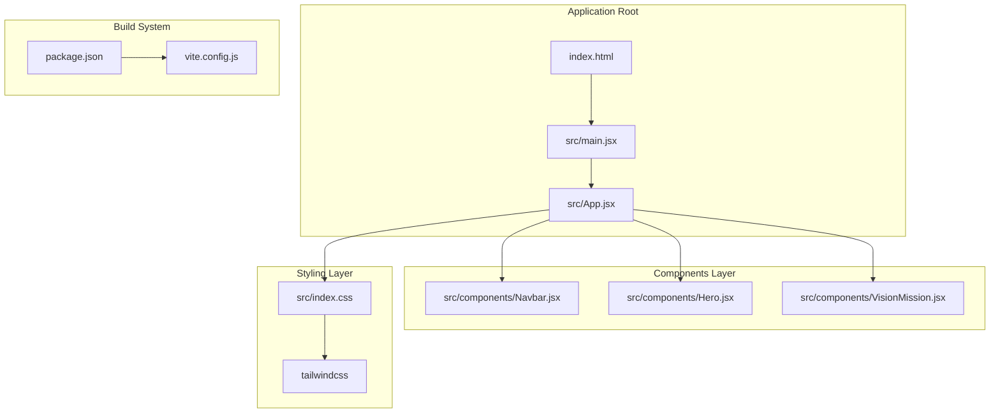
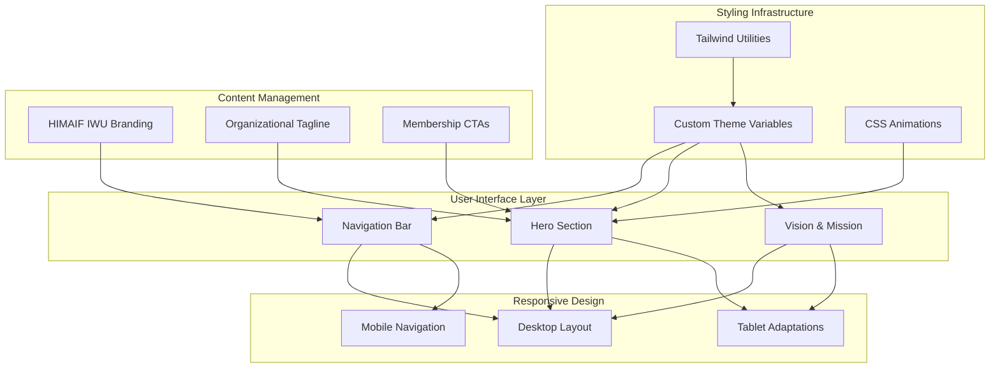

# Project Overview

<cite>
**Referenced Files in This Document**
- [README.md](file://README.md)
- [package.json](file://package.json)
- [index.html](file://index.html)
- [src/index.css](file://src/index.css)
- [src/main.jsx](file://src/main.jsx)
- [src/App.jsx](file://src/App.jsx)
- [src/components/Navbar.jsx](file://src/components/Navbar.jsx)
- [src/components/Hero.jsx](file://src/components/Hero.jsx)
- [src/components/VisionMission.jsx](file://src/components/VisionMission.jsx)
</cite>

## Table of Contents
1. [Introduction](#introduction)
2. [Project Structure](#project-structure)
3. [Core Components](#core-components)
4. [Architecture Overview](#architecture-overview)
5. [Detailed Component Analysis](#detailed-component-analysis)
6. [Dependency Analysis](#dependency-analysis)
7. [Performance Considerations](#performance-considerations)
8. [Troubleshooting Guide](#troubleshooting-guide)
9. [Conclusion](#conclusion)

## Introduction

The HIMA Web project serves as the digital flagship for HIMAIF IWU (Informatics Excellence), establishing a professional online presence for this student organization dedicated to advancing women in informatics technology. This frontend application represents the cornerstone of HIMAIF IWU's digital ecosystem, functioning as both a showcase platform for organizational achievements and a communication hub for member engagement.

The project's primary purpose is to create a modern, responsive web experience that communicates HIMAIF IWU's mission of fostering technological excellence among international women students while serving as a gateway for prospective members and stakeholders to engage with the organization's activities and initiatives.

**Section sources**
- [src/components/Hero.jsx:14-25](file://src/components/Hero.jsx#L14-L25)
- [src/components/VisionMission.jsx:37-41](file://src/components/VisionMission.jsx#L37-L41)

## Project Structure

The HIMA Web application follows a modular React architecture built on Vite, utilizing TailwindCSS for styling and Material Symbols for iconography. The project structure emphasizes component-based development with clear separation of concerns across presentation, styling, and application logic.



**Diagram sources**
- [src/main.jsx:1-11](file://src/main.jsx#L1-L11)
- [src/App.jsx:1-18](file://src/App.jsx#L1-L18)
- [src/components/Navbar.jsx:1-79](file://src/components/Navbar.jsx#L1-L79)
- [src/components/Hero.jsx:1-57](file://src/components/Hero.jsx#L1-L57)
- [src/components/VisionMission.jsx:1-68](file://src/components/VisionMission.jsx#L1-L68)
- [src/index.css:1-206](file://src/index.css#L1-L206)

**Section sources**
- [package.json:1-30](file://package.json#L1-L30)
- [index.html:1-18](file://index.html#L1-L18)

## Core Components

The application's component architecture centers around three primary sections that collectively establish HIMAIF IWU's digital identity and communication framework.

### Navigation System
The Navbar component provides a responsive navigation interface featuring logo branding, desktop navigation links, and mobile-responsive menu functionality. It establishes the primary access points for users to navigate between organizational sections including Home, About Us, Structure, Projects, and Contact.

### Hero Section
The Hero component creates a visually compelling introduction featuring the organization's tagline "Membangun Masa Depan Teknologi Bersama HIMAIF IWU" along with call-to-action buttons for membership and project exploration. This section utilizes advanced styling techniques including dot pattern overlays, glass card effects, and responsive image layouts.

### Vision and Mission Presentation
The VisionMission component presents the organization's strategic pillars through an interactive card-based layout, showcasing four core focus areas: Academic Development, Collaboration, Innovation, and Global Impact. Each card incorporates Material Symbols icons and provides detailed descriptions of HIMAIF IWU's operational objectives.

**Section sources**
- [src/components/Navbar.jsx:3-9](file://src/components/Navbar.jsx#L3-L9)
- [src/components/Hero.jsx:14-37](file://src/components/Hero.jsx#L14-L37)
- [src/components/VisionMission.jsx:28-66](file://src/components/VisionMission.jsx#L28-L66)

## Architecture Overview

The HIMA Web application employs a clean React component hierarchy with centralized styling through TailwindCSS utility classes. The architecture prioritizes modularity, reusability, and maintainability while ensuring optimal performance through efficient component composition.



**Diagram sources**
- [src/App.jsx:5-15](file://src/App.jsx#L5-L15)
- [src/components/Navbar.jsx:14-78](file://src/components/Navbar.jsx#L14-L78)
- [src/components/Hero.jsx:3-56](file://src/components/Hero.jsx#L3-L56)
- [src/components/VisionMission.jsx:30-66](file://src/components/VisionMission.jsx#L30-L66)

## Detailed Component Analysis

### Application Container
The App component serves as the primary container orchestrating the overall page structure, positioning the navigation bar at the top and organizing content sections below. This component establishes the foundational layout that supports HIMAIF IWU's digital communication objectives.

### Navigation Component Behavior
The Navbar component implements sophisticated state management for mobile responsiveness, featuring smooth transitions between menu states and dynamic styling that highlights the active navigation section. The component's design ensures accessibility across different device sizes while maintaining brand consistency.

### Hero Section Implementation
The Hero component demonstrates advanced styling techniques including custom background patterns, glass-morphism effects, and responsive image handling. The section effectively communicates the organization's core message while providing clear pathways for user engagement through strategically placed call-to-action buttons.

### Vision and Mission Display
The VisionMission component utilizes a flexible grid system that adapts to different screen sizes while maintaining visual consistency. Each card element incorporates interactive hover states and iconographic elements that reinforce the organization's strategic focus areas.

**Section sources**
- [src/App.jsx:1-18](file://src/App.jsx#L1-L18)
- [src/components/Navbar.jsx:11-78](file://src/components/Navbar.jsx#L11-L78)
- [src/components/Hero.jsx:1-57](file://src/components/Hero.jsx#L1-L57)
- [src/components/VisionMission.jsx:28-66](file://src/components/VisionMission.jsx#L28-L66)

## Dependency Analysis

The project maintains a lean dependency profile focused on essential technologies for modern web development. The dependency graph reflects a straightforward architecture that minimizes complexity while maximizing functionality and maintainability.

```mermaid
graph LR
subgraph "Runtime Dependencies"
REACT[react ^19.2.6]
REACTDOM[react-dom ^19.2.6]
TAILWIND[tailwindcss ^4.3.1]
TWCSS[@tailwindcss/vite ^4.3.1]
end
subgraph "Development Dependencies"
VITE[vite ^8.0.12]
RSWC[@vitejs/plugin-react ^6.0.1]
ESLINT[eslint ^10.3.0]
TYPES["@types/react ^19.2.14"]
TYPESDOM["@types/react-dom ^19.2.3"]
end
subgraph "Build Configuration"
PKGJSON[package.json]
VITECONFIG[vite.config.js]
ESLINTCONFIG[eslint.config.js]
end
PKGJSON --> REACT
PKGJSON --> REACTDOM
PKGJSON --> TAILWIND
PKGJSON --> TWCSS
PKGJSON --> VITE
PKGJSON --> RSWC
PKGJSON --> ESLINT
PKGJSON --> TYPES
PKGJSON --> TYPESDOM
VITECONFIG --> VITE
ESLINTCONFIG --> ESLINT
```

**Diagram sources**
- [package.json:12-28](file://package.json#L12-L28)

**Section sources**
- [package.json:1-30](file://package.json#L1-L30)

## Performance Considerations

The HIMA Web application implements several performance optimization strategies through its architectural choices and configuration decisions. The use of React's concurrent features, efficient component composition, and optimized styling approaches contribute to a responsive user experience across various devices and network conditions.

The project's build system leverages Vite's modern toolchain for rapid development iteration and efficient production builds, while the styling approach using TailwindCSS ensures minimal CSS overhead through utility-first design principles.

## Troubleshooting Guide

Common issues and their resolutions for the HIMA Web application:

### Build Issues
- Verify Node.js version compatibility with Vite requirements
- Clear npm cache if encountering dependency resolution errors
- Check for conflicting package versions in package.json

### Styling Problems
- Ensure TailwindCSS configuration aligns with custom theme variables
- Verify font loading from Google Fonts CDN
- Check Material Symbols font availability

### Development Environment
- Confirm port availability for Vite development server
- Validate React and React DOM versions match compatibility requirements
- Review ESLint configuration for custom rules

**Section sources**
- [README.md:1-17](file://README.md#L1-L17)
- [package.json:6-11](file://package.json#L6-L11)

## Conclusion

The HIMA Web project successfully establishes a professional digital foundation for HIMAIF IWU's organizational presence. Through its carefully crafted component architecture, responsive design implementation, and strategic use of modern web technologies, the application fulfills its role as both a showcase platform and communication hub for the organization's activities.

The project's modular structure, combined with its emphasis on accessibility and cross-platform compatibility, positions it as an effective tool for advancing HIMAIF IWU's mission while maintaining technical excellence and future extensibility. This frontend application serves as a cornerstone of the broader HIMAIF IWU digital ecosystem, providing a foundation for future enhancements and organizational growth.