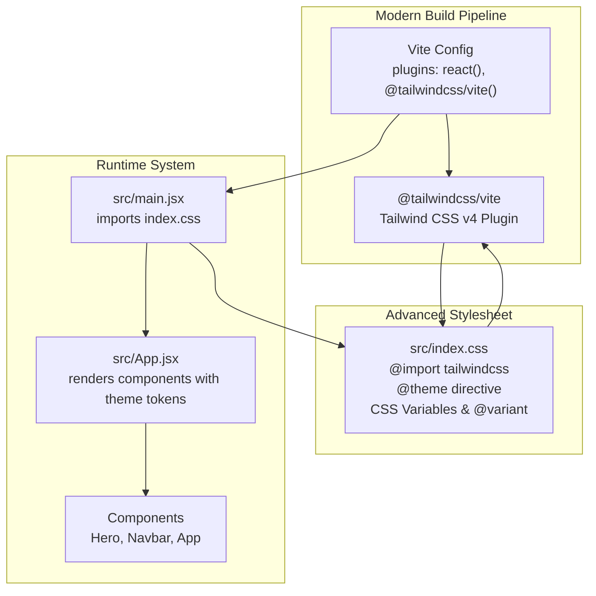
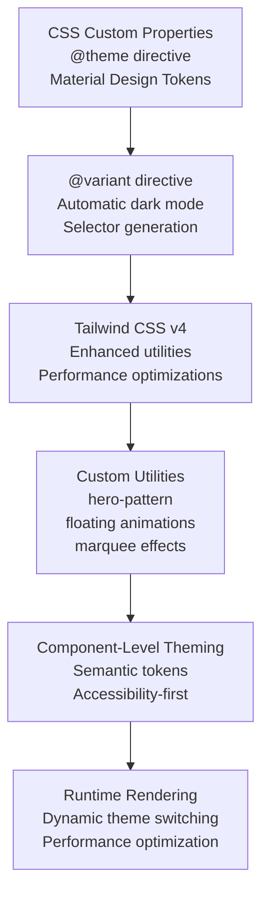
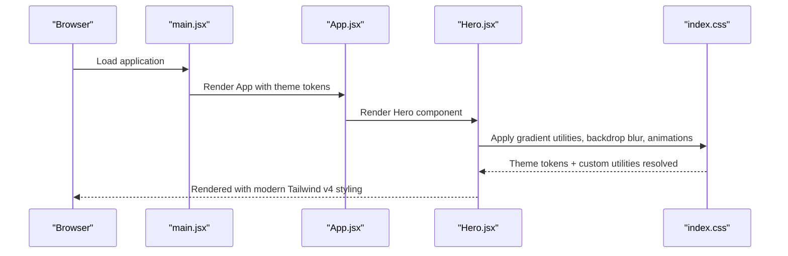
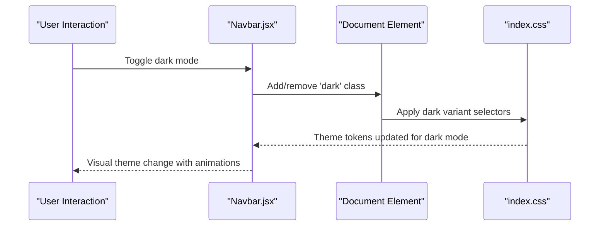
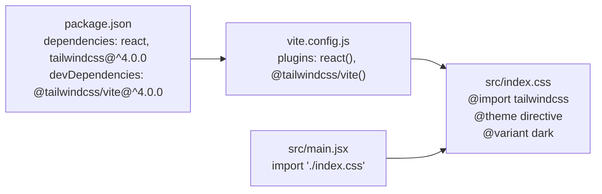

# Styling and Theming

<cite>
**Referenced Files in This Document**
- [index.css](file://src/index.css)
- [main.jsx](file://src/main.jsx)
- [package.json](file://package.json)
- [vite.config.js](file://vite.config.js)
- [Hero.jsx](file://src/components/home/Hero.jsx)
- [Navbar.jsx](file://src/components/home/Navbar.jsx)
- [App.jsx](file://src/App.jsx)
</cite>

## Update Summary
**Changes Made**
- Updated to reflect Tailwind CSS v4 integration with @theme directive and CSS variables
- Added comprehensive dark mode implementation using @variant directive
- Enhanced build system documentation with Vite and @tailwindcss/vite plugin
- Updated component examples to showcase modern Tailwind v4 styling patterns
- Added detailed color palette documentation with Material Design-inspired tokens

## Table of Contents
1. [Introduction](#introduction)
2. [Project Structure](#project-structure)
3. [Core Components](#core-components)
4. [Architecture Overview](#architecture-overview)
5. [Detailed Component Analysis](#detailed-component-analysis)
6. [Dependency Analysis](#dependency-analysis)
7. [Performance Considerations](#performance-considerations)
8. [Troubleshooting Guide](#troubleshooting-guide)
9. [Conclusion](#conclusion)

## Introduction
This document explains the modernized styling and theming system of the HIMA Web project. Built with Tailwind CSS v4 and Vite, the system leverages a comprehensive CSS custom properties foundation with Material Design-inspired color tokens, dual light/dark theme implementation, and advanced responsive design patterns. The styling infrastructure provides a robust foundation for consistent UI development with automatic dark mode support and extensive customization capabilities.

## Project Structure
The styling system centers around a modern Tailwind CSS v4 configuration that utilizes CSS custom properties and the @theme directive to establish a comprehensive design system. The Vite build pipeline integrates Tailwind through the @tailwindcss/vite plugin, ensuring optimal performance and seamless utility generation at runtime. React components consume these utilities and design tokens to render consistent, accessible UI with automatic dark mode support.

**Diagram sources**
- [vite.config.js:1-12](file://vite.config.js#L1-L12)
- [main.jsx:1-11](file://src/main.jsx#L1-L11)
- [index.css:1-147](file://src/index.css#L1-L147)

**Section sources**
- [vite.config.js:1-12](file://vite.config.js#L1-L12)
- [main.jsx:1-11](file://src/main.jsx#L1-L11)
- [index.css:1-147](file://src/index.css#L1-L147)

## Core Components
The styling system is built on several foundational pillars that work together to create a modern, maintainable design infrastructure:

### Comprehensive Color Palette with CSS Variables
The @theme directive establishes a complete Material Design-inspired color system using CSS custom properties. This includes primary, secondary, tertiary, error, and surface colors with appropriate contrast ratios and accessibility considerations. The color system supports both light and dark themes with automatic token switching.

### Advanced Dark Mode Implementation
The @variant directive creates sophisticated dark mode selectors that automatically apply theme tokens in dark mode contexts. The system includes comprehensive dark mode overrides for all color tokens, ensuring optimal readability and visual consistency across both light and dark themes.

### Modern Tailwind CSS v4 Integration
Tailwind CSS v4 introduces significant improvements including the @theme directive for defining design tokens, enhanced dark mode support, and improved performance. The build system leverages these features to create a streamlined development experience with automatic utility generation.

### Advanced Typography and Spacing System
The system includes a comprehensive typography scale with font family definitions and spacing tokens that work seamlessly with the color system. Animations and transitions are implemented using CSS keyframes for smooth, performant interactions.

### Custom Utility Classes
Two primary custom utilities demonstrate advanced styling patterns: hero-pattern for creating sophisticated background effects and floating animations for interactive elements. These utilities showcase the flexibility of the modern Tailwind approach.

Key implementation references:
- Theme tokens and CSS variables: [index.css:5-52](file://src/index.css#L5-L52)
- Dark mode variant: [index.css:3](file://src/index.css#L3)
- Dark mode overrides: [index.css:54-58](file://src/index.css#L54-L58)
- Custom utilities: [index.css:87-146](file://src/index.css#L87-L146)
- Typography and base styles: [index.css:60-79](file://src/index.css#L60-L79)

**Section sources**
- [index.css:1-147](file://src/index.css#L1-L147)

## Architecture Overview
The modernized styling architecture combines centralized token management with advanced Tailwind utilities and component-level theming. The build pipeline ensures tokens are compiled into optimized Tailwind utilities, while components utilize semantic tokens and utility names for consistent, accessible design.

**Diagram sources**
- [index.css:5-52](file://src/index.css#L5-L52)
- [index.css:3](file://src/index.css#L3)
- [index.css:87-146](file://src/index.css#L87-L146)
- [Hero.jsx:1-113](file://src/components/home/Hero.jsx#L1-L113)
- [Navbar.jsx:1-281](file://src/components/home/Navbar.jsx#L1-L281)

## Detailed Component Analysis

### Hero Component - Modern Tailwind v4 Implementation
The Hero component exemplifies the modern styling approach with its sophisticated use of Tailwind utilities and custom animations. The component demonstrates advanced techniques including gradient backgrounds, backdrop blur effects, and complex responsive layouts.

Key modern features:
- Gradient backgrounds with dark mode variants using Tailwind's gradient utilities
- Backdrop blur effects with dynamic opacity based on scroll position
- Complex responsive grid layouts with fractional column sizing
- Custom floating animations using CSS keyframes
- Dynamic color application with theme-aware selectors

**Diagram sources**
- [main.jsx:1-11](file://src/main.jsx#L1-L11)
- [App.jsx:47](file://src/App.jsx#L47)
- [Hero.jsx:1-113](file://src/components/home/Hero.jsx#L1-L113)
- [index.css:1-147](file://src/index.css#L1-L147)

Implementation highlights:
- Gradient backgrounds: [Hero.jsx:9](file://src/components/home/Hero.jsx#L9)
- Backdrop blur effects: [Hero.jsx:52](file://src/components/home/Hero.jsx#L52)
- Floating animations: [Hero.jsx:111](file://src/components/home/Hero.jsx#L111)
- Responsive typography: [Hero.jsx:41](file://src/components/home/Hero.jsx#L41)

**Section sources**
- [Hero.jsx:1-113](file://src/components/home/Hero.jsx#L1-L113)
- [index.css:87-146](file://src/index.css#L87-L146)

### Navbar Component - Advanced Theming Implementation
The Navbar component showcases sophisticated theming capabilities with dynamic dark mode switching, scroll-aware styling, and comprehensive responsive behavior. The component demonstrates modern React patterns combined with advanced Tailwind CSS v4 features.

Key advanced features:
- Dynamic dark mode class management on the document element
- Scroll-aware styling with transition effects
- Comprehensive mobile responsiveness with animated dropdowns
- Material Design-inspired iconography with custom symbols
- Sophisticated color transitions and hover effects

**Diagram sources**
- [Navbar.jsx:16-23](file://src/components/home/Navbar.jsx#L16-L23)
- [index.css:3](file://src/index.css#L3)
- [index.css:54-58](file://src/index.css#L54-L58)

Implementation highlights:
- Dark mode toggle: [Navbar.jsx:16-23](file://src/components/home/Navbar.jsx#L16-L23)
- Scroll-aware styling: [Navbar.jsx:67-72](file://src/components/home/Navbar.jsx#L67-L72)
- Mobile menu: [Navbar.jsx:124-193](file://src/components/home/Navbar.jsx#L124-L193)
- Theme toggle: [Navbar.jsx:263-272](file://src/components/home/Navbar.jsx#L263-L272)

**Section sources**
- [Navbar.jsx:1-281](file://src/components/home/Navbar.jsx#L1-L281)

### App Component - Root-Level Theming
The App component serves as the root container for the entire application, demonstrating comprehensive theming integration at the highest level. The component showcases the benefits of semantic color tokens and automatic dark mode support.

Key theming features:
- Root-level background and text color management
- Selection highlighting with theme-aware colors
- Smooth scrolling behavior with hash navigation
- Comprehensive component composition with proper theming

**Section sources**
- [App.jsx:1-82](file://src/App.jsx#L1-L82)

## Dependency Analysis
The modernized styling system relies on cutting-edge dependencies that provide enhanced functionality and performance. The package configuration includes Tailwind CSS v4 and the @tailwindcss/vite plugin, ensuring optimal integration with the Vite build system.

**Diagram sources**
- [package.json:12-28](file://package.json#L12-L28)
- [vite.config.js:1-12](file://vite.config.js#L1-L12)
- [index.css:1](file://src/index.css#L1)
- [main.jsx:3](file://src/main.jsx#L3)

**Section sources**
- [package.json:1-30](file://package.json#L1-L30)
- [vite.config.js:1-12](file://vite.config.js#L1-L12)
- [main.jsx:1-11](file://src/main.jsx#L1-L11)

## Performance Considerations
The modernized styling system incorporates several performance optimizations that leverage Tailwind CSS v4 capabilities:

- **Efficient utility generation**: Tailwind v4 optimizes utility class generation and reduces bundle size through intelligent tree-shaking
- **CSS custom property optimization**: The @theme directive enables efficient token resolution without bloated CSS
- **Selective dark mode application**: The @variant directive ensures dark mode styles are only applied where needed
- **Animation performance**: Custom animations use transform properties for GPU acceleration
- **Bundle size optimization**: Strategic use of semantic tokens reduces CSS duplication and improves caching

## Troubleshooting Guide
Common issues and resolutions for the modernized styling system:

### Tailwind v4 Integration Issues
- **Utilities not generating**:
  - Verify Tailwind v4 plugin is properly installed and configured
  - Ensure @theme directive is present in the stylesheet
  - Check that the stylesheet is imported before component rendering
  - References: [package.json:19-26](file://package.json#L19-L26), [index.css:1](file://src/index.css#L1)

### Dark Mode Implementation Problems
- **Dark mode not activating**:
  - Verify @variant directive is correctly defined
  - Check that dark class is properly toggled on document element
  - Ensure dark mode overrides are properly structured
  - References: [index.css:3](file://src/index.css#L3), [Navbar.jsx:16-23](file://src/components/home/Navbar.jsx#L16-L23)

### CSS Variable Token Issues
- **Theme tokens not resolving**:
  - Confirm @theme directive contains all required color tokens
  - Verify CSS custom properties are properly defined
  - Check for syntax errors in the theme block
  - References: [index.css:5-52](file://src/index.css#L5-L52)

### Build System Configuration
- **Vite build failures**:
  - Ensure @tailwindcss/vite plugin version matches Tailwind CSS v4
  - Verify plugin order in vite.config.js
  - Check for conflicting CSS processing plugins
  - References: [vite.config.js:3](file://vite.config.js#L3), [package.json:19](file://package.json#L19)

**Section sources**
- [package.json:1-30](file://package.json#L1-L30)
- [vite.config.js:1-12](file://vite.config.js#L1-L12)
- [index.css:1-147](file://src/index.css#L1-L147)
- [Navbar.jsx:1-281](file://src/components/home/Navbar.jsx#L1-L281)

## Conclusion
The HIMA Web styling system represents a modern, comprehensive approach to frontend design that leverages the latest capabilities of Tailwind CSS v4 and the Vite build system. The system provides a robust foundation for scalable, maintainable design with automatic dark mode support, extensive customization options, and optimal performance characteristics. By utilizing CSS custom properties, the @theme directive, and advanced responsive patterns, the system ensures consistent visual identity across all components while maintaining flexibility for future enhancements.

The integration of Material Design-inspired color tokens, sophisticated dark mode implementation, and performance-optimized build processes creates a development environment that balances developer productivity with user experience excellence. This modernized approach positions the HIMA Web project for continued growth and evolution while maintaining design system consistency and accessibility standards.