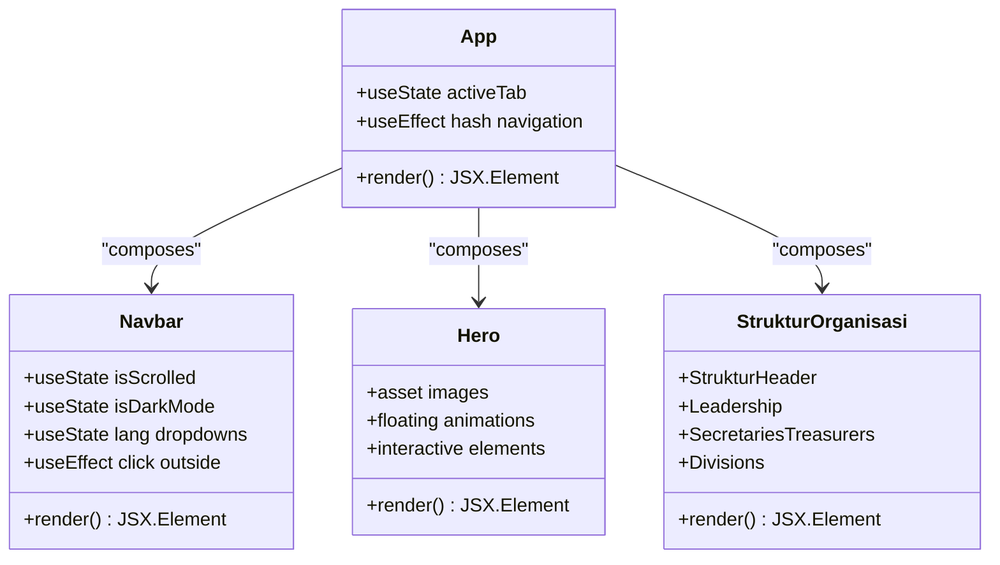
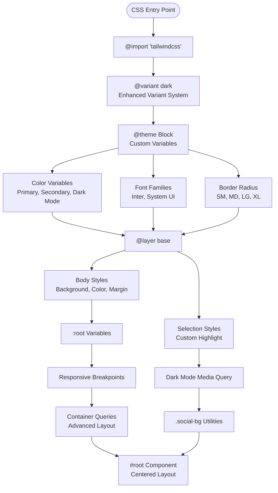
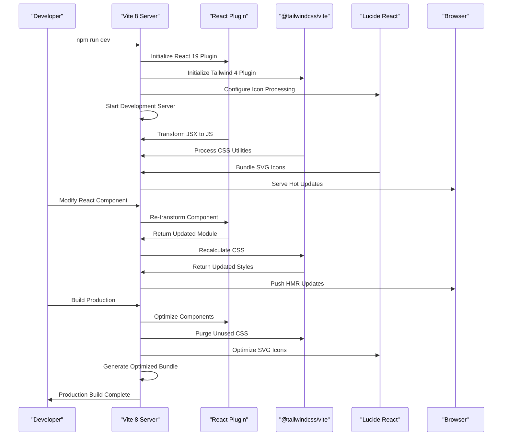

# Technology Stack

<cite>
**Referenced Files in This Document**
- [package.json](file://package.json)
- [vite.config.js](file://vite.config.js)
- [src/index.css](file://src/index.css)
- [src/main.jsx](file://src/main.jsx)
- [src/App.jsx](file://src/App.jsx)
- [src/components/home/Navbar.jsx](file://src/components/home/Navbar.jsx)
- [src/components/home/Hero.jsx](file://src/components/home/Hero.jsx)
- [src/components/struktur/index.jsx](file://src/components/struktur/index.jsx)
- [eslint.config.js](file://eslint.config.js)
</cite>

## Update Summary
**Changes Made**
- Updated core technology versions: React 19.2.6, Vite 8.0.12, Tailwind CSS 4.0.0
- Added lucide-react for modern iconography
- Enhanced CSS architecture with Tailwind CSS 4.0.0 features
- Updated ESLint configuration for modern JavaScript development
- Improved component architecture with advanced React patterns

## Table of Contents
1. [Introduction](#introduction)
2. [Project Structure](#project-structure)
3. [Core Technologies](#core-technologies)
4. [Architecture Overview](#architecture-overview)
5. [Detailed Component Analysis](#detailed-component-analysis)
6. [Build Tool Configuration](#build-tool-configuration)
7. [Development Server Capabilities](#development-server-capabilities)
8. [CSS Framework Benefits](#css-framework-benefits)
9. [Version Compatibility](#version-compatibility)
10. [Performance Characteristics](#performance-characteristics)
11. [Why This Stack Was Selected](#why-this-stack-was-selected)
12. [Troubleshooting Guide](#troubleshooting-guide)
13. [Conclusion](#conclusion)

## Introduction
This document provides comprehensive technology stack documentation for the HIMA Web project. The project has undergone complete modernization featuring React 19.2.6, Vite 8.0.12, Tailwind CSS 4.0.0, and lucide-react for iconography. This modern stack delivers exceptional performance, developer experience, and maintainability while providing a foundation for scalable web application development.

The technology stack represents a carefully curated combination of modern tools that leverage the latest web development standards and best practices. Each technology complements the others through thoughtful integration patterns, creating a cohesive development environment that accelerates project delivery while maintaining high standards for code quality and user experience.

## Project Structure
The HIMA Web project follows a modern React application structure with Vite as the build tool and Tailwind CSS 4.0.0 for styling. The project is organized into clear directories and files that support rapid development and efficient builds with advanced component architecture.

```mermaid
graph TB
subgraph "Project Root"
PJSON["package.json<br/>Modern Dependencies & Scripts"]
VCFG["vite.config.js<br/>Vite 8 Configuration"]
ECONFIG["eslint.config.js<br/>ESLint 10 Configuration"]
END
subgraph "Source Directory (src)"
MAIN["main.jsx<br/>React 19 Entry Point"]
APP["App.jsx<br/>Root Component with State Management"]
INDEXCSS["index.css<br/>Tailwind CSS 4.0.0 Styles"]
subgraph "Components"
NAV["components/home/Navbar.jsx<br/>Advanced Navigation with Icons"]
HERO["components/home/Hero.jsx<br/>Interactive Hero Section"]
STRUCT["components/struktur/index.jsx<br/>Organizational Structure"]
ABOUT["components/home/About.jsx"]
PROJECTS["components/home/Projects.jsx"]
CONTACT["components/home/Contact.jsx"]
FOOTER["components/home/Footer.jsx"]
END
subgraph "Assets"
ASSETS["assets/"]
END
end
subgraph "Public Directory"
PUBLIC["public/"]
end
subgraph "HTML Entry"
HTML["index.html<br/>DOM Container"]
END
MAIN --> APP
APP --> NAV
APP --> HERO
APP --> ABOUT
APP --> PROJECTS
APP --> CONTACT
APP --> FOOTER
APP --> STRUCT
MAIN --> INDEXCSS
HTML --> MAIN
```

**Diagram sources**
- [package.json:1-30](file://package.json#L1-L30)
- [vite.config.js:1-12](file://vite.config.js#L1-L12)
- [src/main.jsx:1-11](file://src/main.jsx#L1-L11)
- [src/App.jsx:1-82](file://src/App.jsx#L1-L82)

**Section sources**
- [package.json:1-30](file://package.json#L1-L30)
- [vite.config.js:1-12](file://vite.config.js#L1-L12)
- [src/main.jsx:1-11](file://src/main.jsx#L1-L11)
- [src/App.jsx:1-82](file://src/App.jsx#L1-L82)

## Core Technologies
The HIMA Web project leverages five core technologies that work together to provide a modern, performant, and developer-friendly web application stack. The stack has been fully modernized to utilize the latest versions and best practices.

### React 19.2.6
React serves as the primary JavaScript library for building the user interface. Version 19.2.6 provides enhanced performance, improved developer experience, and advanced features for component development including automatic JSX transform and enhanced concurrent rendering capabilities.

Key characteristics:
- Modern JSX transform with automatic runtime
- Enhanced concurrent rendering capabilities
- Improved error boundaries and debugging tools
- Optimized bundle sizes and faster startup times
- Advanced state management with hooks and effects

### Vite 8.0.12
Vite acts as the build tool and development server, providing instant server startup and lightning-fast hot module replacement (HMR). The latest version offers significant performance improvements and enhanced development experience.

Key characteristics:
- Lightning-fast cold start times (under 100ms)
- Instant hot module replacement
- Optimized production builds with advanced bundling
- Native ES module support
- Rich plugin ecosystem with React and Tailwind CSS integration
- Enhanced development server with WebSocket connections

### Tailwind CSS 4.0.0
Tailwind CSS provides utility-first styling with a modern approach to CSS development. Version 4.0.0 introduces enhanced theme customization, improved performance, and advanced CSS features including container queries and advanced variant system.

Key characteristics:
- Utility-first CSS framework with atomic design principles
- Comprehensive design system with custom theme variables
- Dark mode and responsive utilities with enhanced variant support
- Customizable theme system with CSS variables
- Atomic CSS approach with advanced composition capabilities
- Container queries and advanced responsive design features

### lucide-react
Lucide React provides a modern, consistent icon library with over 1,000 SVG icons. The library integrates seamlessly with Tailwind CSS and React 19, offering excellent performance and developer experience.

Key characteristics:
- 1,000+ hand-crafted SVG icons with consistent design language
- Lightweight bundle size with tree-shaking support
- React component integration with props for customization
- Dark mode and theme-aware icon variants
- Perfect integration with Tailwind CSS utility classes
- Zero runtime overhead with compile-time optimizations

### @tailwindcss/vite Plugin
The @tailwindcss/vite plugin integrates Tailwind CSS seamlessly with Vite 8, enabling efficient CSS processing during development and production builds with enhanced performance and compatibility.

Key characteristics:
- Native Vite 8 plugin architecture with optimized build performance
- Automatic CSS generation with advanced purging capabilities
- Theme-aware development experience with real-time updates
- Enhanced compatibility with modern CSS features
- Optimized build performance with parallel processing

**Section sources**
- [package.json:12-28](file://package.json#L12-L28)
- [vite.config.js:1-12](file://vite.config.js#L1-L12)
- [src/index.css:1-147](file://src/index.css#L1-L147)

## Architecture Overview
The technology stack creates a cohesive architecture where each component plays a specific role in delivering a modern web application experience with enhanced performance and developer productivity.

```mermaid
graph TB
subgraph "Runtime Layer"
REACT["React Runtime<br/>19.2.6"]
DOM["React DOM<br/>19.2.6"]
LUCIDE["Lucide React<br/>Icon Library"]
END
subgraph "Build Layer"
VITE["Vite Build System<br/>8.0.12"]
PLUGINS["Vite Plugins<br/>React + Tailwind + Lucide"]
END
subgraph "Styling Layer"
TWCSS["Tailwind CSS<br/>4.0.0"]
THEME["@tailwindcss/vite<br/>Plugin"]
UTILS["Utility Classes<br/>Container Queries"]
END
subgraph "Development Experience"
HMR["Hot Module Replacement<br/>Instant Updates"]
LINT["ESLint 10<br/>Modern JavaScript"]
PERF["Performance Monitoring<br/>Bundle Analysis"]
END
subgraph "Output Layer"
BUNDLE["Optimized Bundle<br/>Tree Shaking"]
STATIC["Static Assets<br/>SVG Optimization"]
END
REACT --> DOM
REACT --> LUCIDE
VITE --> PLUGINS
PLUGINS --> TWCSS
TWCSS --> THEME
THEME --> UTILS
HMR --> VITE
LINT --> VITE
PERF --> VITE
VITE --> BUNDLE
BUNDLE --> STATIC
```

**Diagram sources**
- [package.json:12-28](file://package.json#L12-L28)
- [vite.config.js:1-12](file://vite.config.js#L1-L12)
- [src/index.css:1-147](file://src/index.css#L1-L147)

## Detailed Component Analysis

### React Application Architecture
The React application follows a component-based architecture with clear separation of concerns and modular design patterns, utilizing advanced React 19 features for enhanced performance and developer experience.



**Diagram sources**
- [src/App.jsx:13-82](file://src/App.jsx#L13-L82)
- [src/components/home/Navbar.jsx:5-281](file://src/components/home/Navbar.jsx#L5-L281)
- [src/components/home/Hero.jsx:7-113](file://src/components/home/Hero.jsx#L7-L113)
- [src/components/struktur/index.jsx:7-48](file://src/components/struktur/index.jsx#L7-L48)

The application entry point demonstrates clean initialization with React 19's strict mode usage for enhanced development experience and error detection.

**Section sources**
- [src/main.jsx:1-11](file://src/main.jsx#L1-L11)
- [src/App.jsx:13-82](file://src/App.jsx#L13-L82)

### CSS Architecture and Theming
The CSS architecture utilizes Tailwind's modern theming system with comprehensive color palettes, utility classes, and advanced CSS features including container queries and dark mode support.



**Diagram sources**
- [src/index.css:1-147](file://src/index.css#L1-L147)

The CSS implementation showcases advanced features including:
- Custom CSS variables for theming with Tailwind CSS 4.0.0
- Dark mode support with enhanced media queries
- Responsive design utilities with container queries
- Glass morphism effects with backdrop blur
- Custom utility classes with animation support
- SVG optimization and icon integration

**Section sources**
- [src/index.css:1-147](file://src/index.css#L1-L147)

### Build System Integration
The build system integrates all technologies through Vite's modern plugin architecture, providing seamless development and production experiences with enhanced performance and compatibility.



**Diagram sources**
- [vite.config.js:1-12](file://vite.config.js#L1-L12)
- [package.json:6-11](file://package.json#L6-L11)

**Section sources**
- [vite.config.js:1-12](file://vite.config.js#L1-L12)
- [package.json:6-11](file://package.json#L6-L11)

## Build Tool Configuration
The build tool configuration centers around Vite 8's modern configuration system, integrating React, Tailwind CSS 4.0.0, and lucide-react for optimal development experience and performance.

### Vite Configuration Analysis
The Vite configuration demonstrates minimal yet powerful setup that enables essential development features while maintaining performance through modern tooling and optimized architecture patterns.

Key configuration aspects:
- Plugin-based architecture with explicit imports for React 19 and Tailwind CSS 4.0.0
- React plugin integration for JSX transformation with modern features
- Tailwind CSS plugin for utility processing with enhanced variant support
- Clean separation of development and production concerns with optimized builds
- Enhanced HMR with WebSocket connections for instant feedback

### Package Management
The package.json file establishes a comprehensive dependency tree that balances functionality with performance considerations, featuring modern versions of all core technologies.

**Section sources**
- [vite.config.js:1-12](file://vite.config.js#L1-L12)
- [package.json:1-30](file://package.json#L1-L30)

## Development Server Capabilities
The development server provides a fast, responsive environment for building modern web applications with advanced features including instant feedback loops and enhanced debugging capabilities.

### Hot Module Replacement
The development server offers instant feedback through hot module replacement, allowing developers to see changes immediately without full page reloads, with enhanced WebSocket connections for real-time updates.

### Performance Features
- Fast startup times through native ES modules and optimized bundling
- Efficient asset loading and caching with advanced compression
- Real-time error reporting and debugging with enhanced tooling
- Integrated development tools and monitoring with performance analytics

### Development Workflow
The development workflow emphasizes speed and productivity through:
- Instant server startup (< 100ms) with Vite 8's optimized architecture
- Efficient HMR updates with enhanced WebSocket connections
- Integrated linting and formatting with ESLint 10
- Preview server for testing builds with advanced optimization
- Modern JavaScript development with TypeScript ESLint integration

**Section sources**
- [package.json:6-11](file://package.json#L6-L11)

## CSS Framework Benefits
Tailwind CSS 4.0.0 provides significant advantages for modern web development through its utility-first approach, comprehensive feature set, and advanced CSS capabilities including container queries and enhanced variant system.

### Utility-First Approach
The utility-first methodology eliminates the need for custom CSS classes while providing extensive styling capabilities through atomic classes, enhanced with container queries for responsive design.

### Design System Integration
The comprehensive design system includes:
- Flexible color palette with semantic naming and dark mode support
- Consistent typography scales with advanced font management
- Responsive spacing and layout utilities with container queries
- Dark mode support out of the box with enhanced variant system
- Advanced CSS features including backdrop blur and glass morphism

### Customization Features
Advanced customization capabilities include:
- Custom theme configuration with CSS variables
- Component variants and states with enhanced variant system
- Custom utility classes with container query support
- CSS nesting and composition with modern syntax
- SVG optimization and icon integration with lucide-react

**Section sources**
- [src/index.css:1-147](file://src/index.css#L1-L147)

## Version Compatibility
The technology stack maintains careful version compatibility to ensure stability and performance across all components, with each technology carefully selected for optimal integration and performance.

### Version Matrix
Current stack versions:
- React: 19.2.6 (latest stable)
- Vite: 8.0.12 (latest major release)
- Tailwind CSS: 4.0.0 (latest major release)
- @tailwindcss/vite: 4.0.0 (plugin for Tailwind CSS 4)
- lucide-react: ^0.479.0 (icon library)
- React DOM: 19.2.6 (matching React version)

### Compatibility Requirements
- Node.js version requirements for optimal performance with Vite 8
- Cross-platform compatibility across Windows, macOS, and Linux
- Browser support for modern JavaScript features with React 19
- Plugin compatibility with React 18+ features and Tailwind CSS 4.0.0
- Enhanced compatibility with modern CSS features and container queries

### Upgrade Path Considerations
Future upgrade considerations include:
- React 19 features and optimizations with enhanced concurrent rendering
- Vite 8+ performance improvements with advanced bundling
- Tailwind CSS 4.x advanced capabilities with container queries
- lucide-react updates with enhanced icon variants and performance
- Plugin ecosystem evolution with enhanced compatibility

**Section sources**
- [package.json:12-28](file://package.json#L12-L28)

## Performance Characteristics
The technology stack delivers exceptional performance through modern tooling, optimized architecture patterns, and advanced web development practices including React 19's enhanced features and Tailwind CSS 4.0.0's optimized CSS processing.

### Build Performance
- Lightning-fast compilation times with Vite 8's optimized bundling
- Optimized bundle sizes through tree shaking and advanced code splitting
- Efficient asset optimization and compression with SVG optimization
- Parallel processing capabilities with enhanced build pipeline
- Advanced purging with Tailwind CSS 4.0.0 for minimal CSS footprint

### Runtime Performance
- Minimal runtime overhead with React 19's optimized rendering
- Efficient CSS processing and purging with enhanced variant system
- Fast initial page loads with optimized asset delivery
- Advanced animation performance with CSS keyframes and transforms
- Enhanced icon performance with lucide-react's optimized SVG delivery

### Development Performance
- Sub-second rebuild times with Vite 8's optimized HMR
- Instant hot module replacement with WebSocket connections
- Optimized memory usage with React 19's enhanced memory management
- Reduced development friction with modern tooling and debugging
- Advanced performance monitoring and bundle analysis

## Why This Stack Was Selected
The HIMA Web project selected this modern technology stack for several strategic reasons that align with current web development best practices and project requirements, emphasizing performance, developer productivity, and future-proof architecture.

### Modern Development Experience
The stack provides a cutting-edge development environment with:
- Instant feedback loops through Vite 8's optimized HMR
- Advanced debugging capabilities with enhanced error reporting
- Type safety with TypeScript ESLint integration
- Comprehensive linting and formatting with ESLint 10
- Modern JavaScript development with React 19 features

### Performance Focus
Performance considerations drive every aspect of the technology selection:
- Vite 8's native ES module support for faster builds and development
- React 19's enhanced concurrent rendering and performance optimizations
- Tailwind CSS 4.0.0's utility-first approach for efficient styling and minimal CSS
- lucide-react's lightweight bundle size with tree-shaking support
- Optimized bundle sizes and loading performance with advanced bundling

### Developer Productivity
The stack maximizes developer productivity through:
- Minimal configuration overhead with Vite 8's zero-config setup
- Rich plugin ecosystem with React and Tailwind CSS integration
- Excellent tooling and debugging with modern development tools
- Seamless integration between all technologies
- Advanced CSS features with container queries and enhanced variants

### Future-Proof Architecture
The selected technologies provide long-term viability:
- Active development and community support for all technologies
- Regular updates and security patches with modern version management
- Strong backward compatibility guarantees with version pinning
- Evolving standards compliance with modern web development practices
- Enhanced compatibility with emerging web standards and features

## Troubleshooting Guide
Common issues and solutions for the modernized technology stack components, addressing React 19, Vite 8, Tailwind CSS 4.0.0, and lucide-react integration.

### React Development Issues
- Component rendering problems: Check for proper React 19 version compatibility and modern JSX transform
- Hook usage errors: Verify hook ordering and lifecycle management with enhanced error boundaries
- Strict mode warnings: Review component structure and side effects with React 19's enhanced debugging
- Concurrent rendering issues: Check for proper async/await handling and state management patterns

### Vite Configuration Problems
- Plugin conflicts: Ensure proper plugin order and Vite 8 compatibility
- Asset loading issues: Verify public directory structure and path resolution
- Build errors: Check for unsupported syntax or missing dependencies with modern JavaScript
- HMR issues: Verify WebSocket connections and browser compatibility

### Tailwind CSS Issues
- Utility classes not applying: Verify Tailwind CSS 4.0.0 configuration and variant system
- Theme customization problems: Check @theme block syntax and CSS variable usage
- Container query issues: Verify container query support and fallback strategies
- Build performance issues: Review unused CSS purging and optimization settings

### lucide-react Integration Problems
- Icon not displaying: Verify lucide-react installation and import statements
- SVG optimization issues: Check SVG optimization settings and bundle analysis
- Icon sizing problems: Verify Tailwind CSS utility classes and icon props
- Performance issues: Check bundle size and tree-shaking effectiveness

### Performance Troubleshooting
- Slow build times: Optimize Vite 8 configuration and reduce unnecessary transformations
- Memory usage spikes: Monitor for memory leaks in development tools and React 19 features
- Bundle size growth: Audit dependencies and remove unused code with advanced analysis
- Runtime performance issues: Check React 19 optimizations and Tailwind CSS 4.0.0 efficiency

**Section sources**
- [eslint.config.js:1-23](file://eslint.config.js#L1-L23)

## Conclusion
The HIMA Web project's modernized technology stack represents a carefully curated combination of cutting-edge tools that deliver exceptional performance, developer experience, and maintainability. The integration of React 19.2.6, Vite 8.0.12, Tailwind CSS 4.0.0, lucide-react, and @tailwindcss/vite plugin creates a robust foundation for building contemporary web applications with enhanced capabilities and modern development practices.

The stack's strength lies in its focus on performance, developer productivity, and future-proof architecture. Each technology complements the others through thoughtful integration patterns, resulting in a cohesive development environment that accelerates project delivery while maintaining high standards for code quality and user experience. The addition of lucide-react enhances the visual design capabilities while maintaining optimal performance, and the modernized CSS architecture with Tailwind CSS 4.0.0 provides advanced styling capabilities with container queries and enhanced variant support.

This modern technology choice positions the HIMA Web project to handle current requirements effectively while providing a solid foundation for future enhancements, scaling needs, and continued innovation in web development practices.